# Complete Lineage Analysis Report
## 9-projections-layer.xml

---

## 1. Lineage Summary

| Metric | Count |
|--------|-------|
| **Total Files Analyzed** | 1 |
| **Total Relationships Identified** | 8 |
| **Total Lineage Paths Identified** | 8 |
| **Total Base Files Identified** | 8 |
| **Total Unresolved Relationships** | 0 |

---

## 2. File Inventory

| File | Type | Identified Purpose | Upstream Files | Downstream Files |
|------|------|-------------------|----------------|------------------|
| 9-projections-layer.xml | HANA Calculation View (Projection Layer) | Aggregates and projects financial and SKF (Store Key Figures) data from multiple composite calculation views. Performs complex calculations for sales, budget, forecast, and variance analysis. Includes filters for segment (CONVDRUG) and comp store analysis. | CVS_FRIP.Composite.Master::SFN_PRIOR_FISCAL_WEEK, CV_COMP_FIN_FLASH_STATIC, CV_COMP_FIN_BUDGET_STATIC, CV_COMP_SKF_BUDGET_STATIC, CV_COMP_FORECAST_MJE_STATIC, CV_COMP_FIN_ACTUAL_STATIC, CV_COMP_SKF_ACTUAL_STATIC, CV_COMP_TOPSIDE_ADJUSTMENTS | None (Final projection layer) |
| CVS_FRIP.Composite.Master::SFN_PRIOR_FISCAL_WEEK | HANA Calculation View (Master Data) | Provides fiscal week master data and date range parameters for filtering | Unknown (Not provided in ZIP) | 9-projections-layer.xml |
| CV_COMP_FIN_FLASH_STATIC | HANA Calculation View (Composite FI) | Provides financial flash sales data (FS_SALESAMOUNT, REDUCTIONAMOUNT, etc.) | Unknown (Not provided in ZIP) | 9-projections-layer.xml |
| CV_COMP_FIN_BUDGET_STATIC | HANA Calculation View (Composite FI) | Provides financial budget data (FIN_BUDGET_AMOUNT, RX_BUDGET) | Unknown (Not provided in ZIP) | 9-projections-layer.xml |
| CV_COMP_SKF_BUDGET_STATIC | HANA Calculation View (Composite FI) | Provides SKF budget quantity data (SKF_BUDGET_QTY) | Unknown (Not provided in ZIP) | 9-projections-layer.xml |
| CV_COMP_FORECAST_MJE_STATIC | HANA Calculation View (Composite FI) | Provides forecast and manual journal entry data (FIN_FCST_AMOUNT, SKF_FCST_QTY, CAL_FS_SALES_MJE, CAL_RX_SALES_MJE, SKF_MJE_QTY) | Unknown (Not provided in ZIP) | 9-projections-layer.xml |
| CV_COMP_FIN_ACTUAL_STATIC | HANA Calculation View (Composite FI) | Provides last year financial actual data (FIN_LY_AMOUNT) | Unknown (Not provided in ZIP) | 9-projections-layer.xml |
| CV_COMP_SKF_ACTUAL_STATIC | HANA Calculation View (Composite FI) | Provides last year SKF actual quantity data (SKF_LY_QTY) | Unknown (Not provided in ZIP) | 9-projections-layer.xml |
| CV_COMP_TOPSIDE_ADJUSTMENTS | HANA Calculation View (Composite FI) | Provides topside adjustment data for financial reconciliation (referenced twice in the projection) | Unknown (Not provided in ZIP) | 9-projections-layer.xml |

---

## 3. File Relationships

| Source File | Target File | Dependency Type | Score | Reason |
|------------|------------|-----------------|--------|---------|
| CVS_FRIP.Composite.Master::SFN_PRIOR_FISCAL_WEEK | 9-projections-layer.xml | Calculation View Dependency | 90 | Explicitly referenced in XML as data source in variableMapping section with multiple input parameter mappings (IP_WEEK_ENDING_FROM, IP_WEEK_ENDING_TO). This view provides fiscal week master data for date range filtering. |
| CV_COMP_FIN_FLASH_STATIC | 9-projections-layer.xml | Calculation View Dependency | 90 | Explicitly referenced in XML as input node at path /CVS_FRIP.Composite.FI/calculationviews/CV_COMP_FIN_FLASH_STATIC with multiple column mappings including FS_SALESAMOUNT, REDUCTIONAMOUNT, EMP_REDUCTIONAMOUNT, RX_SALESAMOUNT, COMP_FLAG, FS_RX_FLAG, and other financial flash metrics. |
| CV_COMP_FIN_BUDGET_STATIC | 9-projections-layer.xml | Calculation View Dependency | 90 | Explicitly referenced in XML as input node at path /CVS_FRIP.Composite.FI/calculationviews/CV_COMP_FIN_BUDGET_STATIC with multiple column mappings including FIN_BUDGET_AMOUNT, RX_BUDGET, BUDGET_COMP_FLAG, and other budget-related fields. Referenced twice in different calculation views within the projection. |
| CV_COMP_SKF_BUDGET_STATIC | 9-projections-layer.xml | Calculation View Dependency | 90 | Explicitly referenced in XML as input node at path /CVS_FRIP.Composite.FI/calculationviews/CV_COMP_SKF_BUDGET_STATIC with column mappings for SKF_BUDGET_QTY and related store key figure budget metrics. |
| CV_COMP_FORECAST_MJE_STATIC | 9-projections-layer.xml | Calculation View Dependency | 90 | Explicitly referenced in XML as input node at path /CVS_FRIP.Composite.FI/calculationviews/CV_COMP_FORECAST_MJE_STATIC with column mappings for FIN_FCST_AMOUNT, SKF_FCST_QTY, CAL_FS_SALES_MJE, CAL_RX_SALES_MJE, SKF_MJE_QTY, and other forecast and manual journal entry fields. |
| CV_COMP_FIN_ACTUAL_STATIC | 9-projections-layer.xml | Calculation View Dependency | 90 | Explicitly referenced in XML as input node at path /CVS_FRIP.Composite.FI/calculationviews/CV_COMP_FIN_ACTUAL_STATIC with column mappings for FIN_LY_AMOUNT and other last year financial actual metrics. |
| CV_COMP_SKF_ACTUAL_STATIC | 9-projections-layer.xml | Calculation View Dependency | 90 | Explicitly referenced in XML as input node at path /CVS_FRIP.Composite.FI/calculationviews/CV_COMP_SKF_ACTUAL_STATIC with column mappings for SKF_LY_QTY and other last year store key figure actual metrics. |
| CV_COMP_TOPSIDE_ADJUSTMENTS | 9-projections-layer.xml | Calculation View Dependency | 90 | Explicitly referenced in XML as input node at path /CVS_FRIP.Composite.FI/calculationviews/CV_COMP_TOPSIDE_ADJUSTMENTS with column mappings for SBT (Topside Adjustments). This view is referenced twice in the projection layer, indicating its importance for financial reconciliation. |

---

## 4. Complete Lineage

### Lineage Path Analysis

The 9-projections-layer.xml represents a **final projection layer** that consolidates data from 8 upstream calculation views. The lineage is structured as follows:

```
CVS_FRIP.Composite.Master::SFN_PRIOR_FISCAL_WEEK ──┐
                                                     │
CV_COMP_FIN_FLASH_STATIC ──────────────────────────┤
                                                     │
CV_COMP_FIN_BUDGET_STATIC ─────────────────────────┤
                                                     │
CV_COMP_SKF_BUDGET_STATIC ─────────────────────────┤
                                                     ├──> 9-projections-layer.xml
CV_COMP_FORECAST_MJE_STATIC ───────────────────────┤
                                                     │
CV_COMP_FIN_ACTUAL_STATIC ─────────────────────────┤
                                                     │
CV_COMP_SKF_ACTUAL_STATIC ─────────────────────────┤
                                                     │
CV_COMP_TOPSIDE_ADJUSTMENTS ───────────────────────┘
```

### Lineage Path Details

#### Path 1: Master Data Flow
**CVS_FRIP.Composite.Master::SFN_PRIOR_FISCAL_WEEK → 9-projections-layer.xml**
- **Confidence Score**: 90
- **Determination**: Explicit XML reference in variableMapping section with parameter mappings for IP_WEEK_ENDING_FROM and IP_WEEK_ENDING_TO
- **Purpose**: Provides fiscal week master data for date range filtering

#### Path 2: Flash Sales Data Flow
**CV_COMP_FIN_FLASH_STATIC → 9-projections-layer.xml**
- **Confidence Score**: 90
- **Determination**: Explicit XML reference with multiple column mappings including FS_SALESAMOUNT, REDUCTIONAMOUNT, EMP_REDUCTIONAMOUNT, RX_SALESAMOUNT
- **Purpose**: Provides current period flash sales data for variance analysis

#### Path 3: Budget Data Flow
**CV_COMP_FIN_BUDGET_STATIC → 9-projections-layer.xml**
- **Confidence Score**: 90
- **Determination**: Explicit XML reference with column mappings for FIN_BUDGET_AMOUNT, RX_BUDGET, BUDGET_COMP_FLAG
- **Purpose**: Provides budget data for comparison against actuals

#### Path 4: SKF Budget Data Flow
**CV_COMP_SKF_BUDGET_STATIC → 9-projections-layer.xml**
- **Confidence Score**: 90
- **Determination**: Explicit XML reference with column mappings for SKF_BUDGET_QTY
- **Purpose**: Provides store key figure budget quantities for script analysis

#### Path 5: Forecast and MJE Data Flow
**CV_COMP_FORECAST_MJE_STATIC → 9-projections-layer.xml**
- **Confidence Score**: 90
- **Determination**: Explicit XML reference with column mappings for FIN_FCST_AMOUNT, SKF_FCST_QTY, CAL_FS_SALES_MJE, CAL_RX_SALES_MJE, SKF_MJE_QTY
- **Purpose**: Provides forecast data and manual journal entries for adjusted calculations

#### Path 6: Last Year Financial Actuals Flow
**CV_COMP_FIN_ACTUAL_STATIC → 9-projections-layer.xml**
- **Confidence Score**: 90
- **Determination**: Explicit XML reference with column mappings for FIN_LY_AMOUNT
- **Purpose**: Provides last year financial actuals for year-over-year variance analysis

#### Path 7: Last Year SKF Actuals Flow
**CV_COMP_SKF_ACTUAL_STATIC → 9-projections-layer.xml**
- **Confidence Score**: 90
- **Determination**: Explicit XML reference with column mappings for SKF_LY_QTY
- **Purpose**: Provides last year store key figure quantities for year-over-year script analysis

#### Path 8: Topside Adjustments Flow
**CV_COMP_TOPSIDE_ADJUSTMENTS → 9-projections-layer.xml**
- **Confidence Score**: 90
- **Determination**: Explicit XML reference with column mappings for SBT (Topside Adjustments), referenced twice in the projection
- **Purpose**: Provides corporate-level adjustments for financial reconciliation

### Overall Lineage Confidence Score: **90**

**Determination Rationale**:
- All relationships are explicitly defined in the XML structure
- Each upstream calculation view has clear column mappings to the projection layer
- The XML contains detailed input node references with full paths
- Variable mappings are explicitly defined for parameter passing
- No inferred or assumed relationships exist
- All dependencies are traceable to specific XML elements

---

## 5. Base Files

| Base File | Reason | Score |
|-----------|--------|-------|
| CVS_FRIP.Composite.Master::SFN_PRIOR_FISCAL_WEEK | Master data calculation view providing fiscal week information. No upstream dependencies identified in the provided artifact. Serves as a parameter provider for date range filtering. | 90 |
| CV_COMP_FIN_FLASH_STATIC | Composite calculation view providing financial flash sales data. No upstream dependencies identified in the provided artifact. Serves as a primary data source for current period sales metrics. | 90 |
| CV_COMP_FIN_BUDGET_STATIC | Composite calculation view providing financial budget data. No upstream dependencies identified in the provided artifact. Serves as a primary data source for budget metrics. | 90 |
| CV_COMP_SKF_BUDGET_STATIC | Composite calculation view providing SKF budget data. No upstream dependencies identified in the provided artifact. Serves as a primary data source for store key figure budget quantities. | 90 |
| CV_COMP_FORECAST_MJE_STATIC | Composite calculation view providing forecast and manual journal entry data. No upstream dependencies identified in the provided artifact. Serves as a primary data source for forecast metrics and adjustments. | 90 |
| CV_COMP_FIN_ACTUAL_STATIC | Composite calculation view providing last year financial actual data. No upstream dependencies identified in the provided artifact. Serves as a primary data source for historical comparison. | 90 |
| CV_COMP_SKF_ACTUAL_STATIC | Composite calculation view providing last year SKF actual data. No upstream dependencies identified in the provided artifact. Serves as a primary data source for historical script comparison. | 90 |
| CV_COMP_TOPSIDE_ADJUSTMENTS | Composite calculation view providing topside adjustment data. No upstream dependencies identified in the provided artifact. Serves as a primary data source for corporate-level financial adjustments. | 90 |

**Note**: All 8 upstream calculation views are classified as base files because their internal dependencies are not visible in the provided artifact. The 9-projections-layer.xml only shows these views as input sources without revealing their underlying structure.

---

## 6. Final/Downstream Files

| File | Reason | Score |
|------|--------|-------|
| 9-projections-layer.xml | This is the final projection layer calculation view that aggregates and projects data from 8 upstream calculation views. It performs complex financial calculations including sales variance, budget variance, forecast variance, and year-over-year comparisons. It includes filters for segment analysis (CONVDRUG) and comp store analysis. No downstream consumers are identified in the provided artifact. This represents the terminal node in the lineage. | 90 |

---

## 7. Unresolved Relationships

| File | Possible Related File | Reason |
|------|----------------------|--------|
| None | N/A | All relationships in the provided artifact are explicitly defined with clear XML references. No unresolved relationships exist. |

**Analysis**: The 9-projections-layer.xml file has complete and explicit references to all its upstream dependencies. Each calculation view is referenced with full path notation and detailed column mappings. No ambiguous or missing relationships were identified.

---

## 8. Final Lineage Assessment

### Base Files
The lineage analysis identified **8 base files** (all upstream calculation views):
1. CVS_FRIP.Composite.Master::SFN_PRIOR_FISCAL_WEEK
2. CV_COMP_FIN_FLASH_STATIC
3. CV_COMP_FIN_BUDGET_STATIC
4. CV_COMP_SKF_BUDGET_STATIC
5. CV_COMP_FORECAST_MJE_STATIC
6. CV_COMP_FIN_ACTUAL_STATIC
7. CV_COMP_SKF_ACTUAL_STATIC
8. CV_COMP_TOPSIDE_ADJUSTMENTS

### Main Lineage Paths
The lineage consists of **8 parallel paths** converging into a single projection layer:
- **Master Data Path**: Fiscal week master data → Projection
- **Flash Sales Path**: Current period sales data → Projection
- **Budget Path**: Budget data → Projection
- **SKF Budget Path**: Store key figure budget → Projection
- **Forecast/MJE Path**: Forecast and manual adjustments → Projection
- **Financial Actuals Path**: Last year financial data → Projection
- **SKF Actuals Path**: Last year store key figures → Projection
- **Topside Adjustments Path**: Corporate adjustments → Projection

### File-to-File Relationships
All **8 relationships** are **CONFIRMED** with explicit XML evidence:
- Each relationship has a confidence score of **90**
- All relationships are of type "Calculation View Dependency"
- Each relationship is traceable to specific XML elements (input nodes, column mappings, variable mappings)

### Lineage Scores
- **Overall Lineage Confidence**: 90/100
- **Individual Relationship Scores**: All 90/100
- **Base File Identification Score**: 90/100
- **Downstream File Identification Score**: 90/100

### Reasons for Scores
**Score: 90 (Explicit XML Dependency)**
- All relationships are explicitly defined in the XML structure
- Each upstream view has clear input node references with full paths
- Column mappings are detailed and specific
- Variable mappings are explicitly defined for parameter passing
- No inference or assumption required
- Score is not 100 because the internal structure of upstream views is not provided, limiting full end-to-end lineage visibility

### Unresolved Relationships
**Count**: 0

All relationships in the provided artifact are fully resolved with explicit XML evidence. No ambiguous, missing, or inferred relationships exist.

### Key Findings
1. **Architecture**: The 9-projections-layer.xml implements a star-like aggregation pattern where multiple composite views feed into a single projection layer
2. **Business Logic**: The projection performs complex financial variance analysis including:
   - Sales vs Budget variance
   - Sales vs Forecast variance
   - Sales vs Last Year variance
   - Comp store analysis
   - ASP (Average Selling Price) calculations
   - Script quantity analysis (90-day adjusted)
3. **Data Domains**: The projection integrates data from multiple domains:
   - Master Data (fiscal calendar)
   - Financial Data (sales, budget, forecast, actuals)
   - Store Key Figures (script quantities)
   - Adjustments (MJE, topside)
4. **Filtering**: The projection applies business rules including:
   - Segment filtering (CONVDRUG)
   - Comp store flag filtering
   - Date range filtering via fiscal week parameters
5. **Calculation Complexity**: The projection includes 25+ calculated measures and 12+ variance calculations

### Recommendations for SQL Consolidation Agent
1. **Dependency Resolution**: Process upstream views in parallel as they have no inter-dependencies
2. **Join Strategy**: The projection uses union operations to combine data from multiple sources
3. **Filter Application**: Apply segment and comp store filters early in the query plan for optimization
4. **Calculation Order**: Ensure base calculations (CAL_FS_SALES, CAL_RX_SALES, CAL_SCRIPTS_90AS3) are computed before variance calculations
5. **Parameter Handling**: Implement IP_WEEK_ENDING_FROM and IP_WEEK_ENDING_TO as query parameters for date range filtering

---

## Mermaid Lineage Diagram

```mermaid
flowchart TD
    %% Base Files - Upstream Calculation Views
    A1["CVS_FRIP.Composite.Master::SFN_PRIOR_FISCAL_WEEK<br/>Schema: CVS_FRIP.Composite.Master<br/>Type: Master Data View"]
    A2["CV_COMP_FIN_FLASH_STATIC<br/>Schema: CVS_FRIP.Composite.FI<br/>Type: Composite View"]
    A3["CV_COMP_FIN_BUDGET_STATIC<br/>Schema: CVS_FRIP.Composite.FI<br/>Type: Composite View"]
    A4["CV_COMP_SKF_BUDGET_STATIC<br/>Schema: CVS_FRIP.Composite.FI<br/>Type: Composite View"]
    A5["CV_COMP_FORECAST_MJE_STATIC<br/>Schema: CVS_FRIP.Composite.FI<br/>Type: Composite View"]
    A6["CV_COMP_FIN_ACTUAL_STATIC<br/>Schema: CVS_FRIP.Composite.FI<br/>Type: Composite View"]
    A7["CV_COMP_SKF_ACTUAL_STATIC<br/>Schema: CVS_FRIP.Composite.FI<br/>Type: Composite View"]
    A8["CV_COMP_TOPSIDE_ADJUSTMENTS<br/>Schema: CVS_FRIP.Composite.FI<br/>Type: Composite View"]
    
    %% Final Projection Layer
    B["9-projections-layer.xml<br/>Type: Projection Layer<br/>Purpose: Financial Variance Analysis"]
    
    %% Relationships with detailed annotations
    A1 -->|"Calculation View Dependency<br/>Status: CONFIRMED<br/>Score: 90<br/>Reason: Provides fiscal week master data<br/>via variableMapping for date filtering"| B
    
    A2 -->|"Calculation View Dependency<br/>Status: CONFIRMED<br/>Score: 90<br/>Reason: Provides flash sales data<br/>(FS_SALESAMOUNT, RX_SALESAMOUNT, etc.)"| B
    
    A3 -->|"Calculation View Dependency<br/>Status: CONFIRMED<br/>Score: 90<br/>Reason: Provides budget data<br/>(FIN_BUDGET_AMOUNT, RX_BUDGET)"| B
    
    A4 -->|"Calculation View Dependency<br/>Status: CONFIRMED<br/>Score: 90<br/>Reason: Provides SKF budget quantities<br/>(SKF_BUDGET_QTY)"| B
    
    A5 -->|"Calculation View Dependency<br/>Status: CONFIRMED<br/>Score: 90<br/>Reason: Provides forecast and MJE data<br/>(FIN_FCST_AMOUNT, CAL_FS_SALES_MJE)"| B
    
    A6 -->|"Calculation View Dependency<br/>Status: CONFIRMED<br/>Score: 90<br/>Reason: Provides last year financial actuals<br/>(FIN_LY_AMOUNT)"| B
    
    A7 -->|"Calculation View Dependency<br/>Status: CONFIRMED<br/>Score: 90<br/>Reason: Provides last year SKF actuals<br/>(SKF_LY_QTY)"| B
    
    A8 -->|"Calculation View Dependency<br/>Status: CONFIRMED<br/>Score: 90<br/>Reason: Provides topside adjustments<br/>(SBT) - Referenced twice"| B
    
    %% Styling
    classDef baseFile fill:#e1f5ff,stroke:#01579b,stroke-width:2px,color:#000
    classDef projectionFile fill:#fff9c4,stroke:#f57f17,stroke-width:3px,color:#000
    
    class A1,A2,A3,A4,A5,A6,A7,A8 baseFile
    class B projectionFile
```



---

## Validation Summary

### Validation 1: File Classification
✅ **PASSED** - All files classified:
- 9-projections-layer.xml: **USED** (Final projection layer)
- CVS_FRIP.Composite.Master::SFN_PRIOR_FISCAL_WEEK: **USED** (Base file)
- CV_COMP_FIN_FLASH_STATIC: **USED** (Base file)
- CV_COMP_FIN_BUDGET_STATIC: **USED** (Base file)
- CV_COMP_SKF_BUDGET_STATIC: **USED** (Base file)
- CV_COMP_FORECAST_MJE_STATIC: **USED** (Base file)
- CV_COMP_FIN_ACTUAL_STATIC: **USED** (Base file)
- CV_COMP_SKF_ACTUAL_STATIC: **USED** (Base file)
- CV_COMP_TOPSIDE_ADJUSTMENTS: **USED** (Base file)

### Validation 2: Evidence Traceability
✅ **PASSED** - All dependencies traceable to XML evidence:
- Variable mappings in XML for parameter passing
- Input node references with full paths
- Column mappings for data flow
- No inferred dependencies without evidence

### Validation 3: Stored Procedure Lineage
✅ **PASSED** - No stored procedures identified in the provided artifact. All dependencies are calculation view to calculation view.

### Validation 4: ETL Table Exclusion
✅ **PASSED** - No physical ETL tables appear as primary lineage nodes. All lineage relationships are between calculation view artifacts as required.

---

## Conclusion

This lineage analysis successfully identified and documented all file-to-file dependencies in the 9-projections-layer.xml artifact. The analysis reveals a well-structured projection layer that consolidates data from 8 upstream calculation views to perform comprehensive financial variance analysis. All relationships are explicitly defined with high confidence scores (90/100), and no unresolved relationships exist. The lineage is ready for consumption by the downstream SQL Consolidation Agent for recursive dependency expansion.

**Analysis Completed**: ✅  
**Total Relationships Documented**: 8  
**Confidence Level**: HIGH (90/100)  
**Unresolved Issues**: 0

---

*Generated by File Lineage Analysis Agent*  
*Analysis Date: 2024*  
*Artifact: 9-projections-layer.xml*
