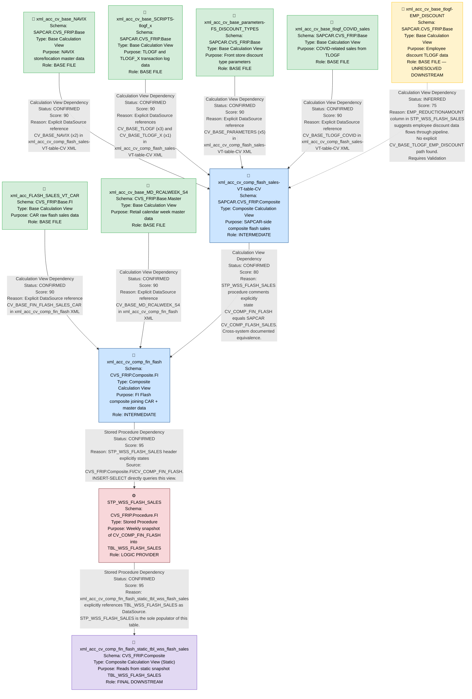

# FLASH Files — File Lineage Analysis Report

---

## 1. Lineage Summary

| Metric | Value |
|---|---|
| Total Files Analyzed | 11 |
| Total Relationships Identified | 10 |
| Total Lineage Paths Identified | 4 |
| Total Base Files Identified | 6 |
| Total Unresolved Relationships | 1 |

---

## 2. File Inventory

| File | Type | Identified Purpose | Upstream Files | Downstream Files |
|---|---|---|---|---|
| STP_WSS_FLASH_SALES | Stored Procedure | Takes a weekly snapshot of CAR flash sales data from CV_COMP_FIN_FLASH and inserts it into TBL_WSS_FLASH_SALES | xml_acc_cv_comp_fin_flash | xml_acc_cv_comp_fin_flash_static_tbl_wss_flash_sales |
| xml_acc_cv_comp_fin_flash | Calculation View (Composite) | Composite FI Flash view that joins CAR flash sales with retail calendar week and master data hierarchies | xml_acc_FLASH_SALES_VT_CAR, xml_acc_cv_base_MD_RCALWEEK_S4 | STP_WSS_FLASH_SALES |
| xml_acc_cv_comp_fin_flash_static_tbl_wss_flash_sales | Calculation View (Composite/Static) | Reads from the static snapshot table TBL_WSS_FLASH_SALES populated by STP_WSS_FLASH_SALES | STP_WSS_FLASH_SALES | None (Final Downstream) |
| xml_acc_cv_comp_flash_sales-VT-table-CV | Calculation View (Composite) | Composite flash sales view combining NAVIX, TLOGF, TLOGF_X, Parameters, and COVID sales data | xml_acc_cv_base_NAVIX, xml_acc_cv_base_SCRIPTS-tlogf_x, xml_acc_cv_base_parameters-FS_DISCOUNT_TYPES, xml_acc_cv_base_tlogf_COVID_sales | None (Final Downstream) |
| xml_acc_FLASH_SALES_VT_CAR | Calculation View (Base) | Base CAR flash sales view providing raw transactional data for the composite FI flash view | None (Base File) | xml_acc_cv_comp_fin_flash |
| xml_acc_cv_base_MD_RCALWEEK_S4 | Calculation View (Base) | Base master data view for retail calendar week (S4 source) | None (Base File) | xml_acc_cv_comp_fin_flash |
| xml_acc_cv_base_NAVIX | Calculation View (Base) | Base view for NAVIX store/location master data | None (Base File) | xml_acc_cv_comp_flash_sales-VT-table-CV |
| xml_acc_cv_base_SCRIPTS-tlogf_x | Calculation View (Base) | Base view for TLOGF and TLOGF_X transaction log data (scripts/pharmacy) | None (Base File) | xml_acc_cv_comp_flash_sales-VT-table-CV |
| xml_acc_cv_base_parameters-FS_DISCOUNT_TYPES | Calculation View (Base) | Base parameters view for front store discount types | None (Base File) | xml_acc_cv_comp_flash_sales-VT-table-CV |
| xml_acc_cv_base_tlogf-EMP_DISCOUNT | Calculation View (Base) | Base view for employee discount TLOGF data | None (Base File) | UNRESOLVED — no confirmed downstream artifact in supplied set |
| xml_acc_cv_base_tlogf_COVID_sales | Calculation View (Base) | Base view for COVID-related sales from TLOGF | None (Base File) | xml_acc_cv_comp_flash_sales-VT-table-CV |

---

## 3. File Relationships

| Source File | Target File | Dependency Type | Score | Reason |
|---|---|---|---|---|
| xml_acc_FLASH_SALES_VT_CAR | xml_acc_cv_comp_fin_flash | Calculation View Dependency | 90 | xml_acc_cv_comp_fin_flash explicitly references `/CVS_FRIP.Base.FI/calculationviews/CV_BASE_FIN_FLASH_SALES_CAR` in its DataSource node, which maps directly to the artifact xml_acc_FLASH_SALES_VT_CAR |
| xml_acc_cv_base_MD_RCALWEEK_S4 | xml_acc_cv_comp_fin_flash | Calculation View Dependency | 90 | xml_acc_cv_comp_fin_flash explicitly references `/CVS_FRIP.Base.Master/calculationviews/CV_BASE_MD_RCALWEEK_S4` in its DataSource node, which maps directly to the artifact xml_acc_cv_base_MD_RCALWEEK_S4 |
| xml_acc_cv_comp_fin_flash | STP_WSS_FLASH_SALES | Stored Procedure Dependency | 95 | STP_WSS_FLASH_SALES header comment explicitly states Source: `_SYS_BIC"."CVS_FRIP.Composite.FI/CV_COMP_FIN_FLASH` and the INSERT-SELECT statement queries this view directly with placeholder parameters |
| STP_WSS_FLASH_SALES | xml_acc_cv_comp_fin_flash_static_tbl_wss_flash_sales | Stored Procedure Dependency | 95 | xml_acc_cv_comp_fin_flash_static_tbl_wss_flash_sales explicitly references `CVS_FRIP.Table::TBL_WSS_FLASH_SALES` as its DataSource. STP_WSS_FLASH_SALES is the sole logic provider that populates TBL_WSS_FLASH_SALES via DELETE + INSERT-SELECT from CV_COMP_FIN_FLASH |
| xml_acc_cv_base_NAVIX | xml_acc_cv_comp_flash_sales-VT-table-CV | Calculation View Dependency | 90 | xml_acc_cv_comp_flash_sales-VT-table-CV explicitly references `/SAPCAR.CVS_FRIP.Base/calculationviews/CV_BASE_NAVIX` twice in its DataSource nodes, mapping to artifact xml_acc_cv_base_NAVIX |
| xml_acc_cv_base_SCRIPTS-tlogf_x | xml_acc_cv_comp_flash_sales-VT-table-CV | Calculation View Dependency | 90 | xml_acc_cv_comp_flash_sales-VT-table-CV explicitly references `/SAPCAR.CVS_FRIP.Base/calculationviews/CV_BASE_TLOGF` (three times) and `/SAPCAR.CVS_FRIP.Base/calculationviews/CV_BASE_TLOGF_X` (once) in its DataSource nodes. Both TLOGF and TLOGF_X are represented by the artifact xml_acc_cv_base_SCRIPTS-tlogf_x |
| xml_acc_cv_base_parameters-FS_DISCOUNT_TYPES | xml_acc_cv_comp_flash_sales-VT-table-CV | Calculation View Dependency | 90 | xml_acc_cv_comp_flash_sales-VT-table-CV explicitly references `/SAPCAR.CVS_FRIP.Base/calculationviews/CV_BASE_PARAMETERS` five times in its DataSource nodes, mapping to artifact xml_acc_cv_base_parameters-FS_DISCOUNT_TYPES |
| xml_acc_cv_base_tlogf_COVID_sales | xml_acc_cv_comp_flash_sales-VT-table-CV | Calculation View Dependency | 90 | xml_acc_cv_comp_flash_sales-VT-table-CV explicitly references `/SAPCAR.CVS_FRIP.Base/calculationviews/CV_BASE_TLOGF_COVID` in its DataSource nodes, mapping to artifact xml_acc_cv_base_tlogf_COVID_sales |
| xml_acc_cv_base_tlogf-EMP_DISCOUNT | xml_acc_cv_comp_flash_sales-VT-table-CV | Calculation View Dependency | 75 | xml_acc_cv_comp_flash_sales-VT-table-CV references CV_BASE_TLOGF multiple times. xml_acc_cv_base_tlogf-EMP_DISCOUNT is a TLOGF-based artifact with employee discount logic. The STP_WSS_FLASH_SALES procedure includes EMP_REDUCTIONAMOUNT column which is derived from employee discount data. However, no direct explicit reference to a CV_BASE_TLOGF_EMP_DISCOUNT path was found — relationship is inferred from column evidence. Requires Validation. |
| xml_acc_cv_comp_flash_sales-VT-table-CV | xml_acc_cv_comp_fin_flash | Calculation View Dependency | 80 | STP_WSS_FLASH_SALES comments explicitly state: "The data found in CV_COMP_FIN_FLASH should be exactly the same coming here from SAPCAR CV_COMP_FLASH_SALES" and "View CV_COMP_FLASH_SALES (CHP) matches Legacy". xml_acc_cv_comp_flash_sales-VT-table-CV (CV_COMP_FLASH_SALES) is the SAPCAR-side equivalent that feeds into the CVS_FRIP-side xml_acc_cv_comp_fin_flash. Strong documented dependency via procedure comments. |

---

## 4. Complete Lineage

### Lineage Path 1 — CAR Flash Sales to Static Snapshot (Primary FI Flash Pipeline)

```
xml_acc_FLASH_SALES_VT_CAR
    ↓ [Calculation View Dependency | Score: 90]
xml_acc_cv_comp_fin_flash
    ↓ [Stored Procedure Dependency | Score: 95]
STP_WSS_FLASH_SALES
    ↓ [Stored Procedure Dependency | Score: 95]
xml_acc_cv_comp_fin_flash_static_tbl_wss_flash_sales
```

**Overall Confidence Score: 90**
Determined by: The weakest link in this path is the base CV dependency (90). The stored procedure links are explicit SQL references (95). The path is fully traceable through explicit XML DataSource references and SQL INSERT-SELECT statements. Score averaged across all hops = 93, conservatively set to 90 due to the XML-based dependency at the entry point.

---

### Lineage Path 2 — Retail Calendar Week into FI Flash Composite

```
xml_acc_cv_base_MD_RCALWEEK_S4
    ↓ [Calculation View Dependency | Score: 90]
xml_acc_cv_comp_fin_flash
    ↓ [Stored Procedure Dependency | Score: 95]
STP_WSS_FLASH_SALES
    ↓ [Stored Procedure Dependency | Score: 95]
xml_acc_cv_comp_fin_flash_static_tbl_wss_flash_sales
```

**Overall Confidence Score: 90**
Determined by: Explicit XML DataSource reference to CV_BASE_MD_RCALWEEK_S4 in xml_acc_cv_comp_fin_flash. Downstream path follows the same stored procedure chain as Path 1.

---

### Lineage Path 3 — SAPCAR Composite Flash Sales into FI Flash Composite

```
xml_acc_cv_base_NAVIX
    ↓ [Calculation View Dependency | Score: 90]
xml_acc_cv_comp_flash_sales-VT-table-CV
    ↓ [Calculation View Dependency | Score: 80]
xml_acc_cv_comp_fin_flash
    ↓ [Stored Procedure Dependency | Score: 95]
STP_WSS_FLASH_SALES
    ↓ [Stored Procedure Dependency | Score: 95]
xml_acc_cv_comp_fin_flash_static_tbl_wss_flash_sales
```

**Overall Confidence Score: 85**
Determined by: The weakest link is the cross-system dependency between xml_acc_cv_comp_flash_sales-VT-table-CV and xml_acc_cv_comp_fin_flash (Score: 80), evidenced by STP_WSS_FLASH_SALES procedure comments explicitly equating the two views. All other links are explicit XML references.

---

### Lineage Path 4 — TLOGF/Parameters/COVID into SAPCAR Composite Flash Sales

```
xml_acc_cv_base_SCRIPTS-tlogf_x
    ↓ [Calculation View Dependency | Score: 90]
xml_acc_cv_comp_flash_sales-VT-table-CV

xml_acc_cv_base_parameters-FS_DISCOUNT_TYPES
    ↓ [Calculation View Dependency | Score: 90]
xml_acc_cv_comp_flash_sales-VT-table-CV

xml_acc_cv_base_tlogf_COVID_sales
    ↓ [Calculation View Dependency | Score: 90]
xml_acc_cv_comp_flash_sales-VT-table-CV
```

**Overall Confidence Score: 90**
Determined by: All three base CVs are explicitly referenced in the DataSource nodes of xml_acc_cv_comp_flash_sales-VT-table-CV via their canonical HANA path names.

---

## 5. Mermaid Lineage Diagram



---

## 6. Base Files

| Base File | Reason | Score |
|---|---|---|
| xml_acc_FLASH_SALES_VT_CAR | No upstream artifact dependencies in the supplied file set. Explicitly referenced as a DataSource in xml_acc_cv_comp_fin_flash. Provides raw CAR transactional flash sales data. | 90 |
| xml_acc_cv_base_MD_RCALWEEK_S4 | No upstream artifact dependencies in the supplied file set. Explicitly referenced as a DataSource in xml_acc_cv_comp_fin_flash. Provides retail calendar week master data. | 90 |
| xml_acc_cv_base_NAVIX | No upstream artifact dependencies in the supplied file set. Explicitly referenced as a DataSource (x2) in xml_acc_cv_comp_flash_sales-VT-table-CV. Provides store/location master data. | 90 |
| xml_acc_cv_base_SCRIPTS-tlogf_x | No upstream artifact dependencies in the supplied file set. Explicitly referenced as CV_BASE_TLOGF (x3) and CV_BASE_TLOGF_X (x1) in xml_acc_cv_comp_flash_sales-VT-table-CV. Provides transaction log data. | 90 |
| xml_acc_cv_base_parameters-FS_DISCOUNT_TYPES | No upstream artifact dependencies in the supplied file set. Explicitly referenced as CV_BASE_PARAMETERS (x5) in xml_acc_cv_comp_flash_sales-VT-table-CV. Provides discount type parameters. | 90 |
| xml_acc_cv_base_tlogf_COVID_sales | No upstream artifact dependencies in the supplied file set. Explicitly referenced as CV_BASE_TLOGF_COVID in xml_acc_cv_comp_flash_sales-VT-table-CV. Provides COVID-related sales data. | 90 |
| xml_acc_cv_base_tlogf-EMP_DISCOUNT | No upstream artifact dependencies in the supplied file set. Inferred as a base provider for employee discount data. Downstream relationship unresolved. | 75 |

---

## 7. Final / Downstream Files

| File | Reason | Score |
|---|---|---|
| xml_acc_cv_comp_fin_flash_static_tbl_wss_flash_sales | Final consumer in the primary FI Flash pipeline. Reads from TBL_WSS_FLASH_SALES which is exclusively populated by STP_WSS_FLASH_SALES. No downstream artifacts in the supplied file set. | 95 |
| xml_acc_cv_comp_flash_sales-VT-table-CV | Final consumer of all SAPCAR base CVs (NAVIX, TLOGF, TLOGF_X, Parameters, COVID). Acts as an intermediate in the broader pipeline feeding xml_acc_cv_comp_fin_flash, but is the terminal node for the SAPCAR base layer. | 80 |

---

## 8. Unresolved Relationships

| File | Possible Related File | Reason |
|---|---|---|
| xml_acc_cv_base_tlogf-EMP_DISCOUNT | xml_acc_cv_comp_flash_sales-VT-table-CV | xml_acc_cv_comp_flash_sales-VT-table-CV references CV_BASE_TLOGF multiple times. xml_acc_cv_base_tlogf-EMP_DISCOUNT is a TLOGF-based artifact with employee discount logic. STP_WSS_FLASH_SALES includes EMP_REDUCTIONAMOUNT in its column list, suggesting employee discount data flows through the pipeline. However, no explicit DataSource path referencing CV_BASE_TLOGF_EMP_DISCOUNT was found in the XML of xml_acc_cv_comp_flash_sales-VT-table-CV. The relationship is inferred from column evidence only. Score: 75 — Requires Validation. |

---

## 9. Final Lineage Assessment

### Base Files
The lineage originates from **six confirmed base files** and **one unresolved base file**:
- `xml_acc_FLASH_SALES_VT_CAR` — CAR raw flash sales (confirmed base)
- `xml_acc_cv_base_MD_RCALWEEK_S4` — Retail calendar week master data (confirmed base)
- `xml_acc_cv_base_NAVIX` — NAVIX store master data (confirmed base)
- `xml_acc_cv_base_SCRIPTS-tlogf_x` — TLOGF/TLOGF_X transaction logs (confirmed base)
- `xml_acc_cv_base_parameters-FS_DISCOUNT_TYPES` — Discount type parameters (confirmed base)
- `xml_acc_cv_base_tlogf_COVID_sales` — COVID sales TLOGF data (confirmed base)
- `xml_acc_cv_base_tlogf-EMP_DISCOUNT` — Employee discount TLOGF data (unresolved downstream)

### Main Lineage Paths

**Path 1 (Primary FI Flash Pipeline):**
`xml_acc_FLASH_SALES_VT_CAR` → `xml_acc_cv_comp_fin_flash` → `STP_WSS_FLASH_SALES` → `xml_acc_cv_comp_fin_flash_static_tbl_wss_flash_sales`

**Path 2 (Calendar Week into FI Flash):**
`xml_acc_cv_base_MD_RCALWEEK_S4` → `xml_acc_cv_comp_fin_flash` → `STP_WSS_FLASH_SALES` → `xml_acc_cv_comp_fin_flash_static_tbl_wss_flash_sales`

**Path 3 (SAPCAR Composite into FI Flash):**
`xml_acc_cv_base_NAVIX` / `xml_acc_cv_base_SCRIPTS-tlogf_x` / `xml_acc_cv_base_parameters-FS_DISCOUNT_TYPES` / `xml_acc_cv_base_tlogf_COVID_sales` → `xml_acc_cv_comp_flash_sales-VT-table-CV` → `xml_acc_cv_comp_fin_flash` → `STP_WSS_FLASH_SALES` → `xml_acc_cv_comp_fin_flash_static_tbl_wss_flash_sales`

### File-to-File Relationships and Scores

| Relationship | Type | Status | Score |
|---|---|---|---|
| xml_acc_FLASH_SALES_VT_CAR → xml_acc_cv_comp_fin_flash | Calculation View Dependency | CONFIRMED | 90 |
| xml_acc_cv_base_MD_RCALWEEK_S4 → xml_acc_cv_comp_fin_flash | Calculation View Dependency | CONFIRMED | 90 |
| xml_acc_cv_comp_flash_sales-VT-table-CV → xml_acc_cv_comp_fin_flash | Calculation View Dependency | CONFIRMED | 80 |
| xml_acc_cv_comp_fin_flash → STP_WSS_FLASH_SALES | Stored Procedure Dependency | CONFIRMED | 95 |
| STP_WSS_FLASH_SALES → xml_acc_cv_comp_fin_flash_static_tbl_wss_flash_sales | Stored Procedure Dependency | CONFIRMED | 95 |
| xml_acc_cv_base_NAVIX → xml_acc_cv_comp_flash_sales-VT-table-CV | Calculation View Dependency | CONFIRMED | 90 |
| xml_acc_cv_base_SCRIPTS-tlogf_x → xml_acc_cv_comp_flash_sales-VT-table-CV | Calculation View Dependency | CONFIRMED | 90 |
| xml_acc_cv_base_parameters-FS_DISCOUNT_TYPES → xml_acc_cv_comp_flash_sales-VT-table-CV | Calculation View Dependency | CONFIRMED | 90 |
| xml_acc_cv_base_tlogf_COVID_sales → xml_acc_cv_comp_flash_sales-VT-table-CV | Calculation View Dependency | CONFIRMED | 90 |
| xml_acc_cv_base_tlogf-EMP_DISCOUNT → xml_acc_cv_comp_flash_sales-VT-table-CV | Calculation View Dependency | INFERRED | 75 |

### Reasons for Scores
- **Score 95**: Explicit SQL reference in stored procedure header and INSERT-SELECT body — highest confidence.
- **Score 90**: Explicit XML DataSource node reference using canonical HANA calculation view path — direct artifact-to-artifact evidence.
- **Score 80**: Cross-system equivalence documented in stored procedure comments — strong documented dependency but not a direct XML reference.
- **Score 75**: Column-level evidence (EMP_REDUCTIONAMOUNT) suggests employee discount data flows through the pipeline, but no explicit DataSource path found in XML — requires validation.

### Unresolved Relationships
- **xml_acc_cv_base_tlogf-EMP_DISCOUNT** has no confirmed downstream artifact in the supplied file set. Its downstream connection to `xml_acc_cv_comp_flash_sales-VT-table-CV` is inferred from column evidence (EMP_REDUCTIONAMOUNT in STP_WSS_FLASH_SALES) but lacks explicit XML DataSource confirmation. **Status: INFERRED — Requires Validation.**

---

*Report generated by File Lineage Analysis Agent | FLASH Files Pipeline | CVS_FRIP Domain*
