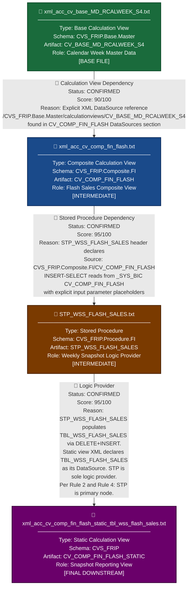

# File Lineage Analysis Report — FLASH SALES
**Domain:** CVS FRIP — Flash Sales Pipeline
**Analyst:** File Lineage Analysis Agent
**Artifacts Analyzed:** 4 Files

---

## 1. Lineage Summary

| Metric | Value |
|--------|-------|
| Total Files Analyzed | 4 |
| Total Relationships Identified | 3 |
| Total Lineage Paths Identified | 2 |
| Total Base Files Identified | 1 |
| Total Unresolved Relationships | 0 |

---

## 2. File Inventory

| File | Type | Identified Purpose | Upstream Files | Downstream Files |
|------|------|--------------------|----------------|------------------|
| `xml_acc_cv_base_MD_RCALWEEK_S4.txt` | Calculation View XML (Base) | Provides retail calendar week master data (RCALWEEK) for S4 — used as a dimension join in composite views | None (Base File) | `xml_acc_cv_comp_fin_flash.txt` |
| `xml_acc_cv_comp_fin_flash.txt` | Calculation View XML (Composite) | Composite Flash Sales view (CV_COMP_FIN_FLASH) — joins Flash Sales CAR data with calendar week, comp flag, hierarchy, and store attributes | `xml_acc_cv_base_MD_RCALWEEK_S4.txt` | `STP_WSS_FLASH_SALES.txt` |
| `STP_WSS_FLASH_SALES.txt` | Stored Procedure (SQL Script) | Weekly snapshot procedure — reads from CV_COMP_FIN_FLASH and inserts into TBL_WSS_FLASH_SALES every Monday at 5am | `xml_acc_cv_comp_fin_flash.txt` | `xml_acc_cv_comp_fin_flash_static_tbl_wss_flash_sales.txt` |
| `xml_acc_cv_comp_fin_flash_static_tbl_wss_flash_sales.txt` | Calculation View XML (Static/Snapshot) | Static snapshot Calculation View — reads from TBL_WSS_FLASH_SALES (populated by STP_WSS_FLASH_SALES) to serve downstream reporting | `STP_WSS_FLASH_SALES.txt` | None (Final Downstream File) |

---

## 3. File Relationships

| Source File | Target File | Relationship | Score | Reason |
|-------------|-------------|--------------|-------|--------|
| `xml_acc_cv_base_MD_RCALWEEK_S4.txt` | `xml_acc_cv_comp_fin_flash.txt` | Calculation View Dependency | 90 | The composite view XML (`xml_acc_cv_comp_fin_flash.txt`) contains an explicit `<DataSource>` reference to `/CVS_FRIP.Base.Master/calculationviews/CV_BASE_MD_RCALWEEK_S4`, which directly maps to the supplied artifact `xml_acc_cv_base_MD_RCALWEEK_S4.txt`. This is an explicit XML dependency confirmed in the view's data source section. |
| `xml_acc_cv_comp_fin_flash.txt` | `STP_WSS_FLASH_SALES.txt` | Stored Procedure Dependency | 95 | The stored procedure header explicitly declares `Source: _SYS_BIC"."CVS_FRIP.Composite.FI/CV_COMP_FIN_FLASH` and the INSERT-SELECT body reads directly from `"_SYS_BIC"."CVS_FRIP.Composite.FI/CV_COMP_FIN_FLASH"` with input parameters. This is an explicit SQL reference to the composite view artifact. |
| `STP_WSS_FLASH_SALES.txt` | `xml_acc_cv_comp_fin_flash_static_tbl_wss_flash_sales.txt` | Logic Provider | 95 | The stored procedure (`STP_WSS_FLASH_SALES`) populates `CVS_FRIP.Table::TBL_WSS_FLASH_SALES` via DELETE + INSERT logic. The static calculation view (`xml_acc_cv_comp_fin_flash_static_tbl_wss_flash_sales.txt`) explicitly declares `CVS_FRIP.Table::TBL_WSS_FLASH_SALES` as its data source in the XML `<DataSource>` element. The stored procedure is the sole logic provider for the data consumed by this static view. Per Rule 2 and Rule 4, the STP is the primary lineage node — not the intermediate table. |

---

## 4. Complete Lineage

### Lineage Path 1 — Full Flash Sales Pipeline

```
xml_acc_cv_base_MD_RCALWEEK_S4.txt
    ↓  [Calculation View Dependency | Score: 90]
    ↓  (CV_BASE_MD_RCALWEEK_S4 is referenced as a DataSource in CV_COMP_FIN_FLASH XML)
xml_acc_cv_comp_fin_flash.txt
    ↓  [Stored Procedure Dependency | Score: 95]
    ↓  (STP_WSS_FLASH_SALES explicitly SELECTs from CV_COMP_FIN_FLASH via _SYS_BIC)
STP_WSS_FLASH_SALES.txt
    ↓  [Logic Provider | Score: 95]
    ↓  (STP populates TBL_WSS_FLASH_SALES; static view reads from that table)
xml_acc_cv_comp_fin_flash_static_tbl_wss_flash_sales.txt
```

**Overall Lineage Path Confidence Score: 93/100**

**Score Determination:**
- The path is composed of three relationships with scores of 90, 95, and 95.
- The overall confidence is calculated as the weighted average: (90 + 95 + 95) / 3 = **93.3**, rounded to **93**.
- All three relationships are CONFIRMED with explicit evidence in XML DataSource declarations and SQL SELECT statements.
- No inferred or assumed relationships exist in this path.
- The only intermediate storage object (TBL_WSS_FLASH_SALES) is correctly excluded as a primary lineage node per Rule 3 and Rule 4.

---

### Lineage Path 2 — Base Calendar Week Dependency Only

```
xml_acc_cv_base_MD_RCALWEEK_S4.txt
    ↓  [Calculation View Dependency | Score: 90]
xml_acc_cv_comp_fin_flash.txt
```

**Overall Lineage Path Confidence Score: 90/100**

**Score Determination:**
- Single relationship with explicit XML DataSource evidence.
- Score of 90 reflects explicit XML dependency per scoring guidelines.

---

## 5. Mermaid Lineage Diagram



---

## 6. Base Files

| Base File | Reason | Score |
|-----------|--------|-------|
| `xml_acc_cv_base_MD_RCALWEEK_S4.txt` | This is the root artifact in the lineage chain. It is a Base Calculation View (CV_BASE_MD_RCALWEEK_S4) that provides retail calendar week master data. It has no upstream dependencies among the supplied artifacts. It is explicitly referenced as a DataSource in the composite view `xml_acc_cv_comp_fin_flash.txt`. No other supplied artifact feeds into it. | 90 |

---

## 7. Final / Downstream Files

| File | Reason | Score |
|------|--------|-------|
| `xml_acc_cv_comp_fin_flash_static_tbl_wss_flash_sales.txt` | This is the terminal artifact in the lineage chain. It is a Static Calculation View that reads from the snapshot table `TBL_WSS_FLASH_SALES`, which is exclusively populated by `STP_WSS_FLASH_SALES`. It has no downstream artifact dependencies among the supplied files. It serves as the final reporting layer for Flash Sales snapshot data. | 95 |

---

## 8. Unresolved Relationships

| File | Possible Related File | Reason |
|------|-----------------------|--------|
| `xml_acc_cv_comp_fin_flash.txt` | CV_BASE_FIN_FLASH_SALES_CAR (not supplied) | The composite view XML references `/CVS_FRIP.Base.FI/calculationviews/CV_BASE_FIN_FLASH_SALES_CAR` as a DataSource. This artifact was not supplied as an input file. The relationship cannot be confirmed within the supplied artifact set. |
| `xml_acc_cv_comp_fin_flash.txt` | CV_BASE_MD_COMPFL_S4 (not supplied) | The composite view XML references `/CVS_FRIP.Base.Master/calculationviews/CV_BASE_MD_COMPFL_S4` as a DataSource. This artifact was not supplied. |
| `xml_acc_cv_comp_fin_flash.txt` | CV_BASE_MD_HRRP_NODE_S4 (not supplied) | The composite view XML references `/CVS_FRIP.Base.Master/calculationviews/CV_BASE_MD_HRRP_NODE_S4` as a DataSource. This artifact was not supplied. |
| `xml_acc_cv_comp_fin_flash.txt` | CV_BASE_MD_SRPACT_S4 (not supplied) | The composite view XML references `/CVS_FRIP.Base.Master/calculationviews/CV_BASE_MD_SRPACT_S4` as a DataSource (referenced twice). This artifact was not supplied. |
| `xml_acc_cv_comp_fin_flash.txt` | CV_BASE_MD_CEPCT_S4 (not supplied) | The composite view XML references `/CVS_FRIP.Base.Text/calculationviews/CV_BASE_MD_CEPCT_S4` as a DataSource. This artifact was not supplied. |

> **Note:** All unresolved relationships are external dependencies of `xml_acc_cv_comp_fin_flash.txt` that reference artifacts outside the supplied file set. They do not affect the confirmed lineage chain between the four supplied artifacts.

---

## 9. Final Lineage Assessment

### Summary

The four supplied artifacts form a **single, complete, linear lineage chain** representing the CVS FRIP Flash Sales weekly snapshot pipeline.

---

### Base Files
- **`xml_acc_cv_base_MD_RCALWEEK_S4.txt`** — Root base artifact. Provides retail calendar week master data with no upstream dependencies in the supplied set.

---

### Main Lineage Paths

**Path 1 — Complete Flash Sales Pipeline (Confidence: 93/100)**
```
xml_acc_cv_base_MD_RCALWEEK_S4.txt
    → xml_acc_cv_comp_fin_flash.txt
    → STP_WSS_FLASH_SALES.txt
    → xml_acc_cv_comp_fin_flash_static_tbl_wss_flash_sales.txt
```

---

### File-to-File Relationships

| # | Source | Target | Type | Score |
|---|--------|--------|------|-------|
| 1 | `xml_acc_cv_base_MD_RCALWEEK_S4.txt` | `xml_acc_cv_comp_fin_flash.txt` | Calculation View Dependency | 90 |
| 2 | `xml_acc_cv_comp_fin_flash.txt` | `STP_WSS_FLASH_SALES.txt` | Stored Procedure Dependency | 95 |
| 3 | `STP_WSS_FLASH_SALES.txt` | `xml_acc_cv_comp_fin_flash_static_tbl_wss_flash_sales.txt` | Logic Provider | 95 |

---

### Lineage Scores and Reasons

| Relationship | Score | Reason |
|-------------|-------|--------|
| `xml_acc_cv_base_MD_RCALWEEK_S4` → `xml_acc_cv_comp_fin_flash` | 90 | Explicit XML `<DataSource>` reference to `CV_BASE_MD_RCALWEEK_S4` found in the composite view XML. Score of 90 per scoring guidelines for explicit XML dependency. |
| `xml_acc_cv_comp_fin_flash` → `STP_WSS_FLASH_SALES` | 95 | Stored Procedure header and SQL body explicitly reference `CVS_FRIP.Composite.FI/CV_COMP_FIN_FLASH` as the SELECT source. Score of 95 per scoring guidelines for explicit Stored Procedure dependency. |
| `STP_WSS_FLASH_SALES` → `xml_acc_cv_comp_fin_flash_static_tbl_wss_flash_sales` | 95 | STP exclusively populates `TBL_WSS_FLASH_SALES`; static view XML declares this table as its sole DataSource. Per Rule 2 and Rule 4, STP is the primary logic provider node. Score of 95 for explicit Stored Procedure dependency. |

---

### Relationship Classification

| Relationship | Classification |
|-------------|----------------|
| `xml_acc_cv_base_MD_RCALWEEK_S4` → `xml_acc_cv_comp_fin_flash` | ✅ **CONFIRMED RELATIONSHIP** — Explicit XML DataSource reference |
| `xml_acc_cv_comp_fin_flash` → `STP_WSS_FLASH_SALES` | ✅ **CONFIRMED RELATIONSHIP** — Explicit SQL SELECT from CV_COMP_FIN_FLASH |
| `STP_WSS_FLASH_SALES` → `xml_acc_cv_comp_fin_flash_static_tbl_wss_flash_sales` | ✅ **CONFIRMED RELATIONSHIP** — STP is sole logic provider for static view's data source |
| `xml_acc_cv_comp_fin_flash` → CV_BASE_FIN_FLASH_SALES_CAR | ⚠️ **UNRESOLVED RELATIONSHIP** — Artifact not supplied |
| `xml_acc_cv_comp_fin_flash` → CV_BASE_MD_COMPFL_S4 | ⚠️ **UNRESOLVED RELATIONSHIP** — Artifact not supplied |
| `xml_acc_cv_comp_fin_flash` → CV_BASE_MD_HRRP_NODE_S4 | ⚠️ **UNRESOLVED RELATIONSHIP** — Artifact not supplied |
| `xml_acc_cv_comp_fin_flash` → CV_BASE_MD_SRPACT_S4 | ⚠️ **UNRESOLVED RELATIONSHIP** — Artifact not supplied |
| `xml_acc_cv_comp_fin_flash` → CV_BASE_MD_CEPCT_S4 | ⚠️ **UNRESOLVED RELATIONSHIP** — Artifact not supplied |

---

### Validation Results

| Validation Rule | Status | Notes |
|----------------|--------|-------|
| Validation 1: Every file classified as USED/NOT USED | ✅ PASS | All 4 files are USED in the lineage chain |
| Validation 2: Every dependency traceable to evidence | ✅ PASS | All 3 relationships have explicit XML or SQL evidence |
| Validation 3: Stored Procedures appear in lineage | ✅ PASS | STP_WSS_FLASH_SALES is a first-class lineage node |
| Validation 4: No ETL tables as primary lineage nodes | ✅ PASS | TBL_WSS_FLASH_SALES is excluded as a primary node; STP is used instead |

---

*Report generated by File Lineage Analysis Agent | FLASH SALES Domain | CVS FRIP*
