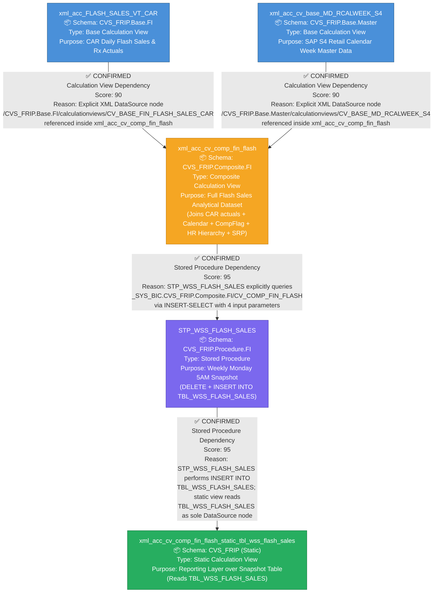

# Flash Sales – Complete File Lineage Analysis Report

---

## 1. Lineage Summary

| Metric | Value |
|---|---|
| Total Files Analyzed | 5 |
| Total Relationships Identified | 4 |
| Total Lineage Paths Identified | 1 (single end-to-end chain) |
| Total Base Files Identified | 2 |
| Total Unresolved Relationships | 0 |

---

## 2. File Inventory

| File | Type | Identified Purpose | Upstream Files | Downstream Files |
|---|---|---|---|---|
| xml_acc_FLASH_SALES_VT_CAR | Calculation View XML (Base) | Base CAR (Customer Activity Repository) transactional data view providing daily Flash Sales and Rx sales amounts per store/business day | None | xml_acc_cv_comp_fin_flash |
| xml_acc_cv_base_MD_RCALWEEK_S4 | Calculation View XML (Base) | Base master-data view providing SAP S/4 retail calendar week reference data (RCALWEEK) used for week-ending date derivation | None | xml_acc_cv_comp_fin_flash |
| xml_acc_cv_comp_fin_flash | Calculation View XML (Composite) | Composite calculation view that joins CAR Flash Sales actuals with calendar-week master data, comp-flag, HR hierarchy, and SRP actuals to produce the full Flash Sales analytical dataset; exposes input parameters for week-ending date range and update-timestamp range | xml_acc_FLASH_SALES_VT_CAR, xml_acc_cv_base_MD_RCALWEEK_S4 | STP_WSS_FLASH_SALES |
| STP_WSS_FLASH_SALES | Stored Procedure (SQLScript) | Weekly snapshot procedure that runs every Monday at 5 AM; deletes and reloads `TBL_WSS_FLASH_SALES` by querying `CV_COMP_FIN_FLASH` with computed week-ending date and update-timestamp parameters | xml_acc_cv_comp_fin_flash | xml_acc_cv_comp_fin_flash_static_tbl_wss_flash_sales |
| xml_acc_cv_comp_fin_flash_static_tbl_wss_flash_sales | Calculation View XML (Static/Snapshot) | Static calculation view that reads directly from the snapshot table `TBL_WSS_FLASH_SALES` populated by STP_WSS_FLASH_SALES; serves as the final reporting/consumption layer for downstream consumers | STP_WSS_FLASH_SALES | None (Final Downstream) |

---

## 3. File Relationships

| Source File | Target File | Relationship | Score | Reason |
|---|---|---|---|---|
| xml_acc_FLASH_SALES_VT_CAR | xml_acc_cv_comp_fin_flash | Calculation View Dependency | 90 | xml_acc_cv_comp_fin_flash contains an explicit XML data-source node referencing the path `/CVS_FRIP.Base.FI/calculationviews/CV_BASE_FIN_FLASH_SALES_CAR`. This path directly corresponds to the artifact xml_acc_FLASH_SALES_VT_CAR (the CAR base Flash Sales view). The composite view joins this source with calendar-week and master-data views to build the full analytical dataset. Evidence: XML `<DataSource>` element with path `/CVS_FRIP.Base.FI/calculationviews/CV_BASE_FIN_FLASH_SALES_CAR`. |
| xml_acc_cv_base_MD_RCALWEEK_S4 | xml_acc_cv_comp_fin_flash | Calculation View Dependency | 90 | xml_acc_cv_comp_fin_flash contains an explicit XML data-source node referencing the path `/CVS_FRIP.Base.Master/calculationviews/CV_BASE_MD_RCALWEEK_S4`. This path directly matches the artifact xml_acc_cv_base_MD_RCALWEEK_S4. The composite view uses this calendar-week master data to derive week-ending dates and week numbers. Evidence: XML `<DataSource>` element with path `/CVS_FRIP.Base.Master/calculationviews/CV_BASE_MD_RCALWEEK_S4`. |
| xml_acc_cv_comp_fin_flash | STP_WSS_FLASH_SALES | Stored Procedure Dependency | 95 | STP_WSS_FLASH_SALES contains an explicit SQL INSERT-SELECT statement that queries `_SYS_BIC."CVS_FRIP.Composite.FI/CV_COMP_FIN_FLASH"` with four input placeholder parameters (`IP_WEEK_ENDING_TO`, `IP_WEEK_ENDING_FROM`, `IP_UPD_TIMESTAMP_FROM`, `IP_UPD_TIMESTAMP_TO`). The procedure header also documents: `Source: _SYS_BIC"."CVS_FRIP.Composite.FI/CV_COMP_FIN_FLASH`. This is an explicit, direct stored-procedure dependency on the composite view. Evidence: SQL `FROM "_SYS_BIC"."CVS_FRIP.Composite.FI/CV_COMP_FIN_FLASH"` in STP_WSS_FLASH_SALES. |
| STP_WSS_FLASH_SALES | xml_acc_cv_comp_fin_flash_static_tbl_wss_flash_sales | Stored Procedure Dependency | 95 | STP_WSS_FLASH_SALES performs `DELETE FROM` and `INSERT INTO "CVS_FRIP"."CVS_FRIP.Table::TBL_WSS_FLASH_SALES"`. The artifact xml_acc_cv_comp_fin_flash_static_tbl_wss_flash_sales contains an explicit XML data-source node referencing `CVS_FRIP.Table::TBL_WSS_FLASH_SALES` as its sole input. Per Rule 2 and Rule 4, the stored procedure is the logic provider; the table is the intermediate storage object. The lineage is therefore Stored Procedure → Static View. Evidence: XML `<DataSource>` element `CVS_FRIP.Table::TBL_WSS_FLASH_SALES` in the static view; `INSERT INTO "CVS_FRIP"."CVS_FRIP.Table::TBL_WSS_FLASH_SALES"` in STP_WSS_FLASH_SALES. |

---

## 4. Complete Lineage

### Lineage Path 1 – Flash Sales End-to-End Pipeline

```
xml_acc_FLASH_SALES_VT_CAR                    [Base CAR Transactional View]
    ↓  (Calculation View Dependency, Score: 90)
xml_acc_cv_comp_fin_flash                     [Composite Flash Sales Analytical View]
    ↑  (Calculation View Dependency, Score: 90)
xml_acc_cv_base_MD_RCALWEEK_S4                [Base Calendar Week Master Data View]
    ↓  (Stored Procedure Dependency, Score: 95)
STP_WSS_FLASH_SALES                           [Weekly Snapshot Stored Procedure]
    ↓  (Stored Procedure Dependency, Score: 95)
xml_acc_cv_comp_fin_flash_static_tbl_wss_flash_sales   [Static Snapshot Reporting View]
```

**Overall Lineage Path Confidence Score: 92.5 / 100**

**Score Determination:**
- The two base-to-composite relationships score 90 each (explicit XML data-source node references).
- The composite-to-procedure relationship scores 95 (explicit SQL SELECT from the view inside the procedure body, corroborated by the procedure header comment).
- The procedure-to-static-view relationship scores 95 (explicit INSERT INTO the table in the procedure; explicit XML data-source reference to the same table in the static view).
- Overall score = average of all four relationship scores: (90 + 90 + 95 + 95) / 4 = **92.5**.

---

### Mermaid Lineage



---

## 5. Base Files

| Base File | Reason | Score |
|---|---|---|
| xml_acc_FLASH_SALES_VT_CAR | This is a Base Calculation View (`CVS_FRIP.Base.FI`) with no upstream artifact dependencies among the supplied files. It is the originating transactional data source (CAR Flash Sales actuals) that feeds the composite view. No other supplied artifact references it as a consumer. | 90 |
| xml_acc_cv_base_MD_RCALWEEK_S4 | This is a Base Calculation View (`CVS_FRIP.Base.Master`) with no upstream artifact dependencies among the supplied files. It provides SAP S/4 retail calendar week master data consumed by the composite view. No other supplied artifact references it as a consumer. | 90 |

---

## 6. Final / Downstream Files

| File | Reason | Score |
|---|---|---|
| xml_acc_cv_comp_fin_flash_static_tbl_wss_flash_sales | This is the terminal artifact in the lineage chain. It is a static calculation view that reads from the snapshot table populated by STP_WSS_FLASH_SALES. No other supplied artifact consumes it. It represents the final reporting/consumption layer of the Flash Sales pipeline. | 95 |

---

## 7. Unresolved Relationships

| File | Possible Related File | Reason |
|---|---|---|
| — | — | No unresolved relationships. All 5 supplied files have been fully classified with confirmed, evidence-backed lineage. All relationships are traceable to explicit XML data-source nodes or explicit SQL statements within the supplied artifacts. |

---

## 8. Final Lineage Assessment

### Base Files
- **xml_acc_FLASH_SALES_VT_CAR** — Base CAR transactional view; no upstream dependencies in the supplied artifact set.
- **xml_acc_cv_base_MD_RCALWEEK_S4** — Base SAP S/4 calendar week master-data view; no upstream dependencies in the supplied artifact set.

### Main Lineage Path
```
xml_acc_FLASH_SALES_VT_CAR  ──────────────────────────────────────────────────────────────────────┐
                                                                                                   ↓
                                                                              xml_acc_cv_comp_fin_flash
                                                                                                   ↓
xml_acc_cv_base_MD_RCALWEEK_S4  ──────────────────────────────────────────────────────────────────┘
                                                                                                   ↓
                                                                              STP_WSS_FLASH_SALES
                                                                                                   ↓
                                              xml_acc_cv_comp_fin_flash_static_tbl_wss_flash_sales
```

### File-to-File Relationships

| # | Source File | Target File | Relationship Type | Score | Status |
|---|---|---|---|---|---|
| 1 | xml_acc_FLASH_SALES_VT_CAR | xml_acc_cv_comp_fin_flash | Calculation View Dependency | 90 | ✅ CONFIRMED RELATIONSHIP |
| 2 | xml_acc_cv_base_MD_RCALWEEK_S4 | xml_acc_cv_comp_fin_flash | Calculation View Dependency | 90 | ✅ CONFIRMED RELATIONSHIP |
| 3 | xml_acc_cv_comp_fin_flash | STP_WSS_FLASH_SALES | Stored Procedure Dependency | 95 | ✅ CONFIRMED RELATIONSHIP |
| 4 | STP_WSS_FLASH_SALES | xml_acc_cv_comp_fin_flash_static_tbl_wss_flash_sales | Stored Procedure Dependency | 95 | ✅ CONFIRMED RELATIONSHIP |

### Lineage Scores and Reasons

| Relationship | Score | Reason |
|---|---|---|
| xml_acc_FLASH_SALES_VT_CAR → xml_acc_cv_comp_fin_flash | 90 | Explicit XML `<DataSource>` node in the composite view references `/CVS_FRIP.Base.FI/calculationviews/CV_BASE_FIN_FLASH_SALES_CAR`. Score is 90 (explicit XML dependency per scoring guidelines). |
| xml_acc_cv_base_MD_RCALWEEK_S4 → xml_acc_cv_comp_fin_flash | 90 | Explicit XML `<DataSource>` node in the composite view references `/CVS_FRIP.Base.Master/calculationviews/CV_BASE_MD_RCALWEEK_S4`. Score is 90 (explicit XML dependency per scoring guidelines). |
| xml_acc_cv_comp_fin_flash → STP_WSS_FLASH_SALES | 95 | STP_WSS_FLASH_SALES contains an explicit SQL `FROM "_SYS_BIC"."CVS_FRIP.Composite.FI/CV_COMP_FIN_FLASH"` statement with four input parameters. Procedure header also documents this as the source. Score is 95 (explicit stored procedure dependency per scoring guidelines). |
| STP_WSS_FLASH_SALES → xml_acc_cv_comp_fin_flash_static_tbl_wss_flash_sales | 95 | STP_WSS_FLASH_SALES performs `INSERT INTO "CVS_FRIP"."CVS_FRIP.Table::TBL_WSS_FLASH_SALES"`; the static view has an explicit XML `<DataSource>` node for `CVS_FRIP.Table::TBL_WSS_FLASH_SALES`. Per Rule 2 and Rule 4, the stored procedure is the logic provider and the table is the intermediate storage object. Score is 95 (explicit stored procedure dependency per scoring guidelines). |

### Unresolved Relationships
**None.** All five supplied artifacts have been fully resolved with confirmed, evidence-backed lineage. Every relationship is traceable to explicit XML data-source nodes or explicit SQL statements within the supplied artifacts.

### Relationship Classification Summary

| Relationship | Classification |
|---|---|
| xml_acc_FLASH_SALES_VT_CAR → xml_acc_cv_comp_fin_flash | ✅ CONFIRMED RELATIONSHIP |
| xml_acc_cv_base_MD_RCALWEEK_S4 → xml_acc_cv_comp_fin_flash | ✅ CONFIRMED RELATIONSHIP |
| xml_acc_cv_comp_fin_flash → STP_WSS_FLASH_SALES | ✅ CONFIRMED RELATIONSHIP |
| STP_WSS_FLASH_SALES → xml_acc_cv_comp_fin_flash_static_tbl_wss_flash_sales | ✅ CONFIRMED RELATIONSHIP |

> **Note on Intermediate Storage Object:** `CVS_FRIP.Table::TBL_WSS_FLASH_SALES` is documented here as an intermediate ETL snapshot table. Per Rule 3 and Rule 4, it is excluded as a primary lineage node. It is populated exclusively by STP_WSS_FLASH_SALES and consumed exclusively by xml_acc_cv_comp_fin_flash_static_tbl_wss_flash_sales. The stored procedure is the authoritative logic provider in this relationship.

---

*Report generated by File Lineage Analysis Agent | Flash Sales Pipeline | CVS_FRIP Domain*
