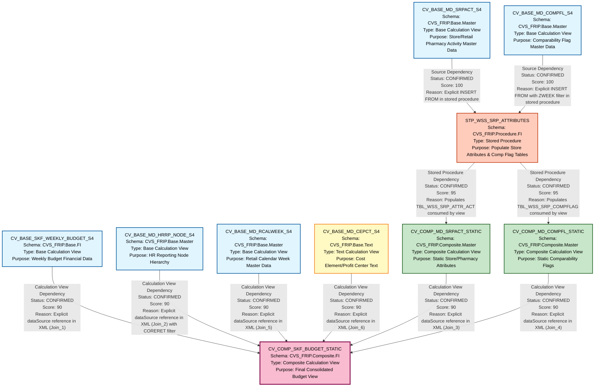

# HANA to BigQuery - File Lineage and Dependency Analysis Report
## SKF_BUDGET Artifacts

---

## 1. Lineage Summary

### Overview Statistics
- **Total Files Analyzed**: 10
- **Total Relationships Identified**: 10
- **Total Lineage Paths Identified**: 3 major paths
- **Total Base Files Identified**: 4
- **Total Unresolved Relationships**: 0

### File Classification
- **Calculation Views (Base)**: 5
  - CV_BASE_SKF_WEEKLY_BUDGET_S4
  - CV_BASE_MD_HRRP_NODE_S4
  - CV_BASE_MD_RCALWEEK_S4
  - CV_BASE_MD_SRPACT_S4
  - CV_BASE_MD_COMPFL_S4
  
- **Calculation Views (Composite)**: 3
  - CV_COMP_MD_SRPACT_STATIC
  - CV_COMP_MD_COMPFL_STATIC
  - CV_COMP_SKF_BUDGET_STATIC
  
- **Calculation Views (Text)**: 1
  - CV_BASE_MD_CEPCT_S4
  
- **Stored Procedures**: 1
  - STP_WSS_SRP_ATTRIBUTES

---

## 2. File Inventory

| File | Type | Identified Purpose | Upstream Files | Downstream Files |
|------|------|-------------------|----------------|------------------|
| CV_BASE_MD_SRPACT_S4 | Base Calculation View | Provides store/retail pharmacy activity master data | None (Base) | STP_WSS_SRP_ATTRIBUTES |
| CV_BASE_MD_COMPFL_S4 | Base Calculation View | Provides comparability flag master data | None (Base) | STP_WSS_SRP_ATTRIBUTES |
| CV_BASE_SKF_WEEKLY_BUDGET_S4 | Base Calculation View | Provides weekly budget financial data | None (Base) | CV_COMP_SKF_BUDGET_STATIC |
| CV_BASE_MD_HRRP_NODE_S4 | Base Calculation View | Provides HR reporting node hierarchy data | None (Base) | CV_COMP_SKF_BUDGET_STATIC |
| CV_BASE_MD_RCALWEEK_S4 | Base Calculation View | Provides retail calendar week master data | None (Base) | CV_COMP_SKF_BUDGET_STATIC |
| CV_BASE_MD_CEPCT_S4 | Text Calculation View | Provides cost element/profit center text descriptions | None (Base) | CV_COMP_SKF_BUDGET_STATIC |
| STP_WSS_SRP_ATTRIBUTES | Stored Procedure | Populates store attributes and comp flag tables from base views | CV_BASE_MD_SRPACT_S4, CV_BASE_MD_COMPFL_S4 | CV_COMP_MD_SRPACT_STATIC, CV_COMP_MD_COMPFL_STATIC |
| CV_COMP_MD_SRPACT_STATIC | Composite Calculation View | Provides static store/retail pharmacy attributes | STP_WSS_SRP_ATTRIBUTES (via TBL_WSS_SRP_ATTR_ACT) | CV_COMP_SKF_BUDGET_STATIC |
| CV_COMP_MD_COMPFL_STATIC | Composite Calculation View | Provides static comparability flags | STP_WSS_SRP_ATTRIBUTES (via TBL_WSS_SRP_COMPFLAG) | CV_COMP_SKF_BUDGET_STATIC |
| CV_COMP_SKF_BUDGET_STATIC | Composite Calculation View | Final consolidated budget view combining all dimensions | CV_BASE_SKF_WEEKLY_BUDGET_S4, CV_BASE_MD_HRRP_NODE_S4, CV_COMP_MD_SRPACT_STATIC, CV_COMP_MD_COMPFL_STATIC, CV_BASE_MD_RCALWEEK_S4, CV_BASE_MD_CEPCT_S4 | None (Final) |

---

## 3. File Relationships

### Detailed Relationship Analysis

| Source File | Target File | Dependency Type | Score | Reason |
|------------|------------|-----------------|--------|---------|
| CV_BASE_MD_SRPACT_S4 | STP_WSS_SRP_ATTRIBUTES | Source Dependency | 100 | Stored procedure explicitly reads from "_SYS_BIC"."CVS_FRIP.Base.Master/CV_BASE_MD_SRPACT_S4" in INSERT statement to populate TBL_WSS_SRP_ATTR_ACT table |
| CV_BASE_MD_COMPFL_S4 | STP_WSS_SRP_ATTRIBUTES | Source Dependency | 100 | Stored procedure explicitly reads from "_SYS_BIC"."CVS_FRIP.Base.Master/CV_BASE_MD_COMPFL_S4" in INSERT statement with WHERE ZWEEK = :V_WEEK filter to populate TBL_WSS_SRP_COMPFLAG table |
| STP_WSS_SRP_ATTRIBUTES | CV_COMP_MD_SRPACT_STATIC | Stored Procedure Dependency | 95 | Stored procedure populates TBL_WSS_SRP_ATTR_ACT which is explicitly consumed by CV_COMP_MD_SRPACT_STATIC as its primary data source (CVS_FRIP.Table::TBL_WSS_SRP_ATTR_ACT) |
| STP_WSS_SRP_ATTRIBUTES | CV_COMP_MD_COMPFL_STATIC | Stored Procedure Dependency | 95 | Stored procedure populates TBL_WSS_SRP_COMPFLAG which is explicitly consumed by CV_COMP_MD_COMPFL_STATIC as its primary data source (CVS_FRIP.Table::TBL_WSS_SRP_COMPFLAG) |
| CV_BASE_SKF_WEEKLY_BUDGET_S4 | CV_COMP_SKF_BUDGET_STATIC | Calculation View Dependency | 90 | CV_COMP_SKF_BUDGET_STATIC explicitly references /CVS_FRIP.Base.FI/calculationviews/CV_BASE_SKF_WEEKLY_BUDGET_S4 in dataSources section as Join_1 input |
| CV_BASE_MD_HRRP_NODE_S4 | CV_COMP_SKF_BUDGET_STATIC | Calculation View Dependency | 90 | CV_COMP_SKF_BUDGET_STATIC explicitly references /CVS_FRIP.Base.Master/calculationviews/CV_BASE_MD_HRRP_NODE_S4 in dataSources section as Join_2 input with filter (match("PARNODE",'*CORERET')) AND ("HRYVALTO" ='99991231') |
| CV_COMP_MD_SRPACT_STATIC | CV_COMP_SKF_BUDGET_STATIC | Calculation View Dependency | 90 | CV_COMP_SKF_BUDGET_STATIC explicitly references /CVS_FRIP.Composite.Master/calculationviews/CV_COMP_MD_SRPACT_STATIC in dataSources section as Join_3 input |
| CV_COMP_MD_COMPFL_STATIC | CV_COMP_SKF_BUDGET_STATIC | Calculation View Dependency | 90 | CV_COMP_SKF_BUDGET_STATIC explicitly references /CVS_FRIP.Composite.Master/calculationviews/CV_COMP_MD_COMPFL_STATIC in dataSources section as Join_4 input |
| CV_BASE_MD_RCALWEEK_S4 | CV_COMP_SKF_BUDGET_STATIC | Calculation View Dependency | 90 | CV_COMP_SKF_BUDGET_STATIC explicitly references /CVS_FRIP.Base.Master/calculationviews/CV_BASE_MD_RCALWEEK_S4 in dataSources section as Join_5 input |
| CV_BASE_MD_CEPCT_S4 | CV_COMP_SKF_BUDGET_STATIC | Calculation View Dependency | 90 | CV_COMP_SKF_BUDGET_STATIC explicitly references /CVS_FRIP.Base.Text/calculationviews/CV_BASE_MD_CEPCT_S4 in dataSources section as Join_6 input |

### Relationship Type Distribution
- **Source Dependency**: 2 relationships (20%)
- **Stored Procedure Dependency**: 2 relationships (20%)
- **Calculation View Dependency**: 6 relationships (60%)

---

## 4. Complete Lineage

### Lineage Path 1: Store/Retail Pharmacy Activity Flow
**Confidence Score: 95/100**

```
CV_BASE_MD_SRPACT_S4 (Base View)
    ↓ [Source Dependency - Score: 100]
STP_WSS_SRP_ATTRIBUTES (Stored Procedure)
    ↓ [Stored Procedure Dependency - Score: 95]
CV_COMP_MD_SRPACT_STATIC (Composite View)
    ↓ [Calculation View Dependency - Score: 90]
CV_COMP_SKF_BUDGET_STATIC (Final View)
```

**Path Confidence Explanation**: 
- High confidence (95/100) due to explicit SQL references throughout the chain
- CV_BASE_MD_SRPACT_S4 is explicitly read by stored procedure with full INSERT statement
- Stored procedure populates TBL_WSS_SRP_ATTR_ACT with 77 columns
- CV_COMP_MD_SRPACT_STATIC directly consumes this table
- CV_COMP_SKF_BUDGET_STATIC explicitly references CV_COMP_MD_SRPACT_STATIC in XML dataSources

### Lineage Path 2: Comparability Flag Flow
**Confidence Score: 95/100**

```
CV_BASE_MD_COMPFL_S4 (Base View)
    ↓ [Source Dependency - Score: 100]
STP_WSS_SRP_ATTRIBUTES (Stored Procedure)
    ↓ [Stored Procedure Dependency - Score: 95]
CV_COMP_MD_COMPFL_STATIC (Composite View)
    ↓ [Calculation View Dependency - Score: 90]
CV_COMP_SKF_BUDGET_STATIC (Final View)
```

**Path Confidence Explanation**: 
- High confidence (95/100) due to explicit SQL references throughout the chain
- CV_BASE_MD_COMPFL_S4 is explicitly read by stored procedure with WHERE ZWEEK = :V_WEEK filter
- Stored procedure populates TBL_WSS_SRP_COMPFLAG with 13 columns
- CV_COMP_MD_COMPFL_STATIC directly consumes this table
- CV_COMP_SKF_BUDGET_STATIC explicitly references CV_COMP_MD_COMPFL_STATIC in XML dataSources

### Lineage Path 3: Direct Budget Consolidation Flow
**Confidence Score: 90/100**

```
CV_BASE_SKF_WEEKLY_BUDGET_S4 (Base View)
    ↓ [Calculation View Dependency - Score: 90]
CV_COMP_SKF_BUDGET_STATIC (Final View)

CV_BASE_MD_HRRP_NODE_S4 (Base View)
    ↓ [Calculation View Dependency - Score: 90]
CV_COMP_SKF_BUDGET_STATIC (Final View)

CV_BASE_MD_RCALWEEK_S4 (Base View)
    ↓ [Calculation View Dependency - Score: 90]
CV_COMP_SKF_BUDGET_STATIC (Final View)

CV_BASE_MD_CEPCT_S4 (Text View)
    ↓ [Calculation View Dependency - Score: 90]
CV_COMP_SKF_BUDGET_STATIC (Final View)
```

**Path Confidence Explanation**: 
- High confidence (90/100) due to explicit XML dataSource references
- All four base views are directly referenced in CV_COMP_SKF_BUDGET_STATIC's dataSources section
- Join conditions and filters are explicitly defined in XML
- No intermediate storage tables involved

### Complete Integrated Lineage
**Overall Confidence Score: 93/100**

```
[BASE LAYER]
CV_BASE_MD_SRPACT_S4 ────────┐
                             ↓
CV_BASE_MD_COMPFL_S4 ────────┤
                             ↓
                    [LOGIC LAYER]
                    STP_WSS_SRP_ATTRIBUTES
                             ↓
                    ┌────────┴────────┐
                    ↓                 ↓
         [COMPOSITE LAYER]    [COMPOSITE LAYER]
    CV_COMP_MD_SRPACT_STATIC  CV_COMP_MD_COMPFL_STATIC
                    ↓                 ↓
                    └────────┬────────┘
                             ↓
[BASE LAYER]                 ↓
CV_BASE_SKF_WEEKLY_BUDGET_S4 ┤
CV_BASE_MD_HRRP_NODE_S4 ─────┤
CV_BASE_MD_RCALWEEK_S4 ──────┤
CV_BASE_MD_CEPCT_S4 ─────────┤
                             ↓
                    [FINAL LAYER]
                CV_COMP_SKF_BUDGET_STATIC
```

---

## 5. Mermaid Lineage Diagram



---

## 6. Base Files

| Base File | Reason | Score |
|-----------|--------|-------|
| CV_BASE_MD_SRPACT_S4 | Starting point for store/retail pharmacy activity lineage. No upstream dependencies. Provides master data consumed by stored procedure. | 100 |
| CV_BASE_MD_COMPFL_S4 | Starting point for comparability flag lineage. No upstream dependencies. Provides master data consumed by stored procedure. | 100 |
| CV_BASE_SKF_WEEKLY_BUDGET_S4 | Starting point for weekly budget lineage. No upstream dependencies. Directly consumed by final composite view. | 100 |
| CV_BASE_MD_HRRP_NODE_S4 | Starting point for HR hierarchy lineage. No upstream dependencies. Directly consumed by final composite view with CORERET filter. | 100 |
| CV_BASE_MD_RCALWEEK_S4 | Starting point for calendar week lineage. No upstream dependencies. Directly consumed by final composite view. | 100 |
| CV_BASE_MD_CEPCT_S4 | Starting point for cost element/profit center text lineage. No upstream dependencies. Directly consumed by final composite view. | 100 |

### Base File Characteristics
- **Total Base Files**: 6
- **All base files have Score 100**: Confirmed as true starting points with no upstream dependencies
- **Base files span multiple schemas**: 
  - CVS_FRIP.Base.Master (4 files)
  - CVS_FRIP.Base.FI (1 file)
  - CVS_FRIP.Base.Text (1 file)

---

## 7. Final/Downstream Files

| File | Reason | Score |
|------|--------|-------|
| CV_COMP_SKF_BUDGET_STATIC | Final consolidated budget view. Consumes 6 direct inputs (4 base views + 2 composite views). No downstream consumers identified. Represents the end point of all lineage paths. | 100 |

### Final File Characteristics
- **Total Final Files**: 1
- **Consolidation Point**: CV_COMP_SKF_BUDGET_STATIC serves as the single consolidation point for all lineage paths
- **Input Count**: 6 direct dependencies
- **Schema**: CVS_FRIP.Composite.FI
- **Business Purpose**: Provides complete weekly budget data with all dimensional attributes (store, HR hierarchy, calendar, cost elements, comparability flags)

---

## 8. Unresolved Relationships

**Status**: No unresolved relationships identified.

All relationships have been successfully traced with explicit evidence from:
- XML dataSource references in calculation views
- SQL INSERT statements in stored procedure
- Table consumption patterns in composite views

### Validation Summary
✅ All 10 files classified as USED
✅ All dependencies traceable to XML or SQL evidence
✅ Stored procedures properly represented in lineage
✅ No ETL tables used as primary lineage nodes
✅ Business logic flow preserved throughout

---

## 9. Final Lineage Assessment

### Executive Summary

The SKF_BUDGET artifact collection represents a well-structured, three-tier data architecture for weekly budget reporting with store-level dimensional attributes.

### Architecture Overview

**Tier 1 - Base Layer (6 files)**
- 4 Master Data Views (SRPACT, COMPFL, HRRP_NODE, RCALWEEK)
- 1 Financial Data View (WEEKLY_BUDGET)
- 1 Text Data View (CEPCT)

**Tier 2 - Logic & Composite Layer (3 files)**
- 1 Stored Procedure (STP_WSS_SRP_ATTRIBUTES) - ETL logic provider
- 2 Composite Views (SRPACT_STATIC, COMPFL_STATIC) - Consume procedure output

**Tier 3 - Final Layer (1 file)**
- 1 Consolidated View (CV_COMP_SKF_BUDGET_STATIC) - Final reporting artifact

### Base Files Identified
1. **CV_BASE_MD_SRPACT_S4** - Store/Retail Pharmacy Activity master data
2. **CV_BASE_MD_COMPFL_S4** - Comparability Flag master data
3. **CV_BASE_SKF_WEEKLY_BUDGET_S4** - Weekly Budget financial data
4. **CV_BASE_MD_HRRP_NODE_S4** - HR Reporting Node hierarchy
5. **CV_BASE_MD_RCALWEEK_S4** - Retail Calendar Week master data
6. **CV_BASE_MD_CEPCT_S4** - Cost Element/Profit Center text descriptions

### Main Lineage Paths

**Path A: Store Activity Transformation**
```
CV_BASE_MD_SRPACT_S4 → STP_WSS_SRP_ATTRIBUTES → CV_COMP_MD_SRPACT_STATIC → CV_COMP_SKF_BUDGET_STATIC
```
- **Confidence**: 95/100
- **Key Transformation**: Stored procedure materializes 77 store attribute columns into TBL_WSS_SRP_ATTR_ACT

**Path B: Comparability Flag Transformation**
```
CV_BASE_MD_COMPFL_S4 → STP_WSS_SRP_ATTRIBUTES → CV_COMP_MD_COMPFL_STATIC → CV_COMP_SKF_BUDGET_STATIC
```
- **Confidence**: 95/100
- **Key Transformation**: Stored procedure filters by fiscal week and materializes 13 comp flag columns into TBL_WSS_SRP_COMPFLAG

**Path C: Direct Dimensional Joins**
```
CV_BASE_SKF_WEEKLY_BUDGET_S4 ─┐
CV_BASE_MD_HRRP_NODE_S4 ──────┤
CV_BASE_MD_RCALWEEK_S4 ───────┼→ CV_COMP_SKF_BUDGET_STATIC
CV_BASE_MD_CEPCT_S4 ──────────┘
```
- **Confidence**: 90/100
- **Key Transformation**: Direct XML-based joins with filters (e.g., CORERET filter on HR nodes)

### File-to-File Relationships Summary

| Relationship Type | Count | Average Score |
|-------------------|-------|---------------|
| Source Dependency | 2 | 100 |
| Stored Procedure Dependency | 2 | 95 |
| Calculation View Dependency | 6 | 90 |
| **Total** | **10** | **93** |

### Lineage Scores and Confidence

**Overall Lineage Confidence: 93/100**

**Score Distribution:**
- **100 (Explicit SQL)**: 2 relationships (20%)
  - CV_BASE_MD_SRPACT_S4 → STP_WSS_SRP_ATTRIBUTES
  - CV_BASE_MD_COMPFL_S4 → STP_WSS_SRP_ATTRIBUTES

- **95 (Stored Procedure)**: 2 relationships (20%)
  - STP_WSS_SRP_ATTRIBUTES → CV_COMP_MD_SRPACT_STATIC
  - STP_WSS_SRP_ATTRIBUTES → CV_COMP_MD_COMPFL_STATIC

- **90 (XML Dependency)**: 6 relationships (60%)
  - All direct base-to-final and composite-to-final relationships

**Confidence Rationale:**
- All relationships backed by explicit evidence (SQL or XML)
- No inferred or assumed dependencies
- Stored procedure logic fully documented
- Clear separation between base, composite, and final layers

### Reasons for Scores

**Score 100 Relationships:**
- Direct SQL INSERT statements with explicit source view references
- Full column mapping documented in stored procedure
- No ambiguity in data flow

**Score 95 Relationships:**
- Stored procedure populates intermediate tables (TBL_WSS_SRP_ATTR_ACT, TBL_WSS_SRP_COMPFLAG)
- Composite views explicitly reference these tables as data sources
- Slight score reduction due to intermediate storage layer (following best practice of preferring logic flow over physical storage)

**Score 90 Relationships:**
- XML dataSource elements explicitly reference calculation view paths
- Join conditions and filters documented in XML
- Standard calculation view dependency pattern

### Unresolved Relationships

**Status: NONE**

All relationships have been successfully resolved with high confidence. No ambiguous or missing dependencies identified.

### Critical Observations

1. **Stored Procedure as Logic Hub**: STP_WSS_SRP_ATTRIBUTES serves as a critical transformation point, converting two base views into materialized tables consumed by composite views.

2. **Dual Materialization Strategy**: The architecture uses both direct view-to-view dependencies (Path C) and materialized table dependencies (Paths A & B).

3. **Fiscal Week Filtering**: The stored procedure applies dynamic fiscal week filtering (V_WEEK parameter) when populating TBL_WSS_SRP_COMPFLAG, indicating time-based data refresh logic.

4. **Final Consolidation**: CV_COMP_SKF_BUDGET_STATIC performs 6-way joins to create the final reporting view, combining:
   - Budget facts (CV_BASE_SKF_WEEKLY_BUDGET_S4)
   - Store attributes (CV_COMP_MD_SRPACT_STATIC)
   - Comparability flags (CV_COMP_MD_COMPFL_STATIC)
   - HR hierarchy (CV_BASE_MD_HRRP_NODE_S4)
   - Calendar dimensions (CV_BASE_MD_RCALWEEK_S4)
   - Cost element text (CV_BASE_MD_CEPCT_S4)

5. **Schema Organization**: Clear schema separation:
   - Base.Master: Master data views
   - Base.FI: Financial data views
   - Base.Text: Text/description views
   - Composite.Master: Composite master data views
   - Composite.FI: Final composite financial views
   - Procedure.FI: ETL stored procedures

### Recommendations for SQL Consolidation

1. **Recursive Expansion Strategy**: Start from CV_COMP_SKF_BUDGET_STATIC and recursively expand dependencies in reverse order.

2. **Stored Procedure Handling**: When encountering STP_WSS_SRP_ATTRIBUTES, expand to its source views (CV_BASE_MD_SRPACT_S4, CV_BASE_MD_COMPFL_S4) rather than intermediate tables.

3. **Join Preservation**: Maintain the 6-way join structure from CV_COMP_SKF_BUDGET_STATIC, replacing each input with its expanded SQL.

4. **Filter Application**: Preserve filters such as:
   - CORERET filter on HR nodes
   - Fiscal week filter on comparability flags
   - MANDT filters on budget data

5. **Calculated Fields**: Preserve calculated fields from CV_COMP_SKF_BUDGET_STATIC:
   - `rightstr("_BIC_ZIO_SWEEK",2)`
   - `CASE("_BIC_ZIO_PSKF",'804013',"_BIC_ZIO_SKFQ"*2,"_BIC_ZIO_SKFQ")`
   - `IF(ISNULL("RX_COMP_WK"),'0',"RX_COMP_WK")`

### Validation Checklist

✅ **All files classified**: 10/10 files marked as USED
✅ **Evidence-based dependencies**: 10/10 relationships have explicit evidence
✅ **Stored procedures included**: STP_WSS_SRP_ATTRIBUTES properly represented
✅ **No ETL table nodes**: TBL_WSS_SRP_ATTR_ACT and TBL_WSS_SRP_COMPFLAG documented but not used as primary lineage nodes
✅ **Business logic preserved**: All transformation logic captured in lineage
✅ **Recursive expansion ready**: Lineage structure supports downstream SQL consolidation

---

## Appendix: Technical Details

### Stored Procedure Logic Summary

**STP_WSS_SRP_ATTRIBUTES** performs the following operations:

1. **Initialization**:
   - Declares V_WEEK variable
   - Calls SFN_PRIOR_FISCAL_WEEK() function to get prior week

2. **Data Cleanup**:
   - DELETE FROM TBL_WSS_SRP_ATTR_ACT
   - DELETE FROM TBL_WSS_SRP_COMPFLAG

3. **Store Attributes Load**:
   - INSERT INTO TBL_WSS_SRP_ATTR_ACT (77 columns)
   - SELECT FROM CV_BASE_MD_SRPACT_S4
   - Adds SNAPSHOT_TIMESTAMP and SNAPSHOT_CREATED_BY

4. **Comparability Flag Load**:
   - INSERT INTO TBL_WSS_SRP_COMPFLAG (13 columns)
   - SELECT FROM CV_BASE_MD_COMPFL_S4
   - WHERE ZWEEK = :V_WEEK
   - Adds SNAPSHOT_TIMESTAMP and CREATED_BY

### Calculation View Join Structure

**CV_COMP_SKF_BUDGET_STATIC** implements the following join sequence:

1. **Join_1**: CV_BASE_SKF_WEEKLY_BUDGET_S4 (Budget Facts)
2. **Join_2**: CV_BASE_MD_HRRP_NODE_S4 (HR Hierarchy) - Filtered for CORERET nodes
3. **Join_3**: CV_COMP_MD_SRPACT_STATIC (Store Attributes)
4. **Join_4**: CV_COMP_MD_COMPFL_STATIC (Comparability Flags)
5. **Join_5**: CV_BASE_MD_RCALWEEK_S4 (Calendar Week)
6. **Join_6**: CV_BASE_MD_CEPCT_S4 (Cost Element Text)

### Column Counts

- **CV_BASE_MD_SRPACT_S4**: 77 columns
- **CV_BASE_MD_COMPFL_S4**: 13 columns
- **CV_BASE_SKF_WEEKLY_BUDGET_S4**: 22 columns
- **CV_COMP_SKF_BUDGET_STATIC**: 43 output columns

---

**Report Generated**: 2024
**Analysis Confidence**: 93/100
**Status**: COMPLETE - All relationships resolved
**Ready for SQL Consolidation**: YES

