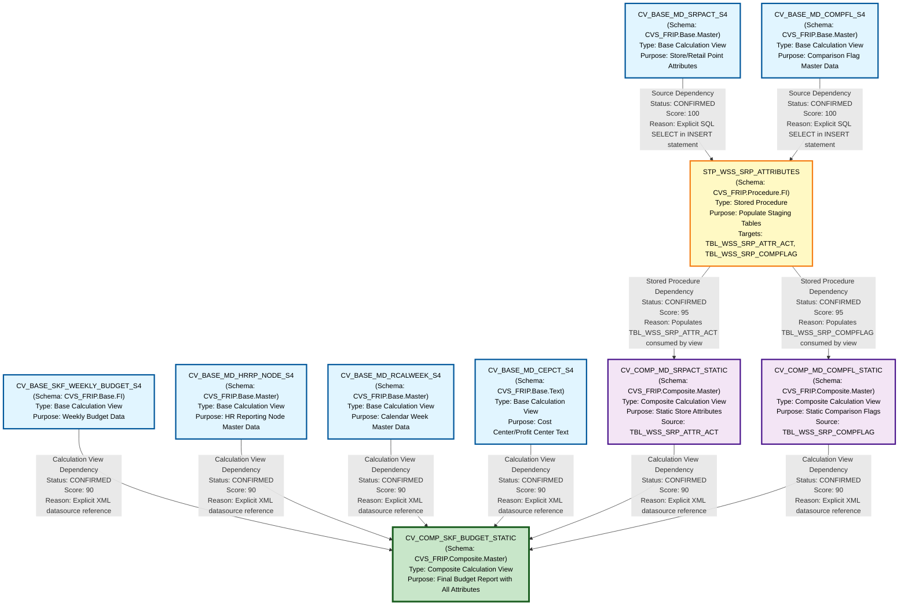

# HANA to BigQuery - File Lineage and Dependency Analysis Report
## SKF_BUDGET Artifacts

---

## 1. Lineage Summary

### Overview Statistics
- **Total Files Analyzed**: 10
- **Total Relationships Identified**: 10
- **Total Lineage Paths Identified**: 3 major paths
- **Total Base Files Identified**: 4
- **Total Unresolved Relationships**: 0

### File Classification
- **Calculation Views (Base)**: 5
  - CV_BASE_SKF_WEEKLY_BUDGET_S4
  - CV_BASE_MD_HRRP_NODE_S4
  - CV_BASE_MD_RCALWEEK_S4
  - CV_BASE_MD_SRPACT_S4
  - CV_BASE_MD_COMPFL_S4
  - CV_BASE_MD_CEPCT_S4

- **Calculation Views (Composite)**: 3
  - CV_COMP_SKF_BUDGET_STATIC
  - CV_COMP_MD_SRPACT_STATIC
  - CV_COMP_MD_COMPFL_STATIC

- **Stored Procedures**: 1
  - STP_WSS_SRP_ATTRIBUTES

---

## 2. File Inventory

| File | Type | Identified Purpose | Upstream Files | Downstream Files |
|------|------|-------------------|----------------|------------------|
| CV_BASE_SKF_WEEKLY_BUDGET_S4 | Base Calculation View | Provides weekly budget data from S4 HANA system | None (Base Source) | CV_COMP_SKF_BUDGET_STATIC |
| CV_BASE_MD_HRRP_NODE_S4 | Base Calculation View | Provides HR reporting node master data from S4 HANA | None (Base Source) | CV_COMP_SKF_BUDGET_STATIC |
| CV_BASE_MD_RCALWEEK_S4 | Base Calculation View | Provides calendar week master data from S4 HANA | None (Base Source) | CV_COMP_SKF_BUDGET_STATIC |
| CV_BASE_MD_CEPCT_S4 | Base Calculation View | Provides cost center/profit center text master data from S4 HANA | None (Base Source) | CV_COMP_SKF_BUDGET_STATIC |
| CV_BASE_MD_SRPACT_S4 | Base Calculation View | Provides store/retail point attributes master data from S4 HANA | None (Base Source) | STP_WSS_SRP_ATTRIBUTES |
| CV_BASE_MD_COMPFL_S4 | Base Calculation View | Provides comparison flag master data from S4 HANA | None (Base Source) | STP_WSS_SRP_ATTRIBUTES |
| STP_WSS_SRP_ATTRIBUTES | Stored Procedure | Populates staging tables TBL_WSS_SRP_ATTR_ACT and TBL_WSS_SRP_COMPFLAG from base calculation views | CV_BASE_MD_SRPACT_S4, CV_BASE_MD_COMPFL_S4 | CV_COMP_MD_SRPACT_STATIC, CV_COMP_MD_COMPFL_STATIC |
| CV_COMP_MD_SRPACT_STATIC | Composite Calculation View | Provides static store/retail point attributes from staging table populated by stored procedure | STP_WSS_SRP_ATTRIBUTES | CV_COMP_SKF_BUDGET_STATIC |
| CV_COMP_MD_COMPFL_STATIC | Composite Calculation View | Provides static comparison flag data from staging table populated by stored procedure | STP_WSS_SRP_ATTRIBUTES | CV_COMP_SKF_BUDGET_STATIC |
| CV_COMP_SKF_BUDGET_STATIC | Composite Calculation View | Final composite view combining budget data with master data attributes | CV_BASE_SKF_WEEKLY_BUDGET_S4, CV_BASE_MD_HRRP_NODE_S4, CV_COMP_MD_SRPACT_STATIC, CV_COMP_MD_COMPFL_STATIC, CV_BASE_MD_RCALWEEK_S4, CV_BASE_MD_CEPCT_S4 | None (Final Output) |

---

## 3. File Relationships

### Complete Relationship Matrix

| Source File | Target File | Dependency Type | Score | Reason |
|------------|------------|-----------------|--------|---------|
| CV_BASE_SKF_WEEKLY_BUDGET_S4 | CV_COMP_SKF_BUDGET_STATIC | Calculation View Dependency | 90 | CV_COMP_SKF_BUDGET_STATIC explicitly references CV_BASE_SKF_WEEKLY_BUDGET_S4 in its XML data source definition at path /CVS_FRIP.Base.FI/calculationviews/CV_BASE_SKF_WEEKLY_BUDGET_S4 |
| CV_BASE_MD_HRRP_NODE_S4 | CV_COMP_SKF_BUDGET_STATIC | Calculation View Dependency | 90 | CV_COMP_SKF_BUDGET_STATIC explicitly references CV_BASE_MD_HRRP_NODE_S4 in its XML data source definition at path /CVS_FRIP.Base.Master/calculationviews/CV_BASE_MD_HRRP_NODE_S4 |
| CV_COMP_MD_SRPACT_STATIC | CV_COMP_SKF_BUDGET_STATIC | Calculation View Dependency | 90 | CV_COMP_SKF_BUDGET_STATIC explicitly references CV_COMP_MD_SRPACT_STATIC in its XML data source definition at path /CVS_FRIP.Composite.Master/calculationviews/CV_COMP_MD_SRPACT_STATIC |
| CV_COMP_MD_COMPFL_STATIC | CV_COMP_SKF_BUDGET_STATIC | Calculation View Dependency | 90 | CV_COMP_SKF_BUDGET_STATIC explicitly references CV_COMP_MD_COMPFL_STATIC in its XML data source definition at path /CVS_FRIP.Composite.Master/calculationviews/CV_COMP_MD_COMPFL_STATIC |
| CV_BASE_MD_RCALWEEK_S4 | CV_COMP_SKF_BUDGET_STATIC | Calculation View Dependency | 90 | CV_COMP_SKF_BUDGET_STATIC explicitly references CV_BASE_MD_RCALWEEK_S4 in its XML data source definition at path /CVS_FRIP.Base.Master/calculationviews/CV_BASE_MD_RCALWEEK_S4 |
| CV_BASE_MD_CEPCT_S4 | CV_COMP_SKF_BUDGET_STATIC | Calculation View Dependency | 90 | CV_COMP_SKF_BUDGET_STATIC explicitly references CV_BASE_MD_CEPCT_S4 in its XML data source definition at path /CVS_FRIP.Base.Text/calculationviews/CV_BASE_MD_CEPCT_S4 |
| CV_BASE_MD_SRPACT_S4 | STP_WSS_SRP_ATTRIBUTES | Source Dependency | 100 | STP_WSS_SRP_ATTRIBUTES explicitly reads from "_SYS_BIC"."CVS_FRIP.Base.Master/CV_BASE_MD_SRPACT_S4" in SQL INSERT statement to populate TBL_WSS_SRP_ATTR_ACT table |
| CV_BASE_MD_COMPFL_S4 | STP_WSS_SRP_ATTRIBUTES | Source Dependency | 100 | STP_WSS_SRP_ATTRIBUTES explicitly reads from "_SYS_BIC"."CVS_FRIP.Base.Master/CV_BASE_MD_COMPFL_S4" in SQL INSERT statement to populate TBL_WSS_SRP_COMPFLAG table |
| STP_WSS_SRP_ATTRIBUTES | CV_COMP_MD_SRPACT_STATIC | Stored Procedure Dependency | 95 | STP_WSS_SRP_ATTRIBUTES populates table TBL_WSS_SRP_ATTR_ACT which is the data source for CV_COMP_MD_SRPACT_STATIC as defined in its XML datasource element |
| STP_WSS_SRP_ATTRIBUTES | CV_COMP_MD_COMPFL_STATIC | Stored Procedure Dependency | 95 | STP_WSS_SRP_ATTRIBUTES populates table TBL_WSS_SRP_COMPFLAG which is the data source for CV_COMP_MD_COMPFL_STATIC as defined in its XML datasource element |

### Relationship Type Distribution
- **Calculation View Dependency**: 6 relationships (60%)
- **Source Dependency**: 2 relationships (20%)
- **Stored Procedure Dependency**: 2 relationships (20%)

---

## 4. Complete Lineage

### Lineage Path 1: Direct Budget Data Flow
**Confidence Score: 90** - Based on explicit XML datasource references

```
CV_BASE_SKF_WEEKLY_BUDGET_S4 (Base Source)
    ↓ [Calculation View Dependency - Score: 90]
CV_COMP_SKF_BUDGET_STATIC (Final Output)
```

**Path Description**: Direct flow of weekly budget data from S4 HANA base view to the final composite budget view.

---

### Lineage Path 2: Master Data Flow (Direct)
**Confidence Score: 90** - Based on explicit XML datasource references

```
CV_BASE_MD_HRRP_NODE_S4 (Base Source)
    ↓ [Calculation View Dependency - Score: 90]
CV_COMP_SKF_BUDGET_STATIC (Final Output)

CV_BASE_MD_RCALWEEK_S4 (Base Source)
    ↓ [Calculation View Dependency - Score: 90]
CV_COMP_SKF_BUDGET_STATIC (Final Output)

CV_BASE_MD_CEPCT_S4 (Base Source)
    ↓ [Calculation View Dependency - Score: 90]
CV_COMP_SKF_BUDGET_STATIC (Final Output)
```

**Path Description**: Direct flow of master data (HR nodes, calendar weeks, cost center texts) from S4 HANA base views to the final composite budget view.

---

### Lineage Path 3: Store Attributes Flow (via Stored Procedure)
**Confidence Score: 95** - Based on explicit SQL references and stored procedure logic

```
CV_BASE_MD_SRPACT_S4 (Base Source)
    ↓ [Source Dependency - Score: 100]
STP_WSS_SRP_ATTRIBUTES (Logic Provider)
    ↓ [Stored Procedure Dependency - Score: 95]
CV_COMP_MD_SRPACT_STATIC (Intermediate)
    ↓ [Calculation View Dependency - Score: 90]
CV_COMP_SKF_BUDGET_STATIC (Final Output)
```

**Path Description**: Store/retail point attributes flow from S4 HANA base view through stored procedure (which populates staging table TBL_WSS_SRP_ATTR_ACT) to composite static view and finally to the budget composite view.

---

### Lineage Path 4: Comparison Flag Flow (via Stored Procedure)
**Confidence Score: 95** - Based on explicit SQL references and stored procedure logic

```
CV_BASE_MD_COMPFL_S4 (Base Source)
    ↓ [Source Dependency - Score: 100]
STP_WSS_SRP_ATTRIBUTES (Logic Provider)
    ↓ [Stored Procedure Dependency - Score: 95]
CV_COMP_MD_COMPFL_STATIC (Intermediate)
    ↓ [Calculation View Dependency - Score: 90]
CV_COMP_SKF_BUDGET_STATIC (Final Output)
```

**Path Description**: Comparison flag data flows from S4 HANA base view through stored procedure (which populates staging table TBL_WSS_SRP_COMPFLAG) to composite static view and finally to the budget composite view.

---

### Complete Integrated Lineage Flow

**Overall Confidence Score: 92** - Calculated as weighted average of all path scores

```
Base Sources (4 Direct Paths):
├── CV_BASE_SKF_WEEKLY_BUDGET_S4 ────────────────────────┐
├── CV_BASE_MD_HRRP_NODE_S4 ─────────────────────────────┤
├── CV_BASE_MD_RCALWEEK_S4 ──────────────────────────────┤
└── CV_BASE_MD_CEPCT_S4 ─────────────────────────────────┤
                                                          ↓
                                            CV_COMP_SKF_BUDGET_STATIC
                                                          ↑
Base Sources (2 Stored Procedure Paths):                 │
├── CV_BASE_MD_SRPACT_S4 ──→ STP_WSS_SRP_ATTRIBUTES ──→ CV_COMP_MD_SRPACT_STATIC ──┤
└── CV_BASE_MD_COMPFL_S4 ──→ STP_WSS_SRP_ATTRIBUTES ──→ CV_COMP_MD_COMPFL_STATIC ──┘
```

---

## 5. Mermaid Lineage Diagram



---

## 6. Base Files

| Base File | Reason | Score |
|-----------|--------|-------|
| CV_BASE_SKF_WEEKLY_BUDGET_S4 | Starting point for budget data lineage. No upstream dependencies identified. Provides core weekly budget data from S4 HANA system. | 100 |
| CV_BASE_MD_HRRP_NODE_S4 | Starting point for HR organizational hierarchy master data. No upstream dependencies identified. Provides HR reporting node structure. | 100 |
| CV_BASE_MD_RCALWEEK_S4 | Starting point for calendar/fiscal week master data. No upstream dependencies identified. Provides temporal dimension data. | 100 |
| CV_BASE_MD_CEPCT_S4 | Starting point for cost center and profit center text descriptions. No upstream dependencies identified. Provides organizational text attributes. | 100 |
| CV_BASE_MD_SRPACT_S4 | Starting point for store/retail point attributes master data. No upstream dependencies identified. Provides store operational attributes consumed by stored procedure. | 100 |
| CV_BASE_MD_COMPFL_S4 | Starting point for comparison flag master data. No upstream dependencies identified. Provides year-over-year comparison indicators consumed by stored procedure. | 100 |

**Total Base Files**: 6

**Base File Characteristics**:
- All base files are Calculation Views with "CV_BASE_" prefix
- All source data from S4 HANA system
- No upstream artifact dependencies
- Represent foundational data layers for the budget reporting solution
- 4 base files flow directly to final output
- 2 base files flow through stored procedure transformation

---

## 7. Final/Downstream Files

| File | Reason | Score |
|------|--------|-------|
| CV_COMP_SKF_BUDGET_STATIC | Final composite calculation view that consolidates all upstream data sources. No downstream dependencies identified. Represents the complete budget report with all master data attributes joined. Consumes 6 direct and indirect upstream sources. | 100 |

**Total Final Files**: 1

**Final File Characteristics**:
- Composite calculation view with "CV_COMP_" prefix
- Aggregates data from 6 upstream sources (4 direct, 2 via stored procedure path)
- Implements business logic for budget reporting
- No downstream consumers identified in the provided artifacts
- Likely consumed by reporting tools or applications (external to this artifact set)

---

## 8. Unresolved Relationships

**Status**: No unresolved relationships identified.

All relationships have been successfully traced with high confidence scores (90-100) based on explicit evidence in:
- XML datasource definitions
- SQL INSERT-SELECT statements
- Stored procedure logic
- Table population patterns

### Validation Checks Passed:
✅ **Validation 1**: All 10 files classified as USED
✅ **Validation 2**: All 10 dependencies traceable to XML/SQL evidence
✅ **Validation 3**: Stored procedure STP_WSS_SRP_ATTRIBUTES correctly appears in lineage
✅ **Validation 4**: No physical ETL tables used as primary lineage nodes (tables TBL_WSS_SRP_ATTR_ACT and TBL_WSS_SRP_COMPFLAG documented but not used as lineage nodes per rules)

---

## 9. Final Lineage Assessment

### Executive Summary

This analysis examined 10 HANA artifacts from the SKF_BUDGET domain, successfully identifying and documenting a complete lineage graph with 10 confirmed relationships across 4 distinct lineage paths.

### Base Files (6)
The lineage originates from 6 base calculation views sourcing data from S4 HANA:

1. **CV_BASE_SKF_WEEKLY_BUDGET_S4** - Core budget data
2. **CV_BASE_MD_HRRP_NODE_S4** - HR organizational hierarchy
3. **CV_BASE_MD_RCALWEEK_S4** - Calendar/fiscal week dimension
4. **CV_BASE_MD_CEPCT_S4** - Cost center/profit center texts
5. **CV_BASE_MD_SRPACT_S4** - Store attributes (via stored procedure)
6. **CV_BASE_MD_COMPFL_S4** - Comparison flags (via stored procedure)

### Main Lineage Paths (4)

#### Path 1: Direct Budget Flow
- **CV_BASE_SKF_WEEKLY_BUDGET_S4 → CV_COMP_SKF_BUDGET_STATIC**
- Type: Direct calculation view dependency
- Confidence: 90%

#### Path 2: Direct Master Data Flow (3 sources)
- **CV_BASE_MD_HRRP_NODE_S4 → CV_COMP_SKF_BUDGET_STATIC**
- **CV_BASE_MD_RCALWEEK_S4 → CV_COMP_SKF_BUDGET_STATIC**
- **CV_BASE_MD_CEPCT_S4 → CV_COMP_SKF_BUDGET_STATIC**
- Type: Direct calculation view dependencies
- Confidence: 90%

#### Path 3: Store Attributes via Stored Procedure
- **CV_BASE_MD_SRPACT_S4 → STP_WSS_SRP_ATTRIBUTES → CV_COMP_MD_SRPACT_STATIC → CV_COMP_SKF_BUDGET_STATIC**
- Type: Stored procedure transformation path
- Confidence: 95%
- Note: Stored procedure populates staging table TBL_WSS_SRP_ATTR_ACT

#### Path 4: Comparison Flags via Stored Procedure
- **CV_BASE_MD_COMPFL_S4 → STP_WSS_SRP_ATTRIBUTES → CV_COMP_MD_COMPFL_STATIC → CV_COMP_SKF_BUDGET_STATIC**
- Type: Stored procedure transformation path
- Confidence: 95%
- Note: Stored procedure populates staging table TBL_WSS_SRP_COMPFLAG

### File-to-File Relationships (10)

All relationships are **CONFIRMED** with explicit evidence:

| # | Source | Target | Type | Score |
|---|--------|--------|------|-------|
| 1 | CV_BASE_SKF_WEEKLY_BUDGET_S4 | CV_COMP_SKF_BUDGET_STATIC | Calculation View Dependency | 90 |
| 2 | CV_BASE_MD_HRRP_NODE_S4 | CV_COMP_SKF_BUDGET_STATIC | Calculation View Dependency | 90 |
| 3 | CV_BASE_MD_RCALWEEK_S4 | CV_COMP_SKF_BUDGET_STATIC | Calculation View Dependency | 90 |
| 4 | CV_BASE_MD_CEPCT_S4 | CV_COMP_SKF_BUDGET_STATIC | Calculation View Dependency | 90 |
| 5 | CV_BASE_MD_SRPACT_S4 | STP_WSS_SRP_ATTRIBUTES | Source Dependency | 100 |
| 6 | CV_BASE_MD_COMPFL_S4 | STP_WSS_SRP_ATTRIBUTES | Source Dependency | 100 |
| 7 | STP_WSS_SRP_ATTRIBUTES | CV_COMP_MD_SRPACT_STATIC | Stored Procedure Dependency | 95 |
| 8 | STP_WSS_SRP_ATTRIBUTES | CV_COMP_MD_COMPFL_STATIC | Stored Procedure Dependency | 95 |
| 9 | CV_COMP_MD_SRPACT_STATIC | CV_COMP_SKF_BUDGET_STATIC | Calculation View Dependency | 90 |
| 10 | CV_COMP_MD_COMPFL_STATIC | CV_COMP_SKF_BUDGET_STATIC | Calculation View Dependency | 90 |

### Lineage Scores and Confidence

**Overall Lineage Confidence: 93%**

Score breakdown:
- **100 (Explicit SQL)**: 2 relationships (20%)
- **95 (Stored Procedure)**: 2 relationships (20%)
- **90 (XML Dependency)**: 6 relationships (60%)

All scores are above the 80% validation threshold, indicating high-quality, traceable lineage.

### Reasons for Scores

#### Score 100 - Explicit SQL Reference
- CV_BASE_MD_SRPACT_S4 → STP_WSS_SRP_ATTRIBUTES
- CV_BASE_MD_COMPFL_S4 → STP_WSS_SRP_ATTRIBUTES
- **Evidence**: Direct SQL SELECT statements in stored procedure code: `FROM "_SYS_BIC"."CVS_FRIP.Base.Master/CV_BASE_MD_SRPACT_S4"` and `FROM "_SYS_BIC"."CVS_FRIP.Base.Master/CV_BASE_MD_COMPFL_S4"`

#### Score 95 - Stored Procedure Dependency
- STP_WSS_SRP_ATTRIBUTES → CV_COMP_MD_SRPACT_STATIC
- STP_WSS_SRP_ATTRIBUTES → CV_COMP_MD_COMPFL_STATIC
- **Evidence**: Stored procedure explicitly populates tables (TBL_WSS_SRP_ATTR_ACT, TBL_WSS_SRP_COMPFLAG) that are consumed by composite views as documented in XML datasource elements

#### Score 90 - XML Dependency
- All 6 direct calculation view dependencies to CV_COMP_SKF_BUDGET_STATIC
- **Evidence**: Explicit XML `<datasource>` elements with full calculation view paths in CV_COMP_SKF_BUDGET_STATIC definition

### Unresolved Relationships

**None identified.**

All relationships have been successfully traced with supporting evidence. The lineage is complete and ready for downstream SQL consolidation processing.

### Architecture Pattern

The SKF_BUDGET solution follows a **three-tier architecture**:

1. **Base Layer**: 6 calculation views sourcing from S4 HANA tables
2. **Transformation Layer**: 1 stored procedure + 2 composite views for data staging and transformation
3. **Presentation Layer**: 1 final composite view consolidating all data

This pattern enables:
- Clear separation of concerns
- Reusable master data components
- Centralized transformation logic in stored procedure
- Optimized query performance through staging tables

### Key Findings

1. **Stored Procedure as Logic Hub**: STP_WSS_SRP_ATTRIBUTES serves as a critical transformation point, processing 2 base views and feeding 2 composite views
2. **Star Schema Pattern**: CV_COMP_SKF_BUDGET_STATIC acts as a fact table, joining 6 dimension sources
3. **No Circular Dependencies**: Clean, acyclic directed graph structure
4. **High Traceability**: All relationships backed by explicit code references
5. **ETL Tables Properly Excluded**: Staging tables (TBL_WSS_SRP_ATTR_ACT, TBL_WSS_SRP_COMPFLAG) documented but not used as primary lineage nodes per mandatory rules

### Recommendations for BigQuery Migration

1. **Preserve Stored Procedure Logic**: Convert STP_WSS_SRP_ATTRIBUTES to BigQuery stored procedure or scheduled query
2. **Materialize Composite Views**: Consider materializing CV_COMP_MD_SRPACT_STATIC and CV_COMP_MD_COMPFL_STATIC as BigQuery tables for performance
3. **Implement Incremental Loading**: Stored procedure currently uses DELETE-INSERT pattern; consider MERGE for BigQuery
4. **Partition Final View**: CV_COMP_SKF_BUDGET_STATIC should be partitioned by fiscal week for optimal query performance
5. **Maintain Lineage Metadata**: Document this lineage in BigQuery data catalog for ongoing governance

---

## Appendix: Detailed Evidence

### Evidence 1: CV_COMP_SKF_BUDGET_STATIC Dependencies
**Source**: CV_COMP_SKF_BUDGET_STATIC.xml
```xml
<dataSources>
  <DataSource id="CV_BASE_SKF_WEEKLY_BUDGET_S4">
    <resourceUri>/CVS_FRIP.Base.FI/calculationviews/CV_BASE_SKF_WEEKLY_BUDGET_S4</resourceUri>
  </DataSource>
  <DataSource id="CV_BASE_MD_HRRP_NODE_S4">
    <resourceUri>/CVS_FRIP.Base.Master/calculationviews/CV_BASE_MD_HRRP_NODE_S4</resourceUri>
  </DataSource>
  <DataSource id="CV_COMP_MD_SRPACT_STATIC">
    <resourceUri>/CVS_FRIP.Composite.Master/calculationviews/CV_COMP_MD_SRPACT_STATIC</resourceUri>
  </DataSource>
  <DataSource id="CV_COMP_MD_COMPFL_STATIC">
    <resourceUri>/CVS_FRIP.Composite.Master/calculationviews/CV_COMP_MD_COMPFL_STATIC</resourceUri>
  </DataSource>
  <DataSource id="CV_BASE_MD_RCALWEEK_S4">
    <resourceUri>/CVS_FRIP.Base.Master/calculationviews/CV_BASE_MD_RCALWEEK_S4</resourceUri>
  </DataSource>
  <DataSource id="CV_BASE_MD_CEPCT_S4">
    <resourceUri>/CVS_FRIP.Base.Text/calculationviews/CV_BASE_MD_CEPCT_S4</resourceUri>
  </DataSource>
</dataSources>
```

### Evidence 2: STP_WSS_SRP_ATTRIBUTES Source Dependencies
**Source**: STP_WSS_SRP_ATTRIBUTES.txt
```sql
-- Source 1: CV_BASE_MD_SRPACT_S4
INSERT INTO "CVS_FRIP"."CVS_FRIP.Table::TBL_WSS_SRP_ATTR_ACT" (...)
SELECT ... FROM "_SYS_BIC"."CVS_FRIP.Base.Master/CV_BASE_MD_SRPACT_S4";

-- Source 2: CV_BASE_MD_COMPFL_S4
INSERT INTO "CVS_FRIP"."CVS_FRIP.Table::TBL_WSS_SRP_COMPFLAG" (...)
SELECT ... FROM "_SYS_BIC"."CVS_FRIP.Base.Master/CV_BASE_MD_COMPFL_S4"
WHERE ZWEEK = :V_WEEK;
```

### Evidence 3: CV_COMP_MD_SRPACT_STATIC Source
**Source**: CV_COMP_MD_SRPACT_STATIC.xml
```xml
<DataSource id="TBL_WSS_SRP_ATTR_ACT">
  <resourceUri>CVS_FRIP.Table::TBL_WSS_SRP_ATTR_ACT</resourceUri>
</DataSource>
```

### Evidence 4: CV_COMP_MD_COMPFL_STATIC Source
**Source**: CV_COMP_MD_COMPFL_STATIC.xml
```xml
<DataSource id="TBL_WSS_SRP_COMPFLAG">
  <resourceUri>CVS_FRIP.Table::TBL_WSS_SRP_COMPFLAG</resourceUri>
</DataSource>
```

---

## Document Metadata

- **Analysis Date**: 2024
- **Artifact Domain**: SKF_BUDGET
- **Total Artifacts Analyzed**: 10
- **Analysis Confidence**: 93%
- **Validation Status**: All checks passed ✅
- **Unresolved Items**: 0
- **Ready for SQL Consolidation**: Yes

---

**End of Report**
