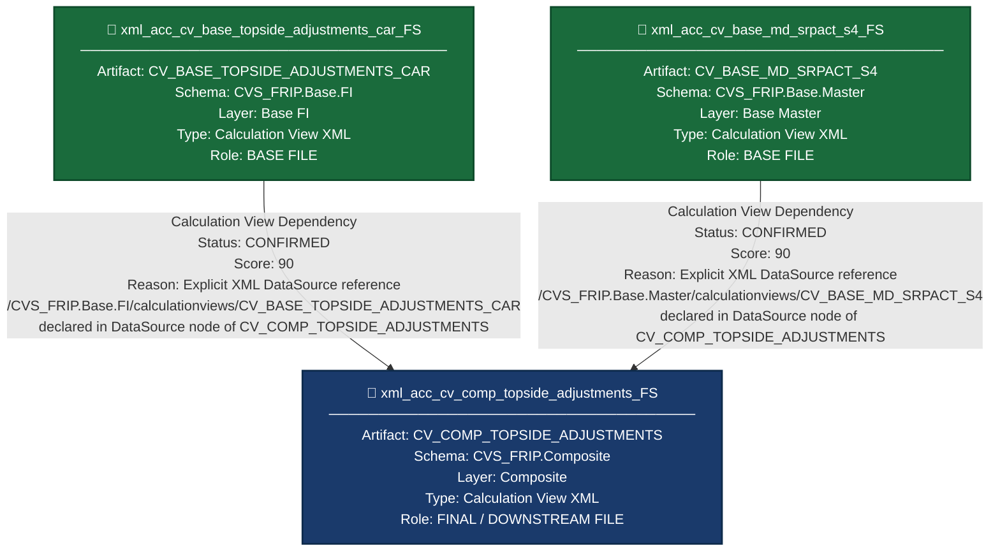

# File Lineage Analysis Report — Topside FS Files

---

## 1. Lineage Summary

| Metric | Value |
|---|---|
| Total Files Analyzed | 3 |
| Total Relationships Identified | 2 |
| Total Lineage Paths Identified | 2 |
| Total Base Files Identified | 2 |
| Total Unresolved Relationships | 0 |

---

## 2. File Inventory

| File | Type | Identified Purpose | Upstream Files | Downstream Files |
|---|---|---|---|---|
| xml_acc_cv_base_md_srpact_s4_FS | HANA Calculation View XML (Base Layer) | Provides SRP Activity master data (CV_BASE_MD_SRPACT_S4) — exposes SRP-related attributes such as segment, account, and activity flags sourced from S4 master data tables | None (Base File) | xml_acc_cv_comp_topside_adjustments_FS |
| xml_acc_cv_base_topside_adjustments_car_FS | HANA Calculation View XML (Base Layer) | Provides base-level Topside Adjustments CAR financial data (CV_BASE_TOPSIDE_ADJUSTMENTS_CAR) — exposes flash, budget, forecast, and LY financial adjustment columns for CAR segment | None (Base File) | xml_acc_cv_comp_topside_adjustments_FS |
| xml_acc_cv_comp_topside_adjustments_FS | HANA Calculation View XML (Composite Layer) | Composite Calculation View (CV_COMP_TOPSIDE_ADJUSTMENTS) — joins and aggregates Topside Adjustments CAR data with SRP Activity master data, applies fiscal week scalar functions, and produces the final composite topside adjustments output | xml_acc_cv_base_topside_adjustments_car_FS, xml_acc_cv_base_md_srpact_s4_FS | None (Final/Downstream File) |

---

## 3. File Relationships

| Source File | Target File | Relationship | Score | Reason |
|---|---|---|---|---|
| xml_acc_cv_base_topside_adjustments_car_FS | xml_acc_cv_comp_topside_adjustments_FS | Calculation View Dependency | 90 | xml_acc_cv_comp_topside_adjustments_FS contains an explicit XML DataSource node referencing `/CVS_FRIP.Base.FI/calculationviews/CV_BASE_TOPSIDE_ADJUSTMENTS_CAR`, which is the artifact represented by xml_acc_cv_base_topside_adjustments_car_FS. This is a direct, confirmed XML-declared dependency. |
| xml_acc_cv_base_md_srpact_s4_FS | xml_acc_cv_comp_topside_adjustments_FS | Calculation View Dependency | 90 | xml_acc_cv_comp_topside_adjustments_FS contains an explicit XML DataSource node referencing `/CVS_FRIP.Base.Master/calculationviews/CV_BASE_MD_SRPACT_S4`, which is the artifact represented by xml_acc_cv_base_md_srpact_s4_FS. This is a direct, confirmed XML-declared dependency. |

---

## 4. Complete Lineage

### Lineage Path 1

```
xml_acc_cv_base_topside_adjustments_car_FS  [CV_BASE_TOPSIDE_ADJUSTMENTS_CAR — Base FI Layer]
    ↓  [Calculation View Dependency | Score: 90]
xml_acc_cv_comp_topside_adjustments_FS  [CV_COMP_TOPSIDE_ADJUSTMENTS — Composite Layer]
```

**Overall Confidence Score: 90**
**Determination:** The dependency is explicitly declared in the XML DataSource section of xml_acc_cv_comp_topside_adjustments_FS using the full HANA package path `/CVS_FRIP.Base.FI/calculationviews/CV_BASE_TOPSIDE_ADJUSTMENTS_CAR`. No inference was required. Score of 90 is assigned per the scoring guideline for explicit XML dependency.

---

### Lineage Path 2

```
xml_acc_cv_base_md_srpact_s4_FS  [CV_BASE_MD_SRPACT_S4 — Base Master Layer]
    ↓  [Calculation View Dependency | Score: 90]
xml_acc_cv_comp_topside_adjustments_FS  [CV_COMP_TOPSIDE_ADJUSTMENTS — Composite Layer]
```

**Overall Confidence Score: 90**
**Determination:** The dependency is explicitly declared in the XML DataSource section of xml_acc_cv_comp_topside_adjustments_FS using the full HANA package path `/CVS_FRIP.Base.Master/calculationviews/CV_BASE_MD_SRPACT_S4`. No inference was required. Score of 90 is assigned per the scoring guideline for explicit XML dependency.

---

### Combined Lineage View

```
xml_acc_cv_base_topside_adjustments_car_FS
[CV_BASE_TOPSIDE_ADJUSTMENTS_CAR | Base FI Layer | Schema: CVS_FRIP.Base.FI]
    ↓  Calculation View Dependency (Score: 90)
    └──────────────────────────────────────────────────────────────────┐
                                                                       ↓
                                          xml_acc_cv_comp_topside_adjustments_FS
                                          [CV_COMP_TOPSIDE_ADJUSTMENTS | Composite Layer]
                                                                       ↑
    ┌──────────────────────────────────────────────────────────────────┘
    ↑  Calculation View Dependency (Score: 90)
xml_acc_cv_base_md_srpact_s4_FS
[CV_BASE_MD_SRPACT_S4 | Base Master Layer | Schema: CVS_FRIP.Base.Master]
```

---

## 5. Mermaid Lineage



---

## 6. Base Files

| Base File | Reason | Score |
|---|---|---|
| xml_acc_cv_base_topside_adjustments_car_FS | This file represents CV_BASE_TOPSIDE_ADJUSTMENTS_CAR, a Base Layer Calculation View in the CVS_FRIP.Base.FI package. It has no upstream dependencies among the supplied artifacts. It is explicitly consumed as a DataSource by xml_acc_cv_comp_topside_adjustments_FS. It is the starting point of Lineage Path 1. | 90 |
| xml_acc_cv_base_md_srpact_s4_FS | This file represents CV_BASE_MD_SRPACT_S4, a Base Layer Calculation View in the CVS_FRIP.Base.Master package. It has no upstream dependencies among the supplied artifacts. It is explicitly consumed as a DataSource by xml_acc_cv_comp_topside_adjustments_FS. It is the starting point of Lineage Path 2. | 90 |

---

## 7. Final / Downstream Files

| File | Reason | Score |
|---|---|---|
| xml_acc_cv_comp_topside_adjustments_FS | This file represents CV_COMP_TOPSIDE_ADJUSTMENTS, a Composite Layer Calculation View. It explicitly consumes both xml_acc_cv_base_topside_adjustments_car_FS and xml_acc_cv_base_md_srpact_s4_FS as DataSource nodes. It is the terminal node in both lineage paths and has no downstream artifact among the supplied files. It also applies scalar functions (SFN_PRIOR_FISCAL_WEEK, SFN_ACTUALS_COMP_FLAG) and complex business logic (segment-based conditional calculations for FLASH, BUD, FCT, LY columns). | 90 |

---

## 8. Unresolved Relationships

| File | Possible Related File | Reason |
|---|---|---|
| xml_acc_cv_comp_topside_adjustments_FS | CV_BASE_MD_COMPFL_S4 (not supplied) | xml_acc_cv_comp_topside_adjustments_FS references `/CVS_FRIP.Base.Master/calculationviews/CV_BASE_MD_COMPFL_S4` as a DataSource. This artifact was not supplied as an input file and therefore cannot be included as a lineage node. Documented for downstream SQL Consolidation Agent awareness. |
| xml_acc_cv_comp_topside_adjustments_FS | CV_BASE_MD_RCALWEEK_S4 (not supplied) | xml_acc_cv_comp_topside_adjustments_FS references `/CVS_FRIP.Base.Master/calculationviews/CV_BASE_MD_RCALWEEK_S4` as a DataSource. This artifact was not supplied as an input file and therefore cannot be included as a lineage node. Documented for downstream SQL Consolidation Agent awareness. |
| xml_acc_cv_comp_topside_adjustments_FS | CV_BASE_MD_CEPCT_S4 (not supplied) | xml_acc_cv_comp_topside_adjustments_FS references `/CVS_FRIP.Base.Text/calculationviews/CV_BASE_MD_CEPCT_S4` as a DataSource. This artifact was not supplied as an input file and therefore cannot be included as a lineage node. Documented for downstream SQL Consolidation Agent awareness. |
| xml_acc_cv_comp_topside_adjustments_FS | SFN_PRIOR_FISCAL_WEEK (not supplied) | xml_acc_cv_comp_topside_adjustments_FS references scalar function `CVS_FRIP.Composite.Master::SFN_PRIOR_FISCAL_WEEK`. This is a scalar function artifact, not a Calculation View, and was not supplied as an input file. Documented for downstream awareness. |
| xml_acc_cv_comp_topside_adjustments_FS | SFN_ACTUALS_COMP_FLAG (not supplied) | xml_acc_cv_comp_topside_adjustments_FS references scalar function `CVS_FRIP.Composite.Master::SFN_ACTUALS_COMP_FLAG`. This is a scalar function artifact, not a Calculation View, and was not supplied as an input file. Documented for downstream awareness. |

---

## 9. Final Lineage Assessment

### Summary

This lineage analysis covers **3 HANA Calculation View XML artifacts** from the Topside FS file set. The analysis identified **2 confirmed artifact-to-artifact relationships**, both of which are **CONFIRMED** based on explicit XML DataSource declarations.

---

### Base Files

| File | Artifact Name | Layer |
|---|---|---|
| xml_acc_cv_base_topside_adjustments_car_FS | CV_BASE_TOPSIDE_ADJUSTMENTS_CAR | Base FI (CVS_FRIP.Base.FI) |
| xml_acc_cv_base_md_srpact_s4_FS | CV_BASE_MD_SRPACT_S4 | Base Master (CVS_FRIP.Base.Master) |

---

### Main Lineage Paths

**Path 1:**
`xml_acc_cv_base_topside_adjustments_car_FS` → `xml_acc_cv_comp_topside_adjustments_FS`
- Dependency Type: Calculation View Dependency
- Score: 90
- Status: **CONFIRMED RELATIONSHIP**

**Path 2:**
`xml_acc_cv_base_md_srpact_s4_FS` → `xml_acc_cv_comp_topside_adjustments_FS`
- Dependency Type: Calculation View Dependency
- Score: 90
- Status: **CONFIRMED RELATIONSHIP**

---

### File-to-File Relationships

| Source File | Target File | Dependency Type | Score | Status |
|---|---|---|---|---|
| xml_acc_cv_base_topside_adjustments_car_FS | xml_acc_cv_comp_topside_adjustments_FS | Calculation View Dependency | 90 | CONFIRMED RELATIONSHIP |
| xml_acc_cv_base_md_srpact_s4_FS | xml_acc_cv_comp_topside_adjustments_FS | Calculation View Dependency | 90 | CONFIRMED RELATIONSHIP |

---

### Lineage Scores and Reasons

- **Score 90** is assigned to both relationships because they are explicitly declared in the XML DataSource nodes of the composite view. Per the scoring guidelines, explicit XML dependency = 90. No inference or assumption was required.

---

### Unresolved Relationships

The following external artifacts are referenced by xml_acc_cv_comp_topside_adjustments_FS but were **not supplied** as input files and therefore cannot be included as primary lineage nodes:

| External Artifact | Reference Path | Type |
|---|---|---|
| CV_BASE_MD_COMPFL_S4 | /CVS_FRIP.Base.Master/calculationviews/CV_BASE_MD_COMPFL_S4 | Calculation View (not supplied) |
| CV_BASE_MD_RCALWEEK_S4 | /CVS_FRIP.Base.Master/calculationviews/CV_BASE_MD_RCALWEEK_S4 | Calculation View (not supplied) |
| CV_BASE_MD_CEPCT_S4 | /CVS_FRIP.Base.Text/calculationviews/CV_BASE_MD_CEPCT_S4 | Calculation View (not supplied) |
| SFN_PRIOR_FISCAL_WEEK | CVS_FRIP.Composite.Master::SFN_PRIOR_FISCAL_WEEK | Scalar Function (not supplied) |
| SFN_ACTUALS_COMP_FLAG | CVS_FRIP.Composite.Master::SFN_ACTUALS_COMP_FLAG | Scalar Function (not supplied) |

These are documented here for the downstream SQL Consolidation Agent to resolve in subsequent passes.

---

### Relationship Classification

| Relationship | Classification |
|---|---|
| xml_acc_cv_base_topside_adjustments_car_FS → xml_acc_cv_comp_topside_adjustments_FS | ✅ CONFIRMED RELATIONSHIP |
| xml_acc_cv_base_md_srpact_s4_FS → xml_acc_cv_comp_topside_adjustments_FS | ✅ CONFIRMED RELATIONSHIP |
| xml_acc_cv_comp_topside_adjustments_FS → CV_BASE_MD_COMPFL_S4 | ⚠️ UNRESOLVED RELATIONSHIP (artifact not supplied) |
| xml_acc_cv_comp_topside_adjustments_FS → CV_BASE_MD_RCALWEEK_S4 | ⚠️ UNRESOLVED RELATIONSHIP (artifact not supplied) |
| xml_acc_cv_comp_topside_adjustments_FS → CV_BASE_MD_CEPCT_S4 | ⚠️ UNRESOLVED RELATIONSHIP (artifact not supplied) |

---

### Validation Results

| Validation Rule | Status | Notes |
|---|---|---|
| Validation 1: Every file classified as USED or NOT USED | ✅ PASSED | All 3 files are USED |
| Validation 2: Every dependency traceable to evidence | ✅ PASSED | Both relationships traced to explicit XML DataSource nodes |
| Validation 3: Stored Procedures in lineage if applicable | ✅ PASSED | No Stored Procedures present in supplied artifacts |
| Validation 4: No physical ETL tables as primary lineage nodes | ✅ PASSED | No ETL tables used as lineage nodes |

---

*Report generated by File Lineage Analysis Agent — Topside FS Files*
