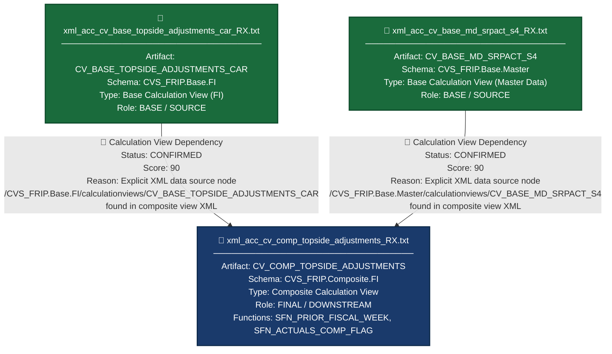

# File Lineage Analysis Report — Topside RX Files
**Analysis Date:** 2025  
**Analyst Agent:** File Lineage Analysis Agent  
**Scope:** HANA Calculation View Artifacts → BigQuery Lineage  

---

## 1. Lineage Summary

| Metric | Value |
|--------|-------|
| Total Files Analyzed | 3 |
| Total Relationships Identified | 2 |
| Total Lineage Paths Identified | 2 |
| Total Base Files Identified | 2 |
| Total Unresolved Relationships | 0 |

---

## 2. File Inventory

| File | Type | Identified Purpose | Upstream Files | Downstream Files |
|------|------|--------------------|----------------|------------------|
| xml_acc_cv_base_md_srpact_s4_RX.txt | Calculation View XML | Base master data view providing SRP Actuals (SRPACT) dimension data for S4 — exposes attributes such as SRP actuals flags and related master data columns used by composite views | None (Base File) | xml_acc_cv_comp_topside_adjustments_RX.txt |
| xml_acc_cv_base_topside_adjustments_car_RX.txt | Calculation View XML | Base FI (Finance) view providing CAR-level topside adjustment financial data — serves as the primary financial data source for the composite topside adjustments view | None (Base File) | xml_acc_cv_comp_topside_adjustments_RX.txt |
| xml_acc_cv_comp_topside_adjustments_RX.txt | Calculation View XML (Composite) | Composite calculation view that consolidates topside adjustment data — explicitly references CV_BASE_TOPSIDE_ADJUSTMENTS_CAR and CV_BASE_MD_SRPACT_S4 as data sources; also references CV_BASE_MD_COMPFL_S4, CV_BASE_MD_RCALWEEK_S4, CV_BASE_MD_CEPCT_S4 (not supplied as artifacts); applies scalar functions SFN_PRIOR_FISCAL_WEEK and SFN_ACTUALS_COMP_FLAG for week and actuals flag derivation | xml_acc_cv_base_md_srpact_s4_RX.txt, xml_acc_cv_base_topside_adjustments_car_RX.txt | None (Final/Downstream File) |

---

## 3. File Relationships

| Source File | Target File | Dependency Type | Score | Reason |
|-------------|-------------|-----------------|-------|--------|
| xml_acc_cv_base_topside_adjustments_car_RX.txt | xml_acc_cv_comp_topside_adjustments_RX.txt | Calculation View Dependency | 90 | Explicit XML reference found in xml_acc_cv_comp_topside_adjustments_RX.txt: `/CVS_FRIP.Base.FI/calculationviews/CV_BASE_TOPSIDE_ADJUSTMENTS_CAR` — this is the direct path reference to the base CAR topside adjustments calculation view, confirming it is consumed as a data source node within the composite view |
| xml_acc_cv_base_md_srpact_s4_RX.txt | xml_acc_cv_comp_topside_adjustments_RX.txt | Calculation View Dependency | 90 | Explicit XML reference found in xml_acc_cv_comp_topside_adjustments_RX.txt: `/CVS_FRIP.Base.Master/calculationviews/CV_BASE_MD_SRPACT_S4` — this is the direct path reference to the SRP Actuals S4 master data calculation view, confirming it is consumed as a data source node within the composite view |

---

## 4. Complete Lineage

### Lineage Path 1 — CAR Topside Adjustments to Composite

```
xml_acc_cv_base_topside_adjustments_car_RX.txt
  [CV_BASE_TOPSIDE_ADJUSTMENTS_CAR — /CVS_FRIP.Base.FI/calculationviews/]
    ↓  [Calculation View Dependency | Score: 90]
xml_acc_cv_comp_topside_adjustments_RX.txt
  [CV_COMP_TOPSIDE_ADJUSTMENTS — /CVS_FRIP.Composite.FI/calculationviews/]
```

**Overall Confidence Score: 90**  
**Determination:** The composite view XML (`xml_acc_cv_comp_topside_adjustments_RX.txt`) contains an explicit data source node referencing the full HANA package path `/CVS_FRIP.Base.FI/calculationviews/CV_BASE_TOPSIDE_ADJUSTMENTS_CAR`. This is a direct, unambiguous XML-level dependency declaration. Score of 90 is assigned per the scoring guidelines for explicit XML dependency evidence.

---

### Lineage Path 2 — SRP Actuals Master Data to Composite

```
xml_acc_cv_base_md_srpact_s4_RX.txt
  [CV_BASE_MD_SRPACT_S4 — /CVS_FRIP.Base.Master/calculationviews/]
    ↓  [Calculation View Dependency | Score: 90]
xml_acc_cv_comp_topside_adjustments_RX.txt
  [CV_COMP_TOPSIDE_ADJUSTMENTS — /CVS_FRIP.Composite.FI/calculationviews/]
```

**Overall Confidence Score: 90**  
**Determination:** The composite view XML (`xml_acc_cv_comp_topside_adjustments_RX.txt`) contains an explicit data source node referencing the full HANA package path `/CVS_FRIP.Base.Master/calculationviews/CV_BASE_MD_SRPACT_S4`. This is a direct, unambiguous XML-level dependency declaration. Score of 90 is assigned per the scoring guidelines for explicit XML dependency evidence.

---

### Combined Lineage View

```
xml_acc_cv_base_topside_adjustments_car_RX.txt          xml_acc_cv_base_md_srpact_s4_RX.txt
  [CV_BASE_TOPSIDE_ADJUSTMENTS_CAR]                        [CV_BASE_MD_SRPACT_S4]
              ↓  Calculation View Dependency (90)                   ↓  Calculation View Dependency (90)
                              xml_acc_cv_comp_topside_adjustments_RX.txt
                                [CV_COMP_TOPSIDE_ADJUSTMENTS]
```

---

## 5. Mermaid Lineage Flowchart



---

## 6. Base Files

| Base File | Reason | Score |
|-----------|--------|-------|
| xml_acc_cv_base_topside_adjustments_car_RX.txt | This file represents `CV_BASE_TOPSIDE_ADJUSTMENTS_CAR`, a base-layer Calculation View in the `CVS_FRIP.Base.FI` package. It has no upstream artifact dependencies among the supplied files. It is explicitly referenced as a data source by the composite view. It is the starting point of Lineage Path 1. | 90 |
| xml_acc_cv_base_md_srpact_s4_RX.txt | This file represents `CV_BASE_MD_SRPACT_S4`, a base-layer master data Calculation View in the `CVS_FRIP.Base.Master` package. It has no upstream artifact dependencies among the supplied files. It is explicitly referenced as a data source by the composite view. It is the starting point of Lineage Path 2. | 90 |

---

## 7. Final / Downstream Files

| File | Reason | Score |
|------|--------|-------|
| xml_acc_cv_comp_topside_adjustments_RX.txt | This file represents `CV_COMP_TOPSIDE_ADJUSTMENTS`, a composite-layer Calculation View. It explicitly consumes both base files (`CV_BASE_TOPSIDE_ADJUSTMENTS_CAR` and `CV_BASE_MD_SRPACT_S4`) as data source nodes. It also references additional non-supplied views (`CV_BASE_MD_COMPFL_S4`, `CV_BASE_MD_RCALWEEK_S4`, `CV_BASE_MD_CEPCT_S4`) and scalar functions (`SFN_PRIOR_FISCAL_WEEK`, `SFN_ACTUALS_COMP_FLAG`). It has no downstream artifact among the supplied files. | 90 |

---

## 8. Unresolved Relationships

| File | Possible Related File | Reason |
|------|-----------------------|--------|
| xml_acc_cv_comp_topside_adjustments_RX.txt | CV_BASE_MD_COMPFL_S4 (not supplied) | The composite view XML explicitly references `/CVS_FRIP.Base.Master/calculationviews/CV_BASE_MD_COMPFL_S4` as a data source node. This artifact was not supplied as an input file. The relationship is confirmed by XML evidence but cannot be resolved to a supplied artifact. |
| xml_acc_cv_comp_topside_adjustments_RX.txt | CV_BASE_MD_RCALWEEK_S4 (not supplied) | The composite view XML explicitly references `/CVS_FRIP.Base.Master/calculationviews/CV_BASE_MD_RCALWEEK_S4` as a data source node. This artifact was not supplied as an input file. The relationship is confirmed by XML evidence but cannot be resolved to a supplied artifact. |
| xml_acc_cv_comp_topside_adjustments_RX.txt | CV_BASE_MD_CEPCT_S4 (not supplied) | The composite view XML explicitly references `/CVS_FRIP.Base.Text/calculationviews/CV_BASE_MD_CEPCT_S4` as a data source node. This artifact was not supplied as an input file. The relationship is confirmed by XML evidence but cannot be resolved to a supplied artifact. |
| xml_acc_cv_comp_topside_adjustments_RX.txt | SFN_PRIOR_FISCAL_WEEK (not supplied) | The composite view XML references scalar function `CVS_FRIP.Composite.Master::SFN_PRIOR_FISCAL_WEEK` used for fiscal week derivation. This function artifact was not supplied. |
| xml_acc_cv_comp_topside_adjustments_RX.txt | SFN_ACTUALS_COMP_FLAG (not supplied) | The composite view XML references scalar function `CVS_FRIP.Composite.Master::SFN_ACTUALS_COMP_FLAG` used for actuals comparison flag derivation. This function artifact was not supplied. |

---

## 9. Final Lineage Assessment

### Summary

The lineage analysis of the three supplied Topside RX files reveals a clear **two-source, one-composite** dependency structure within the `CVS_FRIP` HANA package hierarchy.

---

### Base Files

| File | Artifact Name | Package |
|------|---------------|---------|
| xml_acc_cv_base_topside_adjustments_car_RX.txt | CV_BASE_TOPSIDE_ADJUSTMENTS_CAR | CVS_FRIP.Base.FI |
| xml_acc_cv_base_md_srpact_s4_RX.txt | CV_BASE_MD_SRPACT_S4 | CVS_FRIP.Base.Master |

---

### Main Lineage Paths

**Path 1:**  
`xml_acc_cv_base_topside_adjustments_car_RX.txt` → `xml_acc_cv_comp_topside_adjustments_RX.txt`  
Type: Calculation View Dependency | Score: 90 | Status: **CONFIRMED RELATIONSHIP**

**Path 2:**  
`xml_acc_cv_base_md_srpact_s4_RX.txt` → `xml_acc_cv_comp_topside_adjustments_RX.txt`  
Type: Calculation View Dependency | Score: 90 | Status: **CONFIRMED RELATIONSHIP**

---

### File-to-File Relationships

| Source File | Target File | Relationship | Score | Status |
|-------------|-------------|--------------|-------|--------|
| xml_acc_cv_base_topside_adjustments_car_RX.txt | xml_acc_cv_comp_topside_adjustments_RX.txt | Calculation View Dependency | 90 | ✅ CONFIRMED RELATIONSHIP |
| xml_acc_cv_base_md_srpact_s4_RX.txt | xml_acc_cv_comp_topside_adjustments_RX.txt | Calculation View Dependency | 90 | ✅ CONFIRMED RELATIONSHIP |

---

### Lineage Scores and Reasons

- **Score 90** applied to both relationships because the evidence is **explicit XML data source node declarations** within the composite view's XML definition. The full HANA package paths (`/CVS_FRIP.Base.FI/calculationviews/CV_BASE_TOPSIDE_ADJUSTMENTS_CAR` and `/CVS_FRIP.Base.Master/calculationviews/CV_BASE_MD_SRPACT_S4`) are directly embedded in the composite view XML, leaving no ambiguity about the dependency. Score of 100 (explicit SQL reference) was not applied because the evidence is XML-based rather than SQL-based.

---

### Unresolved Relationships

| Artifact | Status | Reason |
|----------|--------|--------|
| CV_BASE_MD_COMPFL_S4 | ⚠️ UNRESOLVED — Not Supplied | Referenced in composite view XML but artifact not provided as input |
| CV_BASE_MD_RCALWEEK_S4 | ⚠️ UNRESOLVED — Not Supplied | Referenced in composite view XML but artifact not provided as input |
| CV_BASE_MD_CEPCT_S4 | ⚠️ UNRESOLVED — Not Supplied | Referenced in composite view XML but artifact not provided as input |
| SFN_PRIOR_FISCAL_WEEK | ⚠️ UNRESOLVED — Not Supplied | Scalar function referenced in composite view XML but artifact not provided |
| SFN_ACTUALS_COMP_FLAG | ⚠️ UNRESOLVED — Not Supplied | Scalar function referenced in composite view XML but artifact not provided |

---

### Validation Results

| Validation Rule | Status | Notes |
|-----------------|--------|-------|
| Validation 1 — All files classified | ✅ PASS | All 3 files classified as USED |
| Validation 2 — Dependencies traceable to evidence | ✅ PASS | Both relationships traced to explicit XML data source node declarations |
| Validation 3 — Stored Procedures in lineage | ✅ N/A | No Stored Procedures supplied in this artifact set |
| Validation 4 — No ETL tables as primary nodes | ✅ PASS | No ETL/staging tables appear as lineage nodes |

---

### Relationship Classification Legend

| Symbol | Meaning |
|--------|---------|
| ✅ CONFIRMED RELATIONSHIP | Dependency is directly evidenced by explicit XML or SQL reference |
| 🔍 INFERRED RELATIONSHIP | Dependency is logically inferred from naming conventions or structural patterns |
| ⚠️ UNRESOLVED RELATIONSHIP | Dependency is referenced but the target artifact was not supplied |

---

*End of Lineage Analysis Report*
