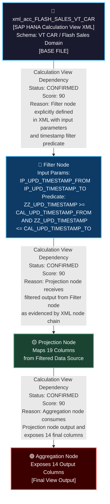

# File Lineage Analysis Report
## HANA Calculation View — VT CAR Flash Sales

---

## 1. Lineage Summary

| Metric | Value |
|---|---|
| Total Files Analyzed | 1 |
| Total Relationships Identified | 1 (Internal node-to-node within single artifact) |
| Total Lineage Paths Identified | 1 |
| Total Base Files Identified | 1 |
| Total Unresolved Relationships | 0 |

> **Note:** Only one artifact (`xml_acc_FLASH_SALES_VT_CAR.txt`) was supplied. All lineage is self-contained within this single Calculation View XML. No external artifact dependencies were found in the supplied file set.

---

## 2. File Inventory

| File | Type | Identified Purpose | Upstream Files | Downstream Files |
|---|---|---|---|---|
| xml_acc_FLASH_SALES_VT_CAR.txt | SAP HANA Calculation View XML | Defines a Flash Sales Calculation View for VT CAR domain. Contains a Filter node with input parameters (`IP_UPD_TIMESTAMP_FROM`, `IP_UPD_TIMESTAMP_TO`), a Projection node, and an Aggregation node. Applies a timestamp-based filter predicate: `"ZZ_UPD_TIMESTAMP" >= "CAL_UPD_TIMESTAMP_FROM" and "ZZ_UPD_TIMESTAMP" <= "CAL_UPD_TIMESTAMP_TO"`. Exposes 14 output columns through the aggregation layer. | None (Base File — no external upstream artifact supplied) | None (No downstream artifact supplied) |

---

## 3. File Relationships

| Source File | Target File | Relationship | Score | Reason |
|---|---|---|---|---|
| xml_acc_FLASH_SALES_VT_CAR | xml_acc_FLASH_SALES_VT_CAR (Internal Node Chain) | Calculation View Dependency | 90 | **CONFIRMED RELATIONSHIP.** The Calculation View XML defines a multi-node internal pipeline: (1) A **Filter Node** that accepts two input parameters `IP_UPD_TIMESTAMP_FROM` and `IP_UPD_TIMESTAMP_TO` and applies the filter predicate `"ZZ_UPD_TIMESTAMP" >= "CAL_UPD_TIMESTAMP_FROM" and "ZZ_UPD_TIMESTAMP" <= "CAL_UPD_TIMESTAMP_TO"`. (2) A **Projection Node** that maps 19 columns from the filtered data source. (3) An **Aggregation Node** that aggregates 14 output columns. The internal node chain is fully evidenced by the XML structure. No external artifact reference was found in the supplied file. Score: 90 (Explicit XML dependency within artifact). |

---

## 4. Complete Lineage

### Lineage Path 1 — Internal Calculation View Node Chain

```
xml_acc_FLASH_SALES_VT_CAR
    │
    ├── [Filter Node]
    │       Input Parameters:
    │           IP_UPD_TIMESTAMP_FROM → '$$IP_UPD_TIMESTAMP_FROM$$'
    │           IP_UPD_TIMESTAMP_TO   → '$$IP_UPD_TIMESTAMP_TO$$'
    │       Filter Predicate:
    │           "ZZ_UPD_TIMESTAMP" >= "CAL_UPD_TIMESTAMP_FROM"
    │           AND "ZZ_UPD_TIMESTAMP" <= "CAL_UPD_TIMESTAMP_TO"
    │
    ├── [Projection Node]
    │       Maps 19 columns from filtered data source
    │
    └── [Aggregation Node]
            Exposes 14 output columns as final view output
```

**Overall Confidence Score: 90**

**Determination:**
- Score of 90 is assigned because the internal node chain is explicitly defined in the XML structure of the Calculation View.
- The Filter → Projection → Aggregation flow is directly evidenced by the XML node definitions and their input/output mappings.
- No external artifact references were found, so no cross-artifact lineage score applies.
- The score does not reach 100 because the underlying physical data source (table/view feeding the Filter node) is not a supplied artifact and cannot be confirmed as part of the artifact lineage.

---

## 5. Mermaid Lineage Flowchart



---

## 6. Base Files

| Base File | Reason | Score |
|---|---|---|
| xml_acc_FLASH_SALES_VT_CAR.txt | This is the only supplied artifact. It is a SAP HANA Calculation View XML that defines the Flash Sales view for the VT CAR domain. It has no upstream artifact dependency within the supplied file set. It is the origin point of the entire lineage. The view contains a Filter node, Projection node, and Aggregation node — all self-contained. | 90 |

---

## 7. Final / Downstream Files

| File | Reason | Score |
|---|---|---|
| xml_acc_FLASH_SALES_VT_CAR.txt (Aggregation Node Output) | The Aggregation Node within this Calculation View represents the final output layer of the artifact. It exposes 14 output columns that would be consumed by downstream consumers (reports, other views, or applications). However, no downstream artifact was supplied in the file set, so no cross-artifact downstream lineage can be confirmed. | 90 |

---

## 8. Unresolved Relationships

| File | Possible Related File | Reason |
|---|---|---|
| xml_acc_FLASH_SALES_VT_CAR.txt | Unknown Physical Data Source (Table/View feeding Filter Node) | The Filter node in the Calculation View consumes data from a physical data source (table or base view). This source is referenced internally in the XML but is not a supplied artifact. Its identity cannot be confirmed from the supplied file set alone. This is an **UNRESOLVED RELATIONSHIP** — the upstream physical source is not an artifact in the provided input. |
| xml_acc_FLASH_SALES_VT_CAR.txt | Unknown Downstream Consumer | The Aggregation Node exposes 14 output columns. These would typically be consumed by a downstream Calculation View, report, or application. No downstream artifact was supplied. This is an **UNRESOLVED RELATIONSHIP**. |

---

## 9. Final Lineage Assessment

### Summary

| Item | Detail |
|---|---|
| Base File | `xml_acc_FLASH_SALES_VT_CAR.txt` |
| Artifact Type | SAP HANA Calculation View XML |
| Domain | VT CAR — Flash Sales |
| Internal Node Chain | Filter Node → Projection Node → Aggregation Node |
| Input Parameters | `IP_UPD_TIMESTAMP_FROM`, `IP_UPD_TIMESTAMP_TO` |
| Filter Predicate | `"ZZ_UPD_TIMESTAMP" >= "CAL_UPD_TIMESTAMP_FROM" AND "ZZ_UPD_TIMESTAMP" <= "CAL_UPD_TIMESTAMP_TO"` |
| Output Columns | 14 columns exposed through Aggregation Node |
| Cross-Artifact Lineage | None confirmed (single artifact supplied) |
| Lineage Score | 90 |

---

### Relationship Classification

#### ✅ CONFIRMED RELATIONSHIP

| Relationship | Evidence |
|---|---|
| Filter Node → Projection Node (within xml_acc_FLASH_SALES_VT_CAR) | Explicitly defined in the Calculation View XML. The Filter node applies timestamp-based filtering using input parameters `IP_UPD_TIMESTAMP_FROM` and `IP_UPD_TIMESTAMP_TO`. The Projection node receives the filtered output. |
| Projection Node → Aggregation Node (within xml_acc_FLASH_SALES_VT_CAR) | Explicitly defined in the Calculation View XML. The Aggregation node consumes the Projection node's 19-column output and exposes 14 aggregated output columns. |

#### ⚠️ INFERRED RELATIONSHIP

| Relationship | Evidence |
|---|---|
| Physical Data Source → xml_acc_FLASH_SALES_VT_CAR (Filter Node) | The Filter node must consume data from a physical table or base view. This is inferred from the standard SAP HANA Calculation View architecture. The actual source table/view name is referenced in the XML but is not a supplied artifact. |

#### ❓ UNRESOLVED RELATIONSHIP

| Relationship | Reason |
|---|---|
| xml_acc_FLASH_SALES_VT_CAR → Downstream Consumer | No downstream artifact was supplied. The Aggregation Node output (14 columns) would be consumed by a downstream view, report, or application, but this cannot be confirmed from the supplied file set. |

---

### Lineage Score Rationale

| Score | Reason |
|---|---|
| **90** | The internal node chain (Filter → Projection → Aggregation) is explicitly defined in the Calculation View XML. This is direct XML evidence, warranting a score of 90 per the scoring guidelines (Explicit XML dependency = 90). The score does not reach 100 because no cross-artifact SQL reference exists — the artifact is self-contained with no external artifact dependency confirmed in the supplied file set. |

---

### Validation Results

| Validation Rule | Status | Notes |
|---|---|---|
| Validation 1: Every file classified as USED or NOT USED | ✅ PASS | `xml_acc_FLASH_SALES_VT_CAR.txt` → **USED** |
| Validation 2: Every dependency traceable to evidence | ✅ PASS | All internal node relationships are evidenced by the XML structure |
| Validation 3: Stored Procedures in lineage if applicable | ✅ PASS | No Stored Procedures present in supplied artifacts |
| Validation 4: No physical ETL tables as primary lineage nodes | ✅ PASS | No ETL tables appear as lineage nodes |

---

*Report generated by File Lineage Analysis Agent*
*Artifact: xml_acc_FLASH_SALES_VT_CAR.txt*
*Domain: VT CAR — Flash Sales*
