# HANA to BigQuery - File Lineage and Dependency Analysis
## CV_COMP_FORECAST_MJE

---

## 1. Lineage Summary

| Metric | Count |
|--------|-------|
| **Total Files Analyzed** | 1 |
| **Total Relationships Identified** | 5 |
| **Total Lineage Paths Identified** | 5 |
| **Total Base Files Identified** | 5 |
| **Total Unresolved Relationships** | 0 |

### Analysis Overview

This analysis examines the **CV_COMP_FORECAST_MJE** calculation view and its dependencies. The view is a composite calculation view that aggregates financial and SKF forecast data along with manual journal entries and SBT (Sales by Territory) data.

**Key Characteristics:**
- **Type**: Calculation View (Composite/Union)
- **Purpose**: Consolidates multiple forecast and manual journal entry sources
- **Dependencies**: 5 upstream calculation views
- **SQL Functions**: 4 SQL functions for date/version filtering
- **Input Parameters**: 6 input parameters for filtering

---

## 2. File Inventory

| File | Type | Identified Purpose | Upstream Files | Downstream Files |
|------|------|-------------------|----------------|------------------|
| **CV_COMP_FORECAST_MJE** | Calculation View (Union) | Consolidates FIN Forecast, SKF Forecast, FIN SBT, FIN Manual JE, and SKF Manual JE data into a unified forecast view with manual journal entries | CV_COMP_FIN_FORECAST<br>CV_COMP_SKF_FORECAST<br>CV_COMP_FIN_SBT<br>CV_COMP_FIN_MANUAL_JE<br>CV_COMP_SKF_MANUAL_JE | None (Terminal view) |
| **CV_COMP_FIN_FORECAST** | Calculation View | Provides financial forecast data | Not Available | CV_COMP_FORECAST_MJE |
| **CV_COMP_SKF_FORECAST** | Calculation View | Provides SKF (Store Keeping Forecast) data | Not Available | CV_COMP_FORECAST_MJE |
| **CV_COMP_FIN_SBT** | Calculation View | Provides financial Sales by Territory data | Not Available | CV_COMP_FORECAST_MJE |
| **CV_COMP_FIN_MANUAL_JE** | Calculation View | Provides financial manual journal entries | Not Available | CV_COMP_FORECAST_MJE |
| **CV_COMP_SKF_MANUAL_JE** | Calculation View | Provides SKF manual journal entries | Not Available | CV_COMP_FORECAST_MJE |

### SQL Functions Referenced

| Function Name | Purpose |
|---------------|---------|
| **SFN_PRIOR_WEEK_FIN_FORECAST_VERSION** | Returns the prior week's financial forecast version |
| **SFN_PRIOR_FISCAL_WEEK** | Returns the prior fiscal week (referenced twice) |
| **SFN_PRIOR_WEEK_SKF_FORECAST_VERSION** | Returns the prior week's SKF forecast version |

### Input Parameters

| Parameter | Purpose |
|-----------|---------|
| IP_FIN_VERSION | Financial forecast version filter |
| IP_SKF_VERSION | SKF forecast version filter |
| IP_WEEK_ENDING_FROM | Week ending date range start (multiple uses) |
| IP_WEEK_ENDING_TO | Week ending date range end (multiple uses) |

---

## 3. File Relationships

| Source File | Target File | Relationship | Score | Reason |
|-------------|-------------|--------------|-------|--------|
| **CV_COMP_FIN_FORECAST** | **CV_COMP_FORECAST_MJE** | Calculation View Dependency | 90 | CV_COMP_FORECAST_MJE explicitly references CV_COMP_FIN_FORECAST in its data sources section with path `/CVS_FRIP.Composite.FI/calculationviews/CV_COMP_FIN_FORECAST`. This is a direct XML dependency where CV_COMP_FIN_FORECAST provides financial forecast data to the union view. |
| **CV_COMP_SKF_FORECAST** | **CV_COMP_FORECAST_MJE** | Calculation View Dependency | 90 | CV_COMP_FORECAST_MJE explicitly references CV_COMP_SKF_FORECAST in its data sources section with path `/CVS_FRIP.Composite.FI/calculationviews/CV_COMP_SKF_FORECAST`. This is a direct XML dependency where CV_COMP_SKF_FORECAST provides SKF forecast data to the union view. |
| **CV_COMP_FIN_SBT** | **CV_COMP_FORECAST_MJE** | Calculation View Dependency | 90 | CV_COMP_FORECAST_MJE explicitly references CV_COMP_FIN_SBT in its data sources section with path `/CVS_FRIP.Composite.FI/calculationviews/CV_COMP_FIN_SBT`. This is a direct XML dependency where CV_COMP_FIN_SBT provides financial Sales by Territory data to the union view. |
| **CV_COMP_FIN_MANUAL_JE** | **CV_COMP_FORECAST_MJE** | Calculation View Dependency | 90 | CV_COMP_FORECAST_MJE explicitly references CV_COMP_FIN_MANUAL_JE in its data sources section with path `/CVS_FRIP.Composite.FI/calculationviews/CV_COMP_FIN_MANUAL_JE`. This is a direct XML dependency where CV_COMP_FIN_MANUAL_JE provides financial manual journal entries to the union view. |
| **CV_COMP_SKF_MANUAL_JE** | **CV_COMP_FORECAST_MJE** | Calculation View Dependency | 90 | CV_COMP_FORECAST_MJE explicitly references CV_COMP_SKF_MANUAL_JE in its data sources section with path `/CVS_FRIP.Composite.FI/calculationviews/CV_COMP_SKF_MANUAL_JE`. This is a direct XML dependency where CV_COMP_SKF_MANUAL_JE provides SKF manual journal entries to the union view. |

### Relationship Classification

All identified relationships are **CONFIRMED RELATIONSHIPS** based on explicit XML references in the calculation view definition.

---

## 4. Complete Lineage

### Lineage Path 1: Financial Forecast Flow
```
CV_COMP_FIN_FORECAST
    ↓ [Calculation View Dependency | Score: 90]
CV_COMP_FORECAST_MJE
```
**Confidence Score**: 90  
**Determination**: Direct XML reference in calculation view data sources section.

---

### Lineage Path 2: SKF Forecast Flow
```
CV_COMP_SKF_FORECAST
    ↓ [Calculation View Dependency | Score: 90]
CV_COMP_FORECAST_MJE
```
**Confidence Score**: 90  
**Determination**: Direct XML reference in calculation view data sources section.

---

### Lineage Path 3: Financial SBT Flow
```
CV_COMP_FIN_SBT
    ↓ [Calculation View Dependency | Score: 90]
CV_COMP_FORECAST_MJE
```
**Confidence Score**: 90  
**Determination**: Direct XML reference in calculation view data sources section.

---

### Lineage Path 4: Financial Manual JE Flow
```
CV_COMP_FIN_MANUAL_JE
    ↓ [Calculation View Dependency | Score: 90]
CV_COMP_FORECAST_MJE
```
**Confidence Score**: 90  
**Determination**: Direct XML reference in calculation view data sources section.

---

### Lineage Path 5: SKF Manual JE Flow
```
CV_COMP_SKF_MANUAL_JE
    ↓ [Calculation View Dependency | Score: 90]
CV_COMP_FORECAST_MJE
```
**Confidence Score**: 90  
**Determination**: Direct XML reference in calculation view data sources section.

---

### Complete Consolidated Lineage
```
CV_COMP_FIN_FORECAST ────┐
                         │
CV_COMP_SKF_FORECAST ────┤
                         │
CV_COMP_FIN_SBT ─────────┼────> CV_COMP_FORECAST_MJE
                         │
CV_COMP_FIN_MANUAL_JE ───┤
                         │
CV_COMP_SKF_MANUAL_JE ───┘
```

**Overall Confidence Score**: 90  
**Determination**: All relationships are based on explicit XML references in the calculation view definition. The union operation combines all five upstream views into a single consolidated forecast view with manual journal entries.

---

## 5. Mermaid Lineage Diagram

```mermaid
flowchart TD
    %% Base/Source Files
    CV_FIN_FORECAST["<b>CV_COMP_FIN_FORECAST</b><br/>Schema: CVS_FRIP.Composite.FI<br/>Type: Calculation View<br/>Purpose: Financial Forecast Data"]
    CV_SKF_FORECAST["<b>CV_COMP_SKF_FORECAST</b><br/>Schema: CVS_FRIP.Composite.FI<br/>Type: Calculation View<br/>Purpose: SKF Forecast Data"]
    CV_FIN_SBT["<b>CV_COMP_FIN_SBT</b><br/>Schema: CVS_FRIP.Composite.FI<br/>Type: Calculation View<br/>Purpose: Financial SBT Data"]
    CV_FIN_MJE["<b>CV_COMP_FIN_MANUAL_JE</b><br/>Schema: CVS_FRIP.Composite.FI<br/>Type: Calculation View<br/>Purpose: Financial Manual JE"]
    CV_SKF_MJE["<b>CV_COMP_SKF_MANUAL_JE</b><br/>Schema: CVS_FRIP.Composite.FI<br/>Type: Calculation View<br/>Purpose: SKF Manual JE"]
    
    %% Target/Final File
    CV_FORECAST_MJE["<b>CV_COMP_FORECAST_MJE</b><br/>Schema: CVS_FRIP.Composite.FI<br/>Type: Calculation View (Union)<br/>Purpose: Consolidated Forecast with Manual JE"]
    
    %% SQL Functions
    FN1["<b>SFN_PRIOR_WEEK_FIN_FORECAST_VERSION</b><br/>Schema: CVS_FRIP.Composite.Master<br/>Type: SQL Function"]
    FN2["<b>SFN_PRIOR_FISCAL_WEEK</b><br/>Schema: CVS_FRIP.Composite.Master<br/>Type: SQL Function"]
    FN3["<b>SFN_PRIOR_WEEK_SKF_FORECAST_VERSION</b><br/>Schema: CVS_FRIP.Composite.Master<br/>Type: SQL Function"]
    
    %% Relationships
    CV_FIN_FORECAST -->|"Calculation View Dependency<br/>Status: CONFIRMED<br/>Score: 90<br/>Reason: Explicit XML reference<br/>in data sources"| CV_FORECAST_MJE
    
    CV_SKF_FORECAST -->|"Calculation View Dependency<br/>Status: CONFIRMED<br/>Score: 90<br/>Reason: Explicit XML reference<br/>in data sources"| CV_FORECAST_MJE
    
    CV_FIN_SBT -->|"Calculation View Dependency<br/>Status: CONFIRMED<br/>Score: 90<br/>Reason: Explicit XML reference<br/>in data sources"| CV_FORECAST_MJE
    
    CV_FIN_MJE -->|"Calculation View Dependency<br/>Status: CONFIRMED<br/>Score: 90<br/>Reason: Explicit XML reference<br/>in data sources"| CV_FORECAST_MJE
    
    CV_SKF_MJE -->|"Calculation View Dependency<br/>Status: CONFIRMED<br/>Score: 90<br/>Reason: Explicit XML reference<br/>in data sources"| CV_FORECAST_MJE
    
    FN1 -.->|"Function Reference<br/>Status: CONFIRMED<br/>Score: 85<br/>Reason: Used for version filtering"| CV_FORECAST_MJE
    
    FN2 -.->|"Function Reference<br/>Status: CONFIRMED<br/>Score: 85<br/>Reason: Used for fiscal week filtering"| CV_FORECAST_MJE
    
    FN3 -.->|"Function Reference<br/>Status: CONFIRMED<br/>Score: 85<br/>Reason: Used for version filtering"| CV_FORECAST_MJE
    
    %% Styling
    classDef baseFile fill:#90EE90,stroke:#006400,stroke-width:3px,color:#000
    classDef finalFile fill:#FFB6C1,stroke:#8B0000,stroke-width:3px,color:#000
    classDef function fill:#87CEEB,stroke:#00008B,stroke-width:2px,color:#000
    
    class CV_FIN_FORECAST,CV_SKF_FORECAST,CV_FIN_SBT,CV_FIN_MJE,CV_SKF_MJE baseFile
    class CV_FORECAST_MJE finalFile
    class FN1,FN2,FN3 function
```



---

## 6. Base Files

| Base File | Reason | Score |
|-----------|--------|-------|
| **CV_COMP_FIN_FORECAST** | This is a base file as it serves as a source calculation view providing financial forecast data to CV_COMP_FORECAST_MJE. No upstream dependencies are identified within the provided artifacts. It represents the starting point for the financial forecast lineage path. | 90 |
| **CV_COMP_SKF_FORECAST** | This is a base file as it serves as a source calculation view providing SKF (Store Keeping Forecast) data to CV_COMP_FORECAST_MJE. No upstream dependencies are identified within the provided artifacts. It represents the starting point for the SKF forecast lineage path. | 90 |
| **CV_COMP_FIN_SBT** | This is a base file as it serves as a source calculation view providing financial Sales by Territory data to CV_COMP_FORECAST_MJE. No upstream dependencies are identified within the provided artifacts. It represents the starting point for the SBT lineage path. | 90 |
| **CV_COMP_FIN_MANUAL_JE** | This is a base file as it serves as a source calculation view providing financial manual journal entries to CV_COMP_FORECAST_MJE. No upstream dependencies are identified within the provided artifacts. It represents the starting point for the financial manual JE lineage path. | 90 |
| **CV_COMP_SKF_MANUAL_JE** | This is a base file as it serves as a source calculation view providing SKF manual journal entries to CV_COMP_FORECAST_MJE. No upstream dependencies are identified within the provided artifacts. It represents the starting point for the SKF manual JE lineage path. | 90 |

### Base File Classification

All five upstream calculation views are classified as **base files** because:
1. They are explicitly referenced as data sources in CV_COMP_FORECAST_MJE
2. No further upstream dependencies are visible in the provided artifacts
3. They represent the starting points of their respective lineage paths
4. They are the origin of business logic flow for their respective data domains

---

## 7. Final/Downstream Files

| File | Reason | Score |
|------|--------|-------|
| **CV_COMP_FORECAST_MJE** | This is the final/terminal file in the lineage as it consumes data from five upstream calculation views (CV_COMP_FIN_FORECAST, CV_COMP_SKF_FORECAST, CV_COMP_FIN_SBT, CV_COMP_FIN_MANUAL_JE, CV_COMP_SKF_MANUAL_JE) and performs a union operation to consolidate forecast and manual journal entry data. No downstream consumers are identified in the provided artifacts. This view represents the final output of the forecast consolidation process. | 90 |

### Final File Classification

**CV_COMP_FORECAST_MJE** is classified as the **final/downstream file** because:
1. It is the only file that consumes data from other artifacts
2. No downstream dependencies or consumers are identified in the provided artifacts
3. It represents the terminal point of the lineage
4. It performs the final consolidation of all forecast and manual journal entry sources
5. The union operation indicates this is an aggregation/consolidation endpoint

---

## 8. Unresolved Relationships

| File | Possible Related File | Reason |
|------|----------------------|--------|
| None | N/A | All relationships have been successfully resolved with explicit XML references. No unresolved relationships exist in the provided artifacts. |

### Resolution Status

**100% Resolution Rate**: All identified dependencies are based on explicit XML references in the calculation view definition. No ambiguous or inferred relationships exist.

---

## 9. Final Lineage Assessment

### Executive Summary

The **CV_COMP_FORECAST_MJE** calculation view represents a **consolidation endpoint** that unifies five distinct data sources related to forecasting and manual journal entries. The lineage is straightforward with a clear fan-in pattern where multiple base files converge into a single final output.

---

### Base Files (5)

1. **CV_COMP_FIN_FORECAST** - Financial forecast data source
2. **CV_COMP_SKF_FORECAST** - SKF forecast data source
3. **CV_COMP_FIN_SBT** - Financial Sales by Territory data source
4. **CV_COMP_FIN_MANUAL_JE** - Financial manual journal entries source
5. **CV_COMP_SKF_MANUAL_JE** - SKF manual journal entries source

All base files are calculation views located in the **CVS_FRIP.Composite.FI** schema.

---

### Main Lineage Paths (5)

#### Path 1: Financial Forecast
```
CV_COMP_FIN_FORECAST → CV_COMP_FORECAST_MJE
```
- **Type**: Calculation View Dependency
- **Score**: 90
- **Status**: CONFIRMED

#### Path 2: SKF Forecast
```
CV_COMP_SKF_FORECAST → CV_COMP_FORECAST_MJE
```
- **Type**: Calculation View Dependency
- **Score**: 90
- **Status**: CONFIRMED

#### Path 3: Financial SBT
```
CV_COMP_FIN_SBT → CV_COMP_FORECAST_MJE
```
- **Type**: Calculation View Dependency
- **Score**: 90
- **Status**: CONFIRMED

#### Path 4: Financial Manual JE
```
CV_COMP_FIN_MANUAL_JE → CV_COMP_FORECAST_MJE
```
- **Type**: Calculation View Dependency
- **Score**: 90
- **Status**: CONFIRMED

#### Path 5: SKF Manual JE
```
CV_COMP_SKF_MANUAL_JE → CV_COMP_FORECAST_MJE
```
- **Type**: Calculation View Dependency
- **Score**: 90
- **Status**: CONFIRMED

---

### File-to-File Relationships (5)

| # | Source | Target | Type | Score |
|---|--------|--------|------|-------|
| 1 | CV_COMP_FIN_FORECAST | CV_COMP_FORECAST_MJE | Calculation View Dependency | 90 |
| 2 | CV_COMP_SKF_FORECAST | CV_COMP_FORECAST_MJE | Calculation View Dependency | 90 |
| 3 | CV_COMP_FIN_SBT | CV_COMP_FORECAST_MJE | Calculation View Dependency | 90 |
| 4 | CV_COMP_FIN_MANUAL_JE | CV_COMP_FORECAST_MJE | Calculation View Dependency | 90 |
| 5 | CV_COMP_SKF_MANUAL_JE | CV_COMP_FORECAST_MJE | Calculation View Dependency | 90 |

---

### Lineage Scores

| Metric | Score | Justification |
|--------|-------|---------------|
| **Overall Lineage Confidence** | 90 | All relationships are based on explicit XML references in the calculation view definition |
| **Relationship Clarity** | 100 | All dependencies are clearly defined with no ambiguity |
| **Documentation Quality** | 95 | XML structure provides complete metadata about data sources and relationships |
| **Completeness** | 85 | While all relationships within the provided artifact are identified, upstream dependencies of the base files are not available |

---

### Reasons for Scores

#### Score: 90 (Calculation View Dependencies)
- **Evidence**: Explicit XML `<dataSources>` references with full paths
- **Traceability**: Each dependency can be traced to specific XML elements
- **Clarity**: Unambiguous relationship definitions
- **Validation**: XML structure validates the dependency chain

**Why not 100?**
- The upstream dependencies of the five base calculation views are not available in the provided artifacts
- Without the complete artifact set, we cannot trace the full lineage back to physical tables or stored procedures

#### Score: 85 (SQL Function References)
- **Evidence**: Explicit function references in `<sqlFunction>` elements
- **Purpose**: Clear usage for date and version filtering
- **Integration**: Functions are properly integrated into the view logic

**Why not 90+?**
- Functions are supporting elements, not primary data sources
- Their impact on lineage is indirect (filtering vs. data provision)

---

### Unresolved Relationships

**Status**: None

All relationships within the scope of the provided artifact (CV_COMP_FORECAST_MJE) have been successfully resolved with high confidence scores.

**Potential Future Analysis**:
- Upstream dependencies of the five base calculation views
- Downstream consumers of CV_COMP_FORECAST_MJE
- Physical table sources for the base calculation views
- Stored procedures that may populate underlying tables

---

### Architectural Pattern

**Pattern**: **Fan-In Consolidation**

```
Multiple Sources → Single Consolidation Point
```

This pattern is typical for:
- Reporting views that aggregate multiple data domains
- Consolidated forecast views combining actuals and adjustments
- Union-based views that standardize heterogeneous sources

**Business Logic Flow**:
1. Five independent data sources provide specialized forecast and manual journal entry data
2. CV_COMP_FORECAST_MJE performs a union operation to consolidate all sources
3. Input parameters enable filtering by version and date range
4. SQL functions provide dynamic date and version calculations
5. Calculated columns transform flags and indicators for reporting

---

### Validation Results

✅ **Validation 1**: All supplied files classified (1 file = USED)  
✅ **Validation 2**: All dependencies traceable to XML evidence  
✅ **Validation 3**: No stored procedures in scope (N/A)  
✅ **Validation 4**: No physical ETL tables as primary lineage nodes  

---

### Recommendations for SQL Consolidation Agent

1. **Recursive Expansion**: When expanding CV_COMP_FORECAST_MJE, recursively expand all five upstream calculation views
2. **Union Handling**: Preserve the union semantics when consolidating SQL
3. **Parameter Propagation**: Ensure input parameters are properly propagated to upstream views
4. **Function Resolution**: Resolve SQL functions to their implementations for complete SQL generation
5. **Schema Qualification**: Maintain schema qualification (CVS_FRIP.Composite.FI) in generated SQL

---

### Critical Success Factors

✅ **Artifact-Based Lineage**: All lineage nodes are calculation views (artifacts)  
✅ **No Physical Tables**: No ETL or staging tables appear as primary lineage nodes  
✅ **Business Logic Flow**: Lineage represents business logic consolidation  
✅ **Evidence-Based**: All relationships supported by XML evidence  
✅ **Recursive Expandable**: Structure supports recursive SQL expansion  

---

## Conclusion

The lineage analysis of **CV_COMP_FORECAST_MJE** reveals a clean, well-structured consolidation pattern with five upstream calculation views feeding into a single union-based output. All relationships are confirmed with high confidence (score: 90) based on explicit XML references. The lineage is complete within the scope of the provided artifact and ready for downstream SQL consolidation processing.

**Key Takeaway**: This is a **terminal consolidation view** that aggregates forecast and manual journal entry data from multiple specialized sources, representing the final output of the forecast consolidation workflow.

---

**Analysis Date**: 2025  
**Analyst**: Senior Lineage and Dependency Analysis Specialist  
**Confidence Level**: High (90/100)  
**Status**: Complete ✅
