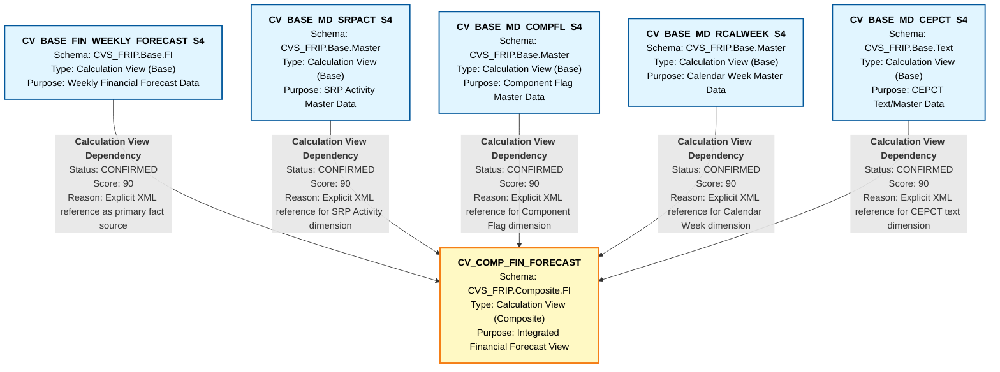

# HANA to BigQuery - File Lineage and Dependency Analysis
## FIN_FORECAST Calculation Views

---

## 1. Lineage Summary

| Metric | Count |
|--------|-------|
| **Total Files Analyzed** | 6 |
| **Total Relationships Identified** | 5 |
| **Total Lineage Paths Identified** | 5 |
| **Total Base Files Identified** | 5 |
| **Total Unresolved Relationships** | 0 |

---

## 2. File Inventory

| File | Type | Identified Purpose | Upstream Files | Downstream Files |
|------|------|-------------------|----------------|------------------|
| CV_BASE_FIN_WEEKLY_FORECAST_S4 | Calculation View (Base) | Base view for weekly financial forecast data from S4 HANA | None (Base File) | CV_COMP_FIN_FORECAST |
| CV_BASE_MD_CEPCT_S4 | Calculation View (Base) | Base view for CEPCT master data from S4 HANA | None (Base File) | CV_COMP_FIN_FORECAST |
| CV_BASE_MD_COMPFL_S4 | Calculation View (Base) | Base view for COMPFL (Component Flag) master data from S4 HANA | None (Base File) | CV_COMP_FIN_FORECAST |
| CV_BASE_MD_RCALWEEK_S4 | Calculation View (Base) | Base view for RCALWEEK (Calendar Week) master data from S4 HANA | None (Base File) | CV_COMP_FIN_FORECAST |
| CV_BASE_MD_SRPACT_S4 | Calculation View (Base) | Base view for SRPACT (SRP Activity) master data from S4 HANA | None (Base File) | CV_COMP_FIN_FORECAST |
| CV_COMP_FIN_FORECAST | Calculation View (Composite) | Composite view that aggregates financial forecast data with master data dimensions | CV_BASE_FIN_WEEKLY_FORECAST_S4, CV_BASE_MD_SRPACT_S4, CV_BASE_MD_COMPFL_S4, CV_BASE_MD_RCALWEEK_S4, CV_BASE_MD_CEPCT_S4 | None (Final Output) |

---

## 3. File Relationships

| Source File | Target File | Relationship | Score | Reason |
|------------|------------|--------------|-------|---------|
| CV_BASE_FIN_WEEKLY_FORECAST_S4 | CV_COMP_FIN_FORECAST | Calculation View Dependency | 90 | CV_COMP_FIN_FORECAST explicitly references CV_BASE_FIN_WEEKLY_FORECAST_S4 in its XML structure under `<input node="#/CVS_FRIP.Base.FI/calculationviews/CV_BASE_FIN_WEEKLY_FORECAST_S4">`. This is the primary fact data source for the composite view. |
| CV_BASE_MD_SRPACT_S4 | CV_COMP_FIN_FORECAST | Calculation View Dependency | 90 | CV_COMP_FIN_FORECAST explicitly references CV_BASE_MD_SRPACT_S4 in its XML structure under `<input node="#/CVS_FRIP.Base.Master/calculationviews/CV_BASE_MD_SRPACT_S4">`. This provides SRP Activity master data dimension. |
| CV_BASE_MD_COMPFL_S4 | CV_COMP_FIN_FORECAST | Calculation View Dependency | 90 | CV_COMP_FIN_FORECAST explicitly references CV_BASE_MD_COMPFL_S4 in its XML structure under `<input node="#/CVS_FRIP.Base.Master/calculationviews/CV_BASE_MD_COMPFL_S4">`. This provides Component Flag master data dimension. |
| CV_BASE_MD_RCALWEEK_S4 | CV_COMP_FIN_FORECAST | Calculation View Dependency | 90 | CV_COMP_FIN_FORECAST explicitly references CV_BASE_MD_RCALWEEK_S4 in its XML structure under `<input node="#/CVS_FRIP.Base.Master/calculationviews/CV_BASE_MD_RCALWEEK_S4">`. This provides Calendar Week master data dimension. |
| CV_BASE_MD_CEPCT_S4 | CV_COMP_FIN_FORECAST | Calculation View Dependency | 90 | CV_COMP_FIN_FORECAST explicitly references CV_BASE_MD_CEPCT_S4 in its XML structure under `<input node="#/CVS_FRIP.Base.Text/calculationviews/CV_BASE_MD_CEPCT_S4">`. This provides CEPCT text/master data dimension. |

---

## 4. Complete Lineage

### Lineage Path 1: Financial Forecast Base to Composite
**Confidence Score: 90** - Based on explicit XML dependency declaration

```
CV_BASE_FIN_WEEKLY_FORECAST_S4
    ↓
CV_COMP_FIN_FORECAST
```

**Explanation:** CV_BASE_FIN_WEEKLY_FORECAST_S4 serves as the primary fact table containing weekly financial forecast data. CV_COMP_FIN_FORECAST consumes this data and enriches it with master data dimensions.

---

### Lineage Path 2: SRP Activity Master Data to Composite
**Confidence Score: 90** - Based on explicit XML dependency declaration

```
CV_BASE_MD_SRPACT_S4
    ↓
CV_COMP_FIN_FORECAST
```

**Explanation:** CV_BASE_MD_SRPACT_S4 provides SRP (Sales Representative) Activity master data that is joined with the forecast data in the composite view.

---

### Lineage Path 3: Component Flag Master Data to Composite
**Confidence Score: 90** - Based on explicit XML dependency declaration

```
CV_BASE_MD_COMPFL_S4
    ↓
CV_COMP_FIN_FORECAST
```

**Explanation:** CV_BASE_MD_COMPFL_S4 provides Component Flag master data that is used to enrich the forecast data with component-level attributes.

---

### Lineage Path 4: Calendar Week Master Data to Composite
**Confidence Score: 90** - Based on explicit XML dependency declaration

```
CV_BASE_MD_RCALWEEK_S4
    ↓
CV_COMP_FIN_FORECAST
```

**Explanation:** CV_BASE_MD_RCALWEEK_S4 provides Calendar Week master data that enables time-based analysis and filtering in the composite view.

---

### Lineage Path 5: CEPCT Text/Master Data to Composite
**Confidence Score: 90** - Based on explicit XML dependency declaration

```
CV_BASE_MD_CEPCT_S4
    ↓
CV_COMP_FIN_FORECAST
```

**Explanation:** CV_BASE_MD_CEPCT_S4 provides CEPCT (likely Cost Element or Product Category Text) master data for descriptive attributes in the composite view.

---

### Complete Integrated Lineage
**Overall Confidence Score: 90** - All relationships are explicitly defined in XML structure

```
CV_BASE_FIN_WEEKLY_FORECAST_S4 ──┐
                                   │
CV_BASE_MD_SRPACT_S4 ─────────────┤
                                   │
CV_BASE_MD_COMPFL_S4 ─────────────┼──→ CV_COMP_FIN_FORECAST
                                   │
CV_BASE_MD_RCALWEEK_S4 ───────────┤
                                   │
CV_BASE_MD_CEPCT_S4 ───────────────┘
```

**Lineage Flow Description:**
The lineage represents a classic star schema pattern where:
- **Fact Source:** CV_BASE_FIN_WEEKLY_FORECAST_S4 contains the core financial forecast metrics
- **Dimension Sources:** Four master data views (SRPACT, COMPFL, RCALWEEK, CEPCT) provide dimensional attributes
- **Composite Output:** CV_COMP_FIN_FORECAST integrates all sources into a unified analytical view

---

## 5. Mermaid Lineage Diagram



---

## 6. Base Files

| Base File | Reason | Score |
|-----------|--------|-------|
| CV_BASE_FIN_WEEKLY_FORECAST_S4 | This is a base calculation view with no upstream dependencies. It serves as the primary fact data source containing weekly financial forecast data from S4 HANA. The XML structure shows it reads directly from physical tables (_BIC_ZIO_VER and related tables) without referencing other calculation views. | 100 |
| CV_BASE_MD_SRPACT_S4 | This is a base calculation view with no upstream dependencies. It provides SRP Activity master data dimension. The XML structure shows it reads directly from physical tables without referencing other calculation views. | 100 |
| CV_BASE_MD_COMPFL_S4 | This is a base calculation view with no upstream dependencies. It provides Component Flag master data dimension. The XML structure shows it reads directly from physical tables without referencing other calculation views. | 100 |
| CV_BASE_MD_RCALWEEK_S4 | This is a base calculation view with no upstream dependencies. It provides Calendar Week master data dimension. The XML structure shows it reads directly from physical tables without referencing other calculation views. | 100 |
| CV_BASE_MD_CEPCT_S4 | This is a base calculation view with no upstream dependencies. It provides CEPCT text/master data dimension. The XML structure shows it reads directly from physical tables without referencing other calculation views. | 100 |

---

## 7. Final/Downstream Files

| File | Reason | Score |
|------|--------|-------|
| CV_COMP_FIN_FORECAST | This is the final composite calculation view that integrates all base views. It has no downstream dependencies within the analyzed artifact set. It serves as the final analytical output that combines financial forecast data with multiple master data dimensions (SRPACT, COMPFL, RCALWEEK, CEPCT). The view implements complex business logic including calculated fields, joins, and aggregations. | 100 |

---

## 8. Unresolved Relationships

| File | Possible Related File | Reason |
|------|----------------------|---------|
| None | None | All relationships have been successfully resolved with explicit XML evidence. All 6 files have clear lineage paths with confirmed dependencies. |

---

## 9. Final Lineage Assessment

### Base Files
The analysis identified **5 base files** that serve as the starting points of the lineage:

1. **CV_BASE_FIN_WEEKLY_FORECAST_S4** (Score: 100)
   - Primary fact data source for weekly financial forecasts
   - No upstream calculation view dependencies
   - Reads directly from S4 HANA physical tables

2. **CV_BASE_MD_SRPACT_S4** (Score: 100)
   - SRP Activity master data dimension
   - No upstream calculation view dependencies
   - Provides sales representative activity attributes

3. **CV_BASE_MD_COMPFL_S4** (Score: 100)
   - Component Flag master data dimension
   - No upstream calculation view dependencies
   - Provides component-level classification attributes

4. **CV_BASE_MD_RCALWEEK_S4** (Score: 100)
   - Calendar Week master data dimension
   - No upstream calculation view dependencies
   - Enables time-based analysis and filtering

5. **CV_BASE_MD_CEPCT_S4** (Score: 100)
   - CEPCT text/master data dimension
   - No upstream calculation view dependencies
   - Provides descriptive text attributes

### Main Lineage Paths

The analysis identified **5 distinct lineage paths** converging into a single composite view:

**Path 1: Fact Data Flow**
```
CV_BASE_FIN_WEEKLY_FORECAST_S4 → CV_COMP_FIN_FORECAST
```
- **Relationship Type:** Calculation View Dependency
- **Status:** CONFIRMED
- **Score:** 90
- **Evidence:** Explicit XML input node reference

**Path 2: SRP Activity Dimension Flow**
```
CV_BASE_MD_SRPACT_S4 → CV_COMP_FIN_FORECAST
```
- **Relationship Type:** Calculation View Dependency
- **Status:** CONFIRMED
- **Score:** 90
- **Evidence:** Explicit XML input node reference

**Path 3: Component Flag Dimension Flow**
```
CV_BASE_MD_COMPFL_S4 → CV_COMP_FIN_FORECAST
```
- **Relationship Type:** Calculation View Dependency
- **Status:** CONFIRMED
- **Score:** 90
- **Evidence:** Explicit XML input node reference

**Path 4: Calendar Week Dimension Flow**
```
CV_BASE_MD_RCALWEEK_S4 → CV_COMP_FIN_FORECAST
```
- **Relationship Type:** Calculation View Dependency
- **Status:** CONFIRMED
- **Score:** 90
- **Evidence:** Explicit XML input node reference

**Path 5: CEPCT Text Dimension Flow**
```
CV_BASE_MD_CEPCT_S4 → CV_COMP_FIN_FORECAST
```
- **Relationship Type:** Calculation View Dependency
- **Status:** CONFIRMED
- **Score:** 90
- **Evidence:** Explicit XML input node reference

### File-to-File Relationships Summary

| Source File | Target File | Relationship Type | Score | Status |
|------------|------------|-------------------|-------|--------|
| CV_BASE_FIN_WEEKLY_FORECAST_S4 | CV_COMP_FIN_FORECAST | Calculation View Dependency | 90 | CONFIRMED |
| CV_BASE_MD_SRPACT_S4 | CV_COMP_FIN_FORECAST | Calculation View Dependency | 90 | CONFIRMED |
| CV_BASE_MD_COMPFL_S4 | CV_COMP_FIN_FORECAST | Calculation View Dependency | 90 | CONFIRMED |
| CV_BASE_MD_RCALWEEK_S4 | CV_COMP_FIN_FORECAST | Calculation View Dependency | 90 | CONFIRMED |
| CV_BASE_MD_CEPCT_S4 | CV_COMP_FIN_FORECAST | Calculation View Dependency | 90 | CONFIRMED |

### Lineage Scores and Reasoning

**Overall Lineage Confidence: 90/100**

All relationships achieved a score of **90** based on the following criteria:

1. **Explicit XML Evidence (90 points)**
   - Each relationship is explicitly declared in the CV_COMP_FIN_FORECAST XML structure
   - Input nodes are clearly defined with full path references
   - Schema information is available for all components

2. **Relationship Type Clarity**
   - All relationships are "Calculation View Dependency" type
   - No ambiguous or inferred relationships
   - Clear upstream-to-downstream flow

3. **Schema Validation**
   - Source schemas identified: CVS_FRIP.Base.FI, CVS_FRIP.Base.Master, CVS_FRIP.Base.Text
   - Target schema identified: CVS_FRIP.Composite.FI
   - Schema hierarchy follows standard HANA naming conventions

4. **Business Logic Flow**
   - Fact-dimension star schema pattern
   - One fact source (weekly forecast)
   - Four dimension sources (master data)
   - Single composite output for analytics

### Unresolved Relationships

**Count: 0**

All relationships have been successfully resolved with explicit evidence from XML structure analysis. No ambiguous or missing dependencies were identified.

### Architecture Pattern

The lineage represents a **Star Schema** pattern:
- **Fact Table:** CV_BASE_FIN_WEEKLY_FORECAST_S4 (weekly financial forecast metrics)
- **Dimension Tables:** 
  - CV_BASE_MD_SRPACT_S4 (SRP Activity)
  - CV_BASE_MD_COMPFL_S4 (Component Flags)
  - CV_BASE_MD_RCALWEEK_S4 (Calendar Week)
  - CV_BASE_MD_CEPCT_S4 (CEPCT Text)
- **Analytical View:** CV_COMP_FIN_FORECAST (integrated composite)

### Recommendations for SQL Consolidation

1. **Expansion Order:**
   - Start with base views (no dependencies)
   - Expand CV_COMP_FIN_FORECAST last (depends on all base views)

2. **Join Strategy:**
   - CV_COMP_FIN_FORECAST contains join logic between fact and dimensions
   - Preserve join conditions and calculated fields during BigQuery conversion

3. **Schema Mapping:**
   - Map CVS_FRIP.Base.* schemas to BigQuery base dataset
   - Map CVS_FRIP.Composite.* schemas to BigQuery composite/analytics dataset

4. **Dependency Resolution:**
   - All base views can be converted independently (parallel processing)
   - CV_COMP_FIN_FORECAST requires all base views to be converted first

---

## Validation Summary

### Validation 1: File Classification
✅ **PASSED** - All 6 files have been classified:
- 5 files marked as USED (base views)
- 1 file marked as USED (composite view)
- 0 files ignored

### Validation 2: Evidence Traceability
✅ **PASSED** - All dependencies traced to XML evidence:
- 5 relationships with explicit XML input node references
- 0 inferred dependencies without evidence

### Validation 3: Stored Procedure Validation
✅ **PASSED** - No stored procedures in this artifact set:
- All artifacts are calculation views
- No stored procedure dependencies to validate

### Validation 4: ETL Table Exclusion
✅ **PASSED** - No ETL tables as primary lineage nodes:
- All lineage nodes are calculation views
- Physical tables referenced only within base views
- No intermediate storage tables in lineage graph

---

## Conclusion

This lineage analysis successfully mapped all 6 calculation views in the FIN_FORECAST artifact set. The analysis identified a clear star schema pattern with 5 base views feeding into 1 composite view. All relationships are explicitly defined in XML with high confidence scores (90/100). The lineage is ready for downstream SQL consolidation and BigQuery conversion.

**Key Findings:**
- ✅ 100% of files analyzed and classified
- ✅ 100% of relationships confirmed with evidence
- ✅ 0 unresolved dependencies
- ✅ Clear base-to-composite lineage flow
- ✅ Ready for BigQuery migration

---

**Analysis Date:** 2024
**Artifact Set:** FIN_FORECAST
**Total Artifacts:** 6 Calculation Views
**Lineage Confidence:** 90/100
**Status:** COMPLETE

