# HANA Lineage and Dependency Analysis Report
## FIN_MANUAL_JE Calculation Views

---

## 1. Lineage Summary

### Overview Statistics

| Metric | Count |
|--------|-------|
| **Total Files Analyzed** | 10 |
| **Total Relationships Identified** | 9 |
| **Total Lineage Paths Identified** | 9 |
| **Total Base Files Identified** | 9 |
| **Total Unresolved Relationships** | 0 |

### Analysis Scope
This analysis covers HANA Calculation View artifacts from the FIN_MANUAL_JE domain, focusing on file-to-file dependencies to support downstream SQL consolidation.

---

## 2. File Inventory

| File | Type | Identified Purpose | Upstream Files | Downstream Files |
|------|------|-------------------|----------------|------------------|
| CV_BASE_FIN_ACDOCA_S4.xml | Calculation View | Base view for Universal Journal Entry Line Items (ACDOCA table) - provides financial transaction data | None | CV_COMP_FIN_MANUAL_JE |
| CV_BASE_FIN_BKPF_S4.xml | Calculation View | Base view for Accounting Document Header (BKPF table) - provides document header information | None | CV_COMP_FIN_MANUAL_JE |
| CV_BASE_MD_CEPCT_S4.xml | Calculation View | Base view for Profit Center Text (CEPCT table) - provides profit center descriptions | None | CV_COMP_FIN_MANUAL_JE |
| CV_BASE_MD_COMPFL_S4.xml | Calculation View | Base view for Comparison Flag Master Data - provides comparison version flags | None | CV_COMP_FIN_MANUAL_JE |
| CV_BASE_MD_RCALWEEK_S4.xml | Calculation View | Base view for Calendar Week Master Data (RCALWEEK table) - provides fiscal calendar information | None | CV_COMP_FIN_MANUAL_JE |
| CV_BASE_MD_SRPACT_S4.xml | Calculation View | Base view for SRP Activity Master Data - provides store/restaurant activity information | None | CV_COMP_FIN_MANUAL_JE |
| GL_HEIR.CV_BASE_MD_HRRP_NODE_S4.xml | Calculation View | Base view for GL Account Hierarchy Node - provides GL account hierarchy structure | None | CV_COMP_FIN_MANUAL_JE |
| PC_HEIR.CV_BASE_MD_HRRP_NODE_S4.xml | Calculation View | Base view for Profit Center Hierarchy Node - provides profit center hierarchy structure | None | CV_COMP_FIN_MANUAL_JE |
| PROD_CLASS_HEIR.CV_BASE_MD_HRRP_NODE_S4.xml | Calculation View | Base view for Product Class Hierarchy Node - provides product classification hierarchy | None | CV_COMP_FIN_MANUAL_JE |
| CV_COMP_FIN_MANUAL_JE.xml | Calculation View | Composite view for Manual Journal Entries - integrates financial transactions with master data and hierarchies | CV_BASE_FIN_ACDOCA_S4, CV_BASE_FIN_BKPF_S4, CV_BASE_MD_CEPCT_S4, CV_BASE_MD_COMPFL_S4, CV_BASE_MD_RCALWEEK_S4, CV_BASE_MD_SRPACT_S4, GL_HEIR.CV_BASE_MD_HRRP_NODE_S4, PC_HEIR.CV_BASE_MD_HRRP_NODE_S4, PROD_CLASS_HEIR.CV_BASE_MD_HRRP_NODE_S4 | None |

---

## 3. File Relationships

### Detailed Relationship Analysis

| Source File | Target File | Relationship | Score | Reason |
|------------|------------|--------------|-------|---------|
| CV_BASE_FIN_ACDOCA_S4 | CV_COMP_FIN_MANUAL_JE | Calculation View Dependency | 90 | CV_COMP_FIN_MANUAL_JE explicitly references /CVS_FRIP.Base.FI/calculationviews/CV_BASE_FIN_ACDOCA_S4 in its data sources section. This provides the core financial transaction data (Universal Journal Entry Line Items) |
| CV_BASE_FIN_BKPF_S4 | CV_COMP_FIN_MANUAL_JE | Calculation View Dependency | 90 | CV_COMP_FIN_MANUAL_JE explicitly references /CVS_FRIP.Base.FI/calculationviews/CV_BASE_FIN_BKPF_S4 in its data sources section. This provides accounting document header information for filtering and enrichment |
| CV_BASE_MD_CEPCT_S4 | CV_COMP_FIN_MANUAL_JE | Calculation View Dependency | 90 | CV_COMP_FIN_MANUAL_JE explicitly references /CVS_FRIP.Base.Text/calculationviews/CV_BASE_MD_CEPCT_S4 in its data sources section. This provides profit center text descriptions for reporting |
| CV_BASE_MD_COMPFL_S4 | CV_COMP_FIN_MANUAL_JE | Calculation View Dependency | 90 | CV_COMP_FIN_MANUAL_JE explicitly references /CVS_FRIP.Base.Master/calculationviews/CV_BASE_MD_COMPFL_S4 in its data sources section. This provides comparison flag master data for version control |
| CV_BASE_MD_RCALWEEK_S4 | CV_COMP_FIN_MANUAL_JE | Calculation View Dependency | 90 | CV_COMP_FIN_MANUAL_JE explicitly references /CVS_FRIP.Base.Master/calculationviews/CV_BASE_MD_RCALWEEK_S4 in its data sources section. This provides fiscal calendar week information for time-based analysis |
| CV_BASE_MD_SRPACT_S4 | CV_COMP_FIN_MANUAL_JE | Calculation View Dependency | 90 | CV_COMP_FIN_MANUAL_JE explicitly references /CVS_FRIP.Base.Master/calculationviews/CV_BASE_MD_SRPACT_S4 in its data sources section. This provides store/restaurant activity master data |
| GL_HEIR.CV_BASE_MD_HRRP_NODE_S4 | CV_COMP_FIN_MANUAL_JE | Calculation View Dependency | 90 | CV_COMP_FIN_MANUAL_JE explicitly references /CVS_FRIP.Base.Master/calculationviews/CV_BASE_MD_HRRP_NODE_S4 in its data sources section. This provides GL account hierarchy structure for financial reporting |
| PC_HEIR.CV_BASE_MD_HRRP_NODE_S4 | CV_COMP_FIN_MANUAL_JE | Calculation View Dependency | 90 | CV_COMP_FIN_MANUAL_JE explicitly references /CVS_FRIP.Base.Master/calculationviews/CV_BASE_MD_HRRP_NODE_S4 in its data sources section. This provides profit center hierarchy structure for organizational reporting |
| PROD_CLASS_HEIR.CV_BASE_MD_HRRP_NODE_S4 | CV_COMP_FIN_MANUAL_JE | Calculation View Dependency | 90 | CV_COMP_FIN_MANUAL_JE explicitly references /CVS_FRIP.Base.Master/calculationviews/CV_BASE_MD_HRRP_NODE_S4 in its data sources section. This provides product class hierarchy for product-based analysis |

### Relationship Type Distribution

| Dependency Type | Count | Percentage |
|----------------|-------|------------|
| Calculation View Dependency | 9 | 100% |
| **Total** | **9** | **100%** |

---

## 4. Complete Lineage

### Lineage Path Structure

The lineage follows a clear hub-and-spoke pattern where CV_COMP_FIN_MANUAL_JE acts as the central integration point for all base views:

```
CV_BASE_FIN_ACDOCA_S4
    ↓
CV_COMP_FIN_MANUAL_JE

CV_BASE_FIN_BKPF_S4
    ↓
CV_COMP_FIN_MANUAL_JE

CV_BASE_MD_CEPCT_S4
    ↓
CV_COMP_FIN_MANUAL_JE

CV_BASE_MD_COMPFL_S4
    ↓
CV_COMP_FIN_MANUAL_JE

CV_BASE_MD_RCALWEEK_S4
    ↓
CV_COMP_FIN_MANUAL_JE

CV_BASE_MD_SRPACT_S4
    ↓
CV_COMP_FIN_MANUAL_JE

GL_HEIR.CV_BASE_MD_HRRP_NODE_S4
    ↓
CV_COMP_FIN_MANUAL_JE

PC_HEIR.CV_BASE_MD_HRRP_NODE_S4
    ↓
CV_COMP_FIN_MANUAL_JE

PROD_CLASS_HEIR.CV_BASE_MD_HRRP_NODE_S4
    ↓
CV_COMP_FIN_MANUAL_JE
```

### Integrated Lineage Flow

```
┌─────────────────────────────────────────────────────────────────┐
│                        BASE LAYER                                │
│  (Financial Data + Master Data + Hierarchies)                    │
└─────────────────────────────────────────────────────────────────┘
                              ↓
    ┌─────────────────────────────────────────────────────────┐
    │  CV_BASE_FIN_ACDOCA_S4 (Universal Journal Entries)      │
    │  CV_BASE_FIN_BKPF_S4 (Document Headers)                 │
    │  CV_BASE_MD_CEPCT_S4 (Profit Center Text)               │
    │  CV_BASE_MD_COMPFL_S4 (Comparison Flags)                │
    │  CV_BASE_MD_RCALWEEK_S4 (Calendar Weeks)                │
    │  CV_BASE_MD_SRPACT_S4 (SRP Activity)                    │
    │  GL_HEIR.CV_BASE_MD_HRRP_NODE_S4 (GL Hierarchy)         │
    │  PC_HEIR.CV_BASE_MD_HRRP_NODE_S4 (PC Hierarchy)         │
    │  PROD_CLASS_HEIR.CV_BASE_MD_HRRP_NODE_S4 (Prod Hier)   │
    └─────────────────────────────────────────────────────────┘
                              ↓
┌─────────────────────────────────────────────────────────────────┐
│                     COMPOSITE LAYER                              │
│              CV_COMP_FIN_MANUAL_JE                               │
│  (Integrated Manual Journal Entry Analysis View)                 │
└─────────────────────────────────────────────────────────────────┘
```

### Lineage Path Confidence Scores

| Lineage Path | Overall Confidence Score | Determination Method |
|--------------|-------------------------|---------------------|
| CV_BASE_FIN_ACDOCA_S4 → CV_COMP_FIN_MANUAL_JE | 90 | Explicit XML data source reference in calculation view definition |
| CV_BASE_FIN_BKPF_S4 → CV_COMP_FIN_MANUAL_JE | 90 | Explicit XML data source reference in calculation view definition |
| CV_BASE_MD_CEPCT_S4 → CV_COMP_FIN_MANUAL_JE | 90 | Explicit XML data source reference in calculation view definition |
| CV_BASE_MD_COMPFL_S4 → CV_COMP_FIN_MANUAL_JE | 90 | Explicit XML data source reference in calculation view definition |
| CV_BASE_MD_RCALWEEK_S4 → CV_COMP_FIN_MANUAL_JE | 90 | Explicit XML data source reference in calculation view definition |
| CV_BASE_MD_SRPACT_S4 → CV_COMP_FIN_MANUAL_JE | 90 | Explicit XML data source reference in calculation view definition |
| GL_HEIR.CV_BASE_MD_HRRP_NODE_S4 → CV_COMP_FIN_MANUAL_JE | 90 | Explicit XML data source reference in calculation view definition |
| PC_HEIR.CV_BASE_MD_HRRP_NODE_S4 → CV_COMP_FIN_MANUAL_JE | 90 | Explicit XML data source reference in calculation view definition |
| PROD_CLASS_HEIR.CV_BASE_MD_HRRP_NODE_S4 → CV_COMP_FIN_MANUAL_JE | 90 | Explicit XML data source reference in calculation view definition |

**Average Confidence Score: 90/100**

All relationships are confirmed through explicit XML references in the calculation view definitions, providing high confidence in the lineage accuracy.

---

## 5. Mermaid Lineage Diagram

```mermaid
flowchart TD
    %% Base Financial Views
    CV_BASE_FIN_ACDOCA_S4["CV_BASE_FIN_ACDOCA_S4<br/>Schema: CVS_FRIP.Base.FI<br/>Type: Base Calculation View<br/>Purpose: Universal Journal Entry Line Items"]
    CV_BASE_FIN_BKPF_S4["CV_BASE_FIN_BKPF_S4<br/>Schema: CVS_FRIP.Base.FI<br/>Type: Base Calculation View<br/>Purpose: Accounting Document Header"]
    
    %% Base Master Data Views
    CV_BASE_MD_CEPCT_S4["CV_BASE_MD_CEPCT_S4<br/>Schema: CVS_FRIP.Base.Text<br/>Type: Base Calculation View<br/>Purpose: Profit Center Text"]
    CV_BASE_MD_COMPFL_S4["CV_BASE_MD_COMPFL_S4<br/>Schema: CVS_FRIP.Base.Master<br/>Type: Base Calculation View<br/>Purpose: Comparison Flag Master Data"]
    CV_BASE_MD_RCALWEEK_S4["CV_BASE_MD_RCALWEEK_S4<br/>Schema: CVS_FRIP.Base.Master<br/>Type: Base Calculation View<br/>Purpose: Calendar Week Master Data"]
    CV_BASE_MD_SRPACT_S4["CV_BASE_MD_SRPACT_S4<br/>Schema: CVS_FRIP.Base.Master<br/>Type: Base Calculation View<br/>Purpose: SRP Activity Master Data"]
    
    %% Hierarchy Views
    GL_HEIR["GL_HEIR.CV_BASE_MD_HRRP_NODE_S4<br/>Schema: CVS_FRIP.Base.Master<br/>Type: Base Calculation View<br/>Purpose: GL Account Hierarchy"]
    PC_HEIR["PC_HEIR.CV_BASE_MD_HRRP_NODE_S4<br/>Schema: CVS_FRIP.Base.Master<br/>Type: Base Calculation View<br/>Purpose: Profit Center Hierarchy"]
    PROD_CLASS_HEIR["PROD_CLASS_HEIR.CV_BASE_MD_HRRP_NODE_S4<br/>Schema: CVS_FRIP.Base.Master<br/>Type: Base Calculation View<br/>Purpose: Product Class Hierarchy"]
    
    %% Composite View
    CV_COMP_FIN_MANUAL_JE["CV_COMP_FIN_MANUAL_JE<br/>Schema: CVS_FRIP.Composite.FI<br/>Type: Composite Calculation View<br/>Purpose: Manual Journal Entry Analysis"]
    
    %% Relationships with metadata
    CV_BASE_FIN_ACDOCA_S4 -->|"Calculation View Dependency<br/>Status: CONFIRMED<br/>Score: 90<br/>Reason: Explicit XML reference<br/>Provides: Financial transaction data"| CV_COMP_FIN_MANUAL_JE
    CV_BASE_FIN_BKPF_S4 -->|"Calculation View Dependency<br/>Status: CONFIRMED<br/>Score: 90<br/>Reason: Explicit XML reference<br/>Provides: Document header info"| CV_COMP_FIN_MANUAL_JE
    CV_BASE_MD_CEPCT_S4 -->|"Calculation View Dependency<br/>Status: CONFIRMED<br/>Score: 90<br/>Reason: Explicit XML reference<br/>Provides: Profit center descriptions"| CV_COMP_FIN_MANUAL_JE
    CV_BASE_MD_COMPFL_S4 -->|"Calculation View Dependency<br/>Status: CONFIRMED<br/>Score: 90<br/>Reason: Explicit XML reference<br/>Provides: Comparison version flags"| CV_COMP_FIN_MANUAL_JE
    CV_BASE_MD_RCALWEEK_S4 -->|"Calculation View Dependency<br/>Status: CONFIRMED<br/>Score: 90<br/>Reason: Explicit XML reference<br/>Provides: Fiscal calendar data"| CV_COMP_FIN_MANUAL_JE
    CV_BASE_MD_SRPACT_S4 -->|"Calculation View Dependency<br/>Status: CONFIRMED<br/>Score: 90<br/>Reason: Explicit XML reference<br/>Provides: Store/restaurant activity"| CV_COMP_FIN_MANUAL_JE
    GL_HEIR -->|"Calculation View Dependency<br/>Status: CONFIRMED<br/>Score: 90<br/>Reason: Explicit XML reference<br/>Provides: GL account hierarchy"| CV_COMP_FIN_MANUAL_JE
    PC_HEIR -->|"Calculation View Dependency<br/>Status: CONFIRMED<br/>Score: 90<br/>Reason: Explicit XML reference<br/>Provides: Profit center hierarchy"| CV_COMP_FIN_MANUAL_JE
    PROD_CLASS_HEIR -->|"Calculation View Dependency<br/>Status: CONFIRMED<br/>Score: 90<br/>Reason: Explicit XML reference<br/>Provides: Product classification"| CV_COMP_FIN_MANUAL_JE
    
    %% Styling
    classDef baseFinancial fill:#e1f5ff,stroke:#01579b,stroke-width:2px
    classDef baseMaster fill:#f3e5f5,stroke:#4a148c,stroke-width:2px
    classDef baseHierarchy fill:#fff3e0,stroke:#e65100,stroke-width:2px
    classDef composite fill:#e8f5e9,stroke:#1b5e20,stroke-width:3px
    
    class CV_BASE_FIN_ACDOCA_S4,CV_BASE_FIN_BKPF_S4 baseFinancial
    class CV_BASE_MD_CEPCT_S4,CV_BASE_MD_COMPFL_S4,CV_BASE_MD_RCALWEEK_S4,CV_BASE_MD_SRPACT_S4 baseMaster
    class GL_HEIR,PC_HEIR,PROD_CLASS_HEIR baseHierarchy
    class CV_COMP_FIN_MANUAL_JE composite
```



---

## 6. Base Files

Base files are the starting points of the lineage - they have no upstream dependencies within this artifact set.

| Base File | Reason | Score |
|-----------|--------|-------|
| CV_BASE_FIN_ACDOCA_S4 | Base calculation view with no upstream calculation view dependencies. Sources data directly from ACDOCA table (Universal Journal Entry Line Items). This is the primary source of financial transaction data. | 100 |
| CV_BASE_FIN_BKPF_S4 | Base calculation view with no upstream calculation view dependencies. Sources data directly from BKPF table (Accounting Document Header). Provides document-level information for filtering manual journal entries. | 100 |
| CV_BASE_MD_CEPCT_S4 | Base calculation view with no upstream calculation view dependencies. Sources data directly from CEPCT table (Profit Center Text). Provides descriptive text for profit centers. | 100 |
| CV_BASE_MD_COMPFL_S4 | Base calculation view with no upstream calculation view dependencies. Sources master data for comparison flags. Used for version control and comparison logic. | 100 |
| CV_BASE_MD_RCALWEEK_S4 | Base calculation view with no upstream calculation view dependencies. Sources data directly from RCALWEEK table (Calendar Week). Provides fiscal calendar information for time-based analysis. | 100 |
| CV_BASE_MD_SRPACT_S4 | Base calculation view with no upstream calculation view dependencies. Sources SRP (Store/Restaurant) activity master data. Provides operational activity information. | 100 |
| GL_HEIR.CV_BASE_MD_HRRP_NODE_S4 | Base calculation view with no upstream calculation view dependencies. Sources GL account hierarchy node data from HRRP tables. Provides GL account organizational structure. | 100 |
| PC_HEIR.CV_BASE_MD_HRRP_NODE_S4 | Base calculation view with no upstream calculation view dependencies. Sources profit center hierarchy node data from HRRP tables. Provides profit center organizational structure. | 100 |
| PROD_CLASS_HEIR.CV_BASE_MD_HRRP_NODE_S4 | Base calculation view with no upstream calculation view dependencies. Sources product class hierarchy node data from HRRP tables. Provides product classification structure. | 100 |

### Base File Categories

**Financial Base Views (2 files):**
- CV_BASE_FIN_ACDOCA_S4 - Transaction line items
- CV_BASE_FIN_BKPF_S4 - Document headers

**Master Data Base Views (4 files):**
- CV_BASE_MD_CEPCT_S4 - Profit center text
- CV_BASE_MD_COMPFL_S4 - Comparison flags
- CV_BASE_MD_RCALWEEK_S4 - Calendar weeks
- CV_BASE_MD_SRPACT_S4 - SRP activity

**Hierarchy Base Views (3 files):**
- GL_HEIR.CV_BASE_MD_HRRP_NODE_S4 - GL account hierarchy
- PC_HEIR.CV_BASE_MD_HRRP_NODE_S4 - Profit center hierarchy
- PROD_CLASS_HEIR.CV_BASE_MD_HRRP_NODE_S4 - Product class hierarchy

---

## 7. Final/Downstream Files

Final files are the endpoints of the lineage - they have no downstream dependencies within this artifact set.

| File | Reason | Score |
|------|--------|-------|
| CV_COMP_FIN_MANUAL_JE | This is the final composite calculation view that integrates all base views. It has no downstream calculation view dependencies within the analyzed artifact set. This view represents the complete business logic for Manual Journal Entry analysis, combining financial transactions with master data and hierarchical structures. It is designed to be consumed directly by reporting tools or applications. | 100 |

### Final File Characteristics

**CV_COMP_FIN_MANUAL_JE** serves as the integration point with the following characteristics:

1. **Data Integration**: Combines 9 base views into a unified analytical model
2. **Business Logic**: Implements complex filtering and transformation logic including:
   - Manual journal entry identification (XREF2_HD filters)
   - Fiscal week calculations
   - Hierarchy integration (GL, PC, Product Class)
   - Comparison flag logic
   - SRP activity enrichment
3. **Consumption Ready**: Designed for direct consumption by:
   - BI reporting tools
   - Analytics applications
   - Data extraction processes
4. **No Downstream Dependencies**: No other calculation views in this set depend on it

---

## 8. Unresolved Relationships

| File | Possible Related File | Reason |
|------|----------------------|---------|
| None | N/A | All relationships have been successfully resolved with explicit XML references. No unresolved dependencies exist within the analyzed artifact set. |

### Resolution Status

✅ **100% Resolution Rate**

All 9 identified relationships are confirmed through explicit XML data source references in the calculation view definitions. No ambiguous or inferred relationships exist.

### Validation Checks Passed

✅ **Validation 1**: All 10 files classified as USED
✅ **Validation 2**: All dependencies traceable to XML evidence
✅ **Validation 3**: No stored procedures in scope (N/A)
✅ **Validation 4**: No physical ETL tables as primary lineage nodes

---

## 9. Final Lineage Assessment

### Executive Summary

This lineage analysis covers the **FIN_MANUAL_JE** domain, which implements a comprehensive Manual Journal Entry analysis solution in SAP HANA. The architecture follows a clean two-tier pattern: a base layer of 9 source views feeding into a single composite integration view.

### Base Files (9 files - 90% of total)

**Financial Data Sources (2 files):**
1. **CV_BASE_FIN_ACDOCA_S4** - Universal Journal Entry Line Items
   - Primary source of financial transaction data
   - Contains GL account postings, amounts, and transaction details
   
2. **CV_BASE_FIN_BKPF_S4** - Accounting Document Header
   - Provides document-level metadata
   - Used for filtering manual journal entries via XREF2_HD field

**Master Data Sources (4 files):**
3. **CV_BASE_MD_CEPCT_S4** - Profit Center Text
   - Provides descriptive text for profit centers
   
4. **CV_BASE_MD_COMPFL_S4** - Comparison Flag Master Data
   - Enables version control and comparison logic
   - Supports actuals vs. budget/forecast scenarios
   
5. **CV_BASE_MD_RCALWEEK_S4** - Calendar Week Master Data
   - Provides fiscal calendar information
   - Enables time-based analysis and period comparisons
   
6. **CV_BASE_MD_SRPACT_S4** - SRP Activity Master Data
   - Store/Restaurant/Pharmacy activity information
   - Links financial data to operational activities

**Hierarchy Sources (3 files):**
7. **GL_HEIR.CV_BASE_MD_HRRP_NODE_S4** - GL Account Hierarchy
   - Provides GL account organizational structure
   - Enables roll-up reporting by account groups
   
8. **PC_HEIR.CV_BASE_MD_HRRP_NODE_S4** - Profit Center Hierarchy
   - Provides profit center organizational structure
   - Enables roll-up reporting by organizational units
   
9. **PROD_CLASS_HEIR.CV_BASE_MD_HRRP_NODE_S4** - Product Class Hierarchy
   - Provides product classification structure
   - Enables product-based analysis and reporting

### Main Lineage Paths (9 paths)

All lineage paths follow a consistent pattern:

```
Base View → CV_COMP_FIN_MANUAL_JE
```

Each base view contributes specific data elements to the composite view:

| Path | Data Contribution | Join Type |
|------|------------------|-----------|
| CV_BASE_FIN_ACDOCA_S4 → CV_COMP_FIN_MANUAL_JE | Core financial transaction data | Primary source |
| CV_BASE_FIN_BKPF_S4 → CV_COMP_FIN_MANUAL_JE | Document header filtering | Left outer join |
| CV_BASE_MD_CEPCT_S4 → CV_COMP_FIN_MANUAL_JE | Profit center descriptions | Left outer join |
| CV_BASE_MD_COMPFL_S4 → CV_COMP_FIN_MANUAL_JE | Comparison version flags | Left outer join |
| CV_BASE_MD_RCALWEEK_S4 → CV_COMP_FIN_MANUAL_JE | Fiscal calendar enrichment | Left outer join |
| CV_BASE_MD_SRPACT_S4 → CV_COMP_FIN_MANUAL_JE | SRP activity enrichment | Left outer join |
| GL_HEIR.CV_BASE_MD_HRRP_NODE_S4 → CV_COMP_FIN_MANUAL_JE | GL hierarchy structure | Left outer join |
| PC_HEIR.CV_BASE_MD_HRRP_NODE_S4 → CV_COMP_FIN_MANUAL_JE | PC hierarchy structure | Left outer join |
| PROD_CLASS_HEIR.CV_BASE_MD_HRRP_NODE_S4 → CV_COMP_FIN_MANUAL_JE | Product hierarchy structure | Left outer join |

### File-to-File Relationships (9 relationships)

All relationships are **Calculation View Dependencies** with the following characteristics:

| Characteristic | Value |
|---------------|-------|
| **Relationship Type** | Calculation View Dependency |
| **Status** | CONFIRMED |
| **Evidence Type** | Explicit XML data source references |
| **Average Score** | 90/100 |
| **Resolution Rate** | 100% |

### Lineage Scores

| Metric | Score | Justification |
|--------|-------|---------------|
| **Overall Lineage Confidence** | 90/100 | All relationships confirmed through explicit XML references |
| **Completeness** | 100/100 | All files analyzed and classified |
| **Traceability** | 100/100 | All dependencies traceable to source XML |
| **Documentation Quality** | 95/100 | Clear naming conventions and structure |
| **Complexity** | Low | Simple hub-and-spoke pattern |

### Reasons for Scores

**Score: 90/100 for all relationships**
- ✅ Explicit XML data source references in calculation view definitions
- ✅ Clear schema and package structure (CVS_FRIP.Base.* → CVS_FRIP.Composite.*)
- ✅ Consistent naming conventions
- ✅ Well-documented view purposes
- ⚠️ Score not 100 because physical table dependencies are abstracted (by design)

### Unresolved Relationships

**Status: None**

All relationships have been successfully resolved. The analysis achieved:
- ✅ 100% file classification rate
- ✅ 100% relationship resolution rate
- ✅ 0 ambiguous dependencies
- ✅ 0 circular dependencies
- ✅ 0 missing artifacts

### Architecture Pattern

The FIN_MANUAL_JE domain implements a **Hub-and-Spoke Integration Pattern**:

```
┌─────────────────────────────────────────────────────────────┐
│                    BASE LAYER (Spokes)                       │
│  9 specialized base views providing focused data sets        │
└─────────────────────────────────────────────────────────────┘
                            ↓
┌─────────────────────────────────────────────────────────────┐
│                 COMPOSITE LAYER (Hub)                        │
│  1 integration view combining all base views                 │
│  CV_COMP_FIN_MANUAL_JE                                       │
└─────────────────────────────────────────────────────────────┘
```

**Benefits of this pattern:**
1. **Modularity**: Each base view has a single, clear responsibility
2. **Reusability**: Base views can be used by other composite views
3. **Maintainability**: Changes to base views don't affect other base views
4. **Performance**: Allows for optimized execution plans
5. **Clarity**: Clear separation between data sourcing and integration logic

### Business Logic Flow

The composite view implements the following business logic:

1. **Manual Journal Entry Identification**
   - Filters transactions where XREF2_HD in ('MJE','TS','GENCO','MAR','SAPARINVOICES','TP')
   - Excludes certain document types (RT, RV, SK)

2. **Fiscal Period Enrichment**
   - Joins with calendar week master data
   - Calculates fiscal week attributes
   - Supports FS (Food Service) and RX (Pharmacy) calendar variants

3. **Hierarchical Enrichment**
   - Integrates GL account hierarchy for financial reporting
   - Integrates profit center hierarchy for organizational reporting
   - Integrates product class hierarchy for product analysis

4. **Comparison Logic**
   - Applies comparison flag logic for version control
   - Supports actuals vs. budget/forecast scenarios
   - Uses parameterized version selection ($$IP_VERSION_COMP_FLAG$$)

5. **Activity Enrichment**
   - Links to SRP activity master data
   - Provides operational context for financial transactions

### Recommendations for SQL Consolidation

For downstream SQL consolidation, the following approach is recommended:

1. **Start with CV_COMP_FIN_MANUAL_JE** as the entry point
2. **Recursively expand** each of the 9 base view dependencies
3. **Preserve join logic** from the composite view (left outer joins)
4. **Maintain filter conditions** for manual journal entry identification
5. **Handle parameters** ($$IP_VERSION_COMP_FLAG$$) appropriately
6. **Consider performance** - the composite view already optimizes the integration

### Data Quality Considerations

| Aspect | Status | Notes |
|--------|--------|-------|
| **Referential Integrity** | ✅ Good | Left outer joins preserve all financial transactions |
| **Data Completeness** | ✅ Good | Master data enrichment is optional (left joins) |
| **Consistency** | ✅ Good | Single source of truth for each data domain |
| **Timeliness** | ⚠️ Unknown | Depends on underlying table refresh schedules |

### Migration Considerations (HANA to BigQuery)

When migrating to BigQuery, consider:

1. **View Materialization**: Consider materializing base views as tables for performance
2. **Join Strategy**: BigQuery may optimize joins differently than HANA
3. **Hierarchy Handling**: BigQuery's nested/repeated fields may offer alternatives
4. **Parameter Handling**: Convert HANA parameters to BigQuery scripting variables
5. **Function Translation**: Translate HANA-specific functions (LEFTSTR, RIGHTSTR, etc.)

---

## Appendix A: Technical Details

### Schema Structure

| Schema | Purpose | View Count |
|--------|---------|------------|
| CVS_FRIP.Base.FI | Financial base views | 2 |
| CVS_FRIP.Base.Master | Master data base views | 5 |
| CVS_FRIP.Base.Text | Text/description views | 1 |
| CVS_FRIP.Composite.FI | Financial composite views | 1 |

### View Type Distribution

| View Type | Count | Percentage |
|-----------|-------|------------|
| Base Calculation View | 9 | 90% |
| Composite Calculation View | 1 | 10% |

### Naming Convention Analysis

All views follow a consistent naming pattern:
- **CV_BASE_**: Base layer views
- **CV_COMP_**: Composite layer views
- **_FIN_**: Financial domain
- **_MD_**: Master data domain
- **_S4**: SAP S/4HANA source system indicator

### Key Fields Analysis

**CV_COMP_FIN_MANUAL_JE** exposes the following key field categories:

1. **Financial Dimensions** (from ACDOCA):
   - Company Code (BUKRS)
   - GL Account (RACCT)
   - Profit Center (PRCTR)
   - Cost Center (KOSTL)
   - Amounts (KSL, HSL, etc.)

2. **Document Attributes** (from BKPF):
   - Document Number (BELNR)
   - Document Type (BLART)
   - Posting Date (BUDAT)
   - Reference Field (XREF2_HD)

3. **Time Dimensions** (from RCALWEEK):
   - Fiscal Year
   - Fiscal Period
   - Calendar Week
   - FS/RX Week indicators

4. **Hierarchical Attributes**:
   - GL Account Hierarchy Nodes
   - Profit Center Hierarchy Nodes
   - Product Class Hierarchy Nodes

5. **Master Data Enrichment**:
   - Profit Center Text (from CEPCT)
   - Comparison Flags (from COMPFL)
   - SRP Activity Attributes (from SRPACT)

---

## Appendix B: Validation Results

### Validation Checklist

| Validation Rule | Status | Details |
|----------------|--------|---------|
| **Rule 1: Artifact-Based Lineage** | ✅ PASS | All lineage nodes are calculation view artifacts |
| **Rule 2: Stored Procedures** | ✅ N/A | No stored procedures in scope |
| **Rule 3: ETL Storage Objects** | ✅ PASS | No ETL tables as primary lineage nodes |
| **Rule 4: Logic Flow Priority** | ✅ PASS | Lineage represents business logic flow |
| **Rule 5: Dependency Types** | ✅ PASS | Only approved dependency types used |
| **Validation 1: File Classification** | ✅ PASS | All 10 files classified as USED |
| **Validation 2: Evidence Traceability** | ✅ PASS | All dependencies traceable to XML |
| **Validation 3: Stored Procedure Inclusion** | ✅ N/A | No stored procedures in scope |
| **Validation 4: ETL Table Exclusion** | ✅ PASS | No ETL tables as primary nodes |

### Evidence Summary

| Evidence Type | Count | Percentage |
|--------------|-------|------------|
| Explicit XML Data Source Reference | 9 | 100% |
| Inferred Relationship | 0 | 0% |
| Unresolved Relationship | 0 | 0% |

---

## Appendix C: Glossary

| Term | Definition |
|------|------------|
| **ACDOCA** | Universal Journal Entry Line Items table in SAP S/4HANA |
| **BKPF** | Accounting Document Header table in SAP |
| **Calculation View** | HANA analytical view that performs calculations and transformations |
| **CEPCT** | Profit Center Text table |
| **Composite View** | Calculation view that combines multiple base views |
| **HRRP** | Hierarchy Repository table prefix in SAP |
| **Manual Journal Entry (MJE)** | Accounting entry created manually (not automatically by system) |
| **RCALWEEK** | Calendar Week master data table |
| **SRP** | Store/Restaurant/Pharmacy |
| **XREF2_HD** | Reference field in document header used to identify entry type |

---

## Document Control

| Attribute | Value |
|-----------|-------|
| **Document Version** | 1.0 |
| **Analysis Date** | 2024 |
| **Artifact Count** | 10 files |
| **Relationship Count** | 9 relationships |
| **Confidence Level** | High (90/100) |
| **Validation Status** | ✅ All checks passed |
| **Completeness** | 100% |

---

**End of Report**