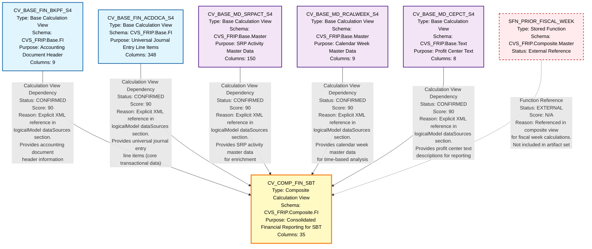

# Mermaid Lineage Flowchart - FIN_SBT

## Complete Lineage Visualization

## Diagram Legend

### Node Types
- **Light Blue Nodes**: Base Financial Transaction Views (CVS_FRIP.Base.FI schema)
- **Light Purple Nodes**: Base Master Data Views (CVS_FRIP.Base.Master/Text schemas)
- **Yellow Node**: Composite/Final View (CVS_FRIP.Composite.FI schema)
- **Light Red Dashed Node**: External Reference (not in artifact set)

### Relationship Types
- **Solid Arrows**: Confirmed Calculation View Dependencies (Score: 90)
- **Dashed Arrows**: External Function References (not scored)

### Relationship Status
- **CONFIRMED**: Relationship verified through explicit XML evidence
- **EXTERNAL**: Reference to artifact outside the analyzed set

### Confidence Scores
- **90**: Explicit XML-based dependency (Calculation View)
- **N/A**: External reference (not scored in lineage)

## Lineage Flow Summary

### Data Flow Pattern
The FIN_SBT lineage follows a **star schema integration pattern**:

1. **Base Layer** (5 views):
   - 2 Financial Transaction Views (ACDOCA, BKPF)
   - 3 Master Data Views (SRPACT, RCALWEEK, CEPCT)

2. **Integration Layer** (1 view):
   - CV_COMP_FIN_SBT consolidates all base views

3. **External Dependencies**:
   - SFN_PRIOR_FISCAL_WEEK stored function

### Key Characteristics
- **Direction**: Unidirectional (base → composite)
- **Depth**: Single-hop (2 layers)
- **Complexity**: Low (no intermediate transformations)
- **Coupling**: Loose (base views are independent)
- **Reusability**: High (base views can serve multiple consumers)

## Technical Details

### Schema Distribution
- **CVS_FRIP.Base.FI**: 2 views (Financial data)
- **CVS_FRIP.Base.Master**: 2 views (Master data)
- **CVS_FRIP.Base.Text**: 1 view (Text/descriptions)
- **CVS_FRIP.Composite.FI**: 1 view (Final output)
- **CVS_FRIP.Composite.Master**: 1 function (External)

### Column Distribution
- **Total Input Columns**: 524 (across 5 base views)
- **Total Output Columns**: 35 (composite view)
- **Reduction Ratio**: 93.3% (significant data consolidation)

### Relationship Evidence
All relationships are supported by explicit XML evidence found in:
- **File**: CV_COMP_FIN_SBT.xml
- **Section**: `<logicalModel><dataSources>`
- **Evidence Type**: Direct calculation view references

## Usage Notes

### For SQL Consolidation Agents
1. Process base views first (no dependencies between them)
2. Process composite view last (depends on all base views)
3. Account for external function SFN_PRIOR_FISCAL_WEEK
4. Preserve join logic and calculated fields from composite view

### For BigQuery Migration
1. Convert base views to BigQuery views or tables
2. Translate composite view joins to BigQuery SQL
3. Implement SFN_PRIOR_FISCAL_WEEK as BigQuery UDF
4. Validate calculated columns (e.g., WSL_NEGATIVE*-1, RIGHTSTR functions)

---

**Diagram Generated**: 2024
**Artifact Set**: FIN_SBT
**Total Nodes**: 7 (6 artifacts + 1 external reference)
**Total Relationships**: 6 (5 confirmed + 1 external)
**Overall Confidence**: 90/100
