# HANA to BigQuery - Complete Lineage Analysis Report
## MJE Forecast Workflow

---

## 1. Lineage Summary

| Metric | Count |
|--------|-------|
| **Total Files Analyzed** | 21 |
| **Total Relationships Identified** | 35 |
| **Total Lineage Paths Identified** | 5 |
| **Total Base Files Identified** | 11 |
| **Total Unresolved Relationships** | 0 |

---

## 2. File Inventory

| File | Type | Identified Purpose | Upstream Files | Downstream Files |
|------|------|-------------------|----------------|------------------|
| CV_BASE_FIN_ACDOCA_S4.xml | Calculation View | Base view for FI ACDOCA data | None | CV_COMP_FIN_MANUAL_JE.xml, CV_COMP_FIN_SBT.xml |
| CV_BASE_FIN_BKPF_S4.xml | Calculation View | Base view for FI BKPF data | None | CV_COMP_FIN_MANUAL_JE.xml, CV_COMP_FIN_SBT.xml |
| CV_BASE_FIN_WEEKLY_FORECAST_S4.txt | Calculation View | Base view for weekly forecast data | None | CV_COMP_FIN_FORECAST.txt |
| CV_BASE_MD_CEPCT_S4.txt | Calculation View | Base view for profit center text | None | CV_COMP_FIN_FORECAST.txt, CV_COMP_SKF_FORECAST.xml, CV_COMP_FIN_SBT.xml, CV_COMP_FIN_MANUAL_JE.xml, CV_COMP_SKF_MANUAL_JE.xml |
| CV_BASE_MD_COMPFL_S4.txt | Calculation View | Base view for comp flag master data | None | CV_COMP_FIN_FORECAST.txt, CV_COMP_SKF_FORECAST.xml, CV_COMP_FIN_MANUAL_JE.xml, CV_COMP_SKF_MANUAL_JE.xml |
| CV_BASE_MD_HRRP_NODE_S4.xml | Calculation View | Base view for hierarchy node data | None | CV_COMP_SKF_MANUAL_JE.xml |
| CV_BASE_MD_RCALWEEK_S4.txt | Calculation View | Base view for calendar week data | None | CV_COMP_FIN_FORECAST.txt, CV_COMP_SKF_FORECAST.xml, CV_COMP_FIN_SBT.xml, CV_COMP_FIN_MANUAL_JE.xml, CV_COMP_SKF_MANUAL_JE.xml |
| CV_BASE_MD_SRPACT_S4.txt | Calculation View | Base view for store activity master data | None | CV_COMP_FIN_FORECAST.txt, CV_COMP_SKF_FORECAST.xml, CV_COMP_FIN_SBT.xml, CV_COMP_FIN_MANUAL_JE.xml, CV_COMP_SKF_MANUAL_JE.xml |
| CV_BASE_SKF_FAGLSKF_PN_S4.xml | Calculation View | Base view for SKF ledger data | None | CV_COMP_SKF_MANUAL_JE.xml |
| CV_BASE_SKF_WEEKLY_FORECAST_S4.xml | Calculation View | Base view for SKF weekly forecast | None | CV_COMP_SKF_FORECAST.xml |
| GL_HEIR.CV_BASE_MD_HRRP_NODE_S4.xml | Calculation View | GL hierarchy node view | None | CV_COMP_FIN_MANUAL_JE.xml |
| PC_HEIR.CV_BASE_MD_HRRP_NODE_S4.xml | Calculation View | Profit center hierarchy node view | None | CV_COMP_FIN_MANUAL_JE.xml |
| PROD_CLASS_HEIR.CV_BASE_MD_HRRP_NODE_S4.xml | Calculation View | Product class hierarchy node view | None | CV_COMP_FIN_MANUAL_JE.xml |
| CV_COMP_FIN_FORECAST.txt | Calculation View | Composite view for FIN forecast | CV_BASE_FIN_WEEKLY_FORECAST_S4.txt, CV_BASE_MD_SRPACT_S4.txt, CV_BASE_MD_COMPFL_S4.txt, CV_BASE_MD_RCALWEEK_S4.txt, CV_BASE_MD_CEPCT_S4.txt | CV_COMP_FORECAST_MJE.txt |
| CV_COMP_SKF_FORECAST.xml | Calculation View | Composite view for SKF forecast | CV_BASE_SKF_WEEKLY_FORECAST_S4.xml, CV_BASE_MD_SRPACT_S4.txt, CV_BASE_MD_COMPFL_S4.txt, CV_BASE_MD_RCALWEEK_S4.txt, CV_BASE_MD_CEPCT_S4.txt | CV_COMP_FORECAST_MJE.txt |
| CV_COMP_FIN_SBT.xml | Calculation View | Composite view for FIN SBT | CV_BASE_FIN_BKPF_S4.xml, CV_BASE_FIN_ACDOCA_S4.xml, CV_BASE_MD_SRPACT_S4.txt, CV_BASE_MD_RCALWEEK_S4.txt, CV_BASE_MD_CEPCT_S4.txt | CV_COMP_FORECAST_MJE.txt |
| CV_COMP_FIN_MANUAL_JE.xml | Calculation View | Composite view for FIN manual journal entries | CV_BASE_FIN_ACDOCA_S4.xml, CV_BASE_MD_SRPACT_S4.txt, CV_BASE_MD_HRRP_NODE_S4.xml, CV_BASE_FIN_BKPF_S4.xml, GL_HEIR.CV_BASE_MD_HRRP_NODE_S4.xml, PC_HEIR.CV_BASE_MD_HRRP_NODE_S4.xml, PROD_CLASS_HEIR.CV_BASE_MD_HRRP_NODE_S4.xml, CV_BASE_MD_COMPFL_S4.txt, CV_BASE_MD_CEPCT_S4.txt, CV_BASE_MD_RCALWEEK_S4.txt | CV_COMP_FORECAST_MJE.txt |
| CV_COMP_SKF_MANUAL_JE.xml | Calculation View | Composite view for SKF manual journal entries | CV_BASE_SKF_FAGLSKF_PN_S4.xml, CV_BASE_MD_SRPACT_S4.txt, CV_BASE_MD_HRRP_NODE_S4.xml, CV_BASE_MD_COMPFL_S4.txt, CV_BASE_MD_RCALWEEK_S4.txt, CV_BASE_MD_CEPCT_S4.txt | CV_COMP_FORECAST_MJE.txt |
| CV_COMP_FORECAST_MJE.txt | Calculation View | Main composite view combining all forecast and MJE data | CV_COMP_FIN_FORECAST.txt, CV_COMP_SKF_FORECAST.xml, CV_COMP_FIN_SBT.xml, CV_COMP_FIN_MANUAL_JE.xml, CV_COMP_SKF_MANUAL_JE.xml | STP_WSS_FORECAST_MJE.txt |
| STP_WSS_FORECAST_MJE.txt | Stored Procedure | Stored procedure to populate target table from CV_COMP_FORECAST_MJE | CV_COMP_FORECAST_MJE.txt | CV_COMP_FORECAST_MJE_STATIC.txt |
| CV_COMP_FORECAST_MJE_STATIC.txt | Table | Static table populated by stored procedure | STP_WSS_FORECAST_MJE.txt | None |

---

## 3. File Relationships

| Source File | Target File | Relationship | Score | Reason |
|------------|------------|--------------|-------|---------|
| CV_BASE_FIN_WEEKLY_FORECAST_S4.txt | CV_COMP_FIN_FORECAST.txt | Calculation View Dependency | 90 | Explicitly referenced in XML as data source: `/CVS_FRIP.Base.FI/calculationviews/CV_BASE_FIN_WEEKLY_FORECAST_S4` |
| CV_BASE_MD_SRPACT_S4.txt | CV_COMP_FIN_FORECAST.txt | Calculation View Dependency | 90 | Explicitly referenced in XML as data source: `/CVS_FRIP.Base.Master/calculationviews/CV_BASE_MD_SRPACT_S4` |
| CV_BASE_MD_COMPFL_S4.txt | CV_COMP_FIN_FORECAST.txt | Calculation View Dependency | 90 | Explicitly referenced in XML as data source: `/CVS_FRIP.Base.Master/calculationviews/CV_BASE_MD_COMPFL_S4` |
| CV_BASE_MD_RCALWEEK_S4.txt | CV_COMP_FIN_FORECAST.txt | Calculation View Dependency | 90 | Explicitly referenced in XML as data source: `/CVS_FRIP.Base.Master/calculationviews/CV_BASE_MD_RCALWEEK_S4` |
| CV_BASE_MD_CEPCT_S4.txt | CV_COMP_FIN_FORECAST.txt | Calculation View Dependency | 90 | Explicitly referenced in XML as data source: `/CVS_FRIP.Base.Text/calculationviews/CV_BASE_MD_CEPCT_S4` |
| CV_BASE_SKF_WEEKLY_FORECAST_S4.xml | CV_COMP_SKF_FORECAST.xml | Calculation View Dependency | 90 | Explicitly referenced in XML as data source: `/CVS_FRIP.Base.FI/calculationviews/CV_BASE_SKF_WEEKLY_FORECAST_S4` |
| CV_BASE_MD_SRPACT_S4.txt | CV_COMP_SKF_FORECAST.xml | Calculation View Dependency | 90 | Explicitly referenced in XML as data source: `/CVS_FRIP.Base.Master/calculationviews/CV_BASE_MD_SRPACT_S4` |
| CV_BASE_MD_COMPFL_S4.txt | CV_COMP_SKF_FORECAST.xml | Calculation View Dependency | 90 | Explicitly referenced in XML as data source: `/CVS_FRIP.Base.Master/calculationviews/CV_BASE_MD_COMPFL_S4` |
| CV_BASE_MD_RCALWEEK_S4.txt | CV_COMP_SKF_FORECAST.xml | Calculation View Dependency | 90 | Explicitly referenced in XML as data source: `/CVS_FRIP.Base.Master/calculationviews/CV_BASE_MD_RCALWEEK_S4` |
| CV_BASE_MD_CEPCT_S4.txt | CV_COMP_SKF_FORECAST.xml | Calculation View Dependency | 90 | Explicitly referenced in XML as data source: `/CVS_FRIP.Base.Text/calculationviews/CV_BASE_MD_CEPCT_S4` |
| CV_BASE_FIN_BKPF_S4.xml | CV_COMP_FIN_SBT.xml | Calculation View Dependency | 90 | Explicitly referenced in XML as data source: `/CVS_FRIP.Base.FI/calculationviews/CV_BASE_FIN_BKPF_S4` |
| CV_BASE_FIN_ACDOCA_S4.xml | CV_COMP_FIN_SBT.xml | Calculation View Dependency | 90 | Explicitly referenced in XML as data source: `/CVS_FRIP.Base.FI/calculationviews/CV_BASE_FIN_ACDOCA_S4` |
| CV_BASE_MD_SRPACT_S4.txt | CV_COMP_FIN_SBT.xml | Calculation View Dependency | 90 | Explicitly referenced in XML as data source: `/CVS_FRIP.Base.Master/calculationviews/CV_BASE_MD_SRPACT_S4` |
| CV_BASE_MD_RCALWEEK_S4.txt | CV_COMP_FIN_SBT.xml | Calculation View Dependency | 90 | Explicitly referenced in XML as data source: `/CVS_FRIP.Base.Master/calculationviews/CV_BASE_MD_RCALWEEK_S4` |
| CV_BASE_MD_CEPCT_S4.txt | CV_COMP_FIN_SBT.xml | Calculation View Dependency | 90 | Explicitly referenced in XML as data source: `/CVS_FRIP.Base.Text/calculationviews/CV_BASE_MD_CEPCT_S4` |
| CV_BASE_FIN_ACDOCA_S4.xml | CV_COMP_FIN_MANUAL_JE.xml | Calculation View Dependency | 90 | Explicitly referenced in XML as data source: `/CVS_FRIP.Base.FI/calculationviews/CV_BASE_FIN_ACDOCA_S4` |
| CV_BASE_MD_SRPACT_S4.txt | CV_COMP_FIN_MANUAL_JE.xml | Calculation View Dependency | 90 | Explicitly referenced in XML as data source: `/CVS_FRIP.Base.Master/calculationviews/CV_BASE_MD_SRPACT_S4` |
| CV_BASE_MD_HRRP_NODE_S4.xml | CV_COMP_FIN_MANUAL_JE.xml | Calculation View Dependency | 90 | Explicitly referenced in XML as data source: `/CVS_FRIP.Base.Master/calculationviews/CV_BASE_MD_HRRP_NODE_S4` |
| CV_BASE_FIN_BKPF_S4.xml | CV_COMP_FIN_MANUAL_JE.xml | Calculation View Dependency | 90 | Explicitly referenced in XML as data source: `/CVS_FRIP.Base.FI/calculationviews/CV_BASE_FIN_BKPF_S4` |
| GL_HEIR.CV_BASE_MD_HRRP_NODE_S4.xml | CV_COMP_FIN_MANUAL_JE.xml | Calculation View Dependency | 90 | Explicitly referenced in XML as data source for GL hierarchy |
| PC_HEIR.CV_BASE_MD_HRRP_NODE_S4.xml | CV_COMP_FIN_MANUAL_JE.xml | Calculation View Dependency | 90 | Explicitly referenced in XML as data source for PC hierarchy |
| PROD_CLASS_HEIR.CV_BASE_MD_HRRP_NODE_S4.xml | CV_COMP_FIN_MANUAL_JE.xml | Calculation View Dependency | 90 | Explicitly referenced in XML as data source for Product Class hierarchy |
| CV_BASE_MD_COMPFL_S4.txt | CV_COMP_FIN_MANUAL_JE.xml | Calculation View Dependency | 90 | Explicitly referenced in XML as data source: `/CVS_FRIP.Base.Master/calculationviews/CV_BASE_MD_COMPFL_S4` |
| CV_BASE_MD_CEPCT_S4.txt | CV_COMP_FIN_MANUAL_JE.xml | Calculation View Dependency | 90 | Explicitly referenced in XML as data source: `/CVS_FRIP.Base.Text/calculationviews/CV_BASE_MD_CEPCT_S4` |
| CV_BASE_MD_RCALWEEK_S4.txt | CV_COMP_FIN_MANUAL_JE.xml | Calculation View Dependency | 90 | Explicitly referenced in XML as data source: `/CVS_FRIP.Base.Master/calculationviews/CV_BASE_MD_RCALWEEK_S4` |
| CV_BASE_SKF_FAGLSKF_PN_S4.xml | CV_COMP_SKF_MANUAL_JE.xml | Calculation View Dependency | 90 | Explicitly referenced in XML as data source: `/CVS_FRIP.Base.FI/calculationviews/CV_BASE_SKF_FAGLSKF_PN_S4` |
| CV_BASE_MD_SRPACT_S4.txt | CV_COMP_SKF_MANUAL_JE.xml | Calculation View Dependency | 90 | Explicitly referenced in XML as data source: `/CVS_FRIP.Base.Master/calculationviews/CV_BASE_MD_SRPACT_S4` |
| CV_BASE_MD_HRRP_NODE_S4.xml | CV_COMP_SKF_MANUAL_JE.xml | Calculation View Dependency | 90 | Explicitly referenced in XML as data source: `/CVS_FRIP.Base.Master/calculationviews/CV_BASE_MD_HRRP_NODE_S4` |
| CV_BASE_MD_COMPFL_S4.txt | CV_COMP_SKF_MANUAL_JE.xml | Calculation View Dependency | 90 | Explicitly referenced in XML as data source: `/CVS_FRIP.Base.Master/calculationviews/CV_BASE_MD_COMPFL_S4` |
| CV_BASE_MD_RCALWEEK_S4.txt | CV_COMP_SKF_MANUAL_JE.xml | Calculation View Dependency | 90 | Explicitly referenced in XML as data source: `/CVS_FRIP.Base.Master/calculationviews/CV_BASE_MD_RCALWEEK_S4` |
| CV_BASE_MD_CEPCT_S4.txt | CV_COMP_SKF_MANUAL_JE.xml | Calculation View Dependency | 90 | Explicitly referenced in XML as data source: `/CVS_FRIP.Base.Text/calculationviews/CV_BASE_MD_CEPCT_S4` |
| CV_COMP_FIN_FORECAST.txt | CV_COMP_FORECAST_MJE.txt | Calculation View Dependency | 90 | Explicitly referenced in XML as data source: `/CVS_FRIP.Composite.FI/calculationviews/CV_COMP_FIN_FORECAST` |
| CV_COMP_SKF_FORECAST.xml | CV_COMP_FORECAST_MJE.txt | Calculation View Dependency | 90 | Explicitly referenced in XML as data source: `/CVS_FRIP.Composite.FI/calculationviews/CV_COMP_SKF_FORECAST` |
| CV_COMP_FIN_SBT.xml | CV_COMP_FORECAST_MJE.txt | Calculation View Dependency | 90 | Explicitly referenced in XML as data source: `/CVS_FRIP.Composite.FI/calculationviews/CV_COMP_FIN_SBT` |
| CV_COMP_FIN_MANUAL_JE.xml | CV_COMP_FORECAST_MJE.txt | Calculation View Dependency | 90 | Explicitly referenced in XML as data source: `/CVS_FRIP.Composite.FI/calculationviews/CV_COMP_FIN_MANUAL_JE` |
| CV_COMP_SKF_MANUAL_JE.xml | CV_COMP_FORECAST_MJE.txt | Calculation View Dependency | 90 | Explicitly referenced in XML as data source: `/CVS_FRIP.Composite.FI/calculationviews/CV_COMP_SKF_MANUAL_JE` |
| CV_COMP_FORECAST_MJE.txt | STP_WSS_FORECAST_MJE.txt | Logic Provider | 100 | Stored procedure explicitly reads from calculation view: `FROM "_SYS_BIC"."CVS_FRIP.Composite.FI/CV_COMP_FORECAST_MJE"` |
| STP_WSS_FORECAST_MJE.txt | CV_COMP_FORECAST_MJE_STATIC.txt | Stored Procedure Dependency | 95 | Stored procedure explicitly populates table: `INSERT INTO "CVS_FRIP"."CVS_FRIP.Table::TBL_WSS_FORECAST_MJE"` and CV_COMP_FORECAST_MJE_STATIC references this table |

---

## 4. Complete Lineage

### Lineage Path 1: FIN Forecast Flow
**Confidence Score: 90** - All relationships are explicitly defined in XML with clear calculation view dependencies

```
CV_BASE_FIN_WEEKLY_FORECAST_S4.txt
    ↓
CV_BASE_MD_SRPACT_S4.txt ──┐
CV_BASE_MD_COMPFL_S4.txt ──┤
CV_BASE_MD_RCALWEEK_S4.txt ┼──→ CV_COMP_FIN_FORECAST.txt
CV_BASE_MD_CEPCT_S4.txt ───┘
    ↓
CV_COMP_FORECAST_MJE.txt
    ↓
STP_WSS_FORECAST_MJE.txt
    ↓
CV_COMP_FORECAST_MJE_STATIC.txt
```

### Lineage Path 2: SKF Forecast Flow
**Confidence Score: 90** - All relationships are explicitly defined in XML with clear calculation view dependencies

```
CV_BASE_SKF_WEEKLY_FORECAST_S4.xml
    ↓
CV_BASE_MD_SRPACT_S4.txt ──┐
CV_BASE_MD_COMPFL_S4.txt ──┤
CV_BASE_MD_RCALWEEK_S4.txt ┼──→ CV_COMP_SKF_FORECAST.xml
CV_BASE_MD_CEPCT_S4.txt ───┘
    ↓
CV_COMP_FORECAST_MJE.txt
    ↓
STP_WSS_FORECAST_MJE.txt
    ↓
CV_COMP_FORECAST_MJE_STATIC.txt
```

### Lineage Path 3: FIN SBT Flow
**Confidence Score: 90** - All relationships are explicitly defined in XML with clear calculation view dependencies

```
CV_BASE_FIN_BKPF_S4.xml ────┐
CV_BASE_FIN_ACDOCA_S4.xml ──┤
CV_BASE_MD_SRPACT_S4.txt ───┤
CV_BASE_MD_RCALWEEK_S4.txt ─┼──→ CV_COMP_FIN_SBT.xml
CV_BASE_MD_CEPCT_S4.txt ────┘
    ↓
CV_COMP_FORECAST_MJE.txt
    ↓
STP_WSS_FORECAST_MJE.txt
    ↓
CV_COMP_FORECAST_MJE_STATIC.txt
```

### Lineage Path 4: FIN Manual JE Flow
**Confidence Score: 90** - All relationships are explicitly defined in XML with clear calculation view dependencies

```
CV_BASE_FIN_ACDOCA_S4.xml ──────────────┐
CV_BASE_MD_SRPACT_S4.txt ───────────────┤
CV_BASE_MD_HRRP_NODE_S4.xml ────────────┤
CV_BASE_FIN_BKPF_S4.xml ────────────────┤
GL_HEIR.CV_BASE_MD_HRRP_NODE_S4.xml ────┤
PC_HEIR.CV_BASE_MD_HRRP_NODE_S4.xml ────┼──→ CV_COMP_FIN_MANUAL_JE.xml
PROD_CLASS_HEIR.CV_BASE_MD_HRRP_NODE_S4.xml ┤
CV_BASE_MD_COMPFL_S4.txt ───────────────┤
CV_BASE_MD_CEPCT_S4.txt ────────────────┤
CV_BASE_MD_RCALWEEK_S4.txt ─────────────┘
    ↓
CV_COMP_FORECAST_MJE.txt
    ↓
STP_WSS_FORECAST_MJE.txt
    ↓
CV_COMP_FORECAST_MJE_STATIC.txt
```

### Lineage Path 5: SKF Manual JE Flow
**Confidence Score: 90** - All relationships are explicitly defined in XML with clear calculation view dependencies

```
CV_BASE_SKF_FAGLSKF_PN_S4.xml ──┐
CV_BASE_MD_SRPACT_S4.txt ───────┤
CV_BASE_MD_HRRP_NODE_S4.xml ────┤
CV_BASE_MD_COMPFL_S4.txt ───────┼──→ CV_COMP_SKF_MANUAL_JE.xml
CV_BASE_MD_RCALWEEK_S4.txt ─────┤
CV_BASE_MD_CEPCT_S4.txt ────────┘
    ↓
CV_COMP_FORECAST_MJE.txt
    ↓
STP_WSS_FORECAST_MJE.txt
    ↓
CV_COMP_FORECAST_MJE_STATIC.txt
```

---

## 5. Mermaid Lineage Diagram

```mermaid
flowchart TD
    %% Base Layer - FIN Forecast
    A1[CV_BASE_FIN_WEEKLY_FORECAST_S4.txt<br/>Schema: CVS_FRIP.Base.FI<br/>Type: Base Calculation View]
    
    %% Base Layer - SKF Forecast
    A2[CV_BASE_SKF_WEEKLY_FORECAST_S4.xml<br/>Schema: CVS_FRIP.Base.FI<br/>Type: Base Calculation View]
    
    %% Base Layer - FIN Actuals
    A3[CV_BASE_FIN_ACDOCA_S4.xml<br/>Schema: CVS_FRIP.Base.FI<br/>Type: Base Calculation View]
    A4[CV_BASE_FIN_BKPF_S4.xml<br/>Schema: CVS_FRIP.Base.FI<br/>Type: Base Calculation View]
    
    %% Base Layer - SKF Actuals
    A5[CV_BASE_SKF_FAGLSKF_PN_S4.xml<br/>Schema: CVS_FRIP.Base.FI<br/>Type: Base Calculation View]
    
    %% Base Layer - Master Data
    M1[CV_BASE_MD_SRPACT_S4.txt<br/>Schema: CVS_FRIP.Base.Master<br/>Type: Base Calculation View]
    M2[CV_BASE_MD_COMPFL_S4.txt<br/>Schema: CVS_FRIP.Base.Master<br/>Type: Base Calculation View]
    M3[CV_BASE_MD_RCALWEEK_S4.txt<br/>Schema: CVS_FRIP.Base.Master<br/>Type: Base Calculation View]
    M4[CV_BASE_MD_CEPCT_S4.txt<br/>Schema: CVS_FRIP.Base.Text<br/>Type: Base Calculation View]
    M5[CV_BASE_MD_HRRP_NODE_S4.xml<br/>Schema: CVS_FRIP.Base.Master<br/>Type: Base Calculation View]
    
    %% Hierarchy Views
    H1[GL_HEIR.CV_BASE_MD_HRRP_NODE_S4.xml<br/>Schema: CVS_FRIP.Base.Master<br/>Type: Hierarchy View]
    H2[PC_HEIR.CV_BASE_MD_HRRP_NODE_S4.xml<br/>Schema: CVS_FRIP.Base.Master<br/>Type: Hierarchy View]
    H3[PROD_CLASS_HEIR.CV_BASE_MD_HRRP_NODE_S4.xml<br/>Schema: CVS_FRIP.Base.Master<br/>Type: Hierarchy View]
    
    %% Composite Layer
    C1[CV_COMP_FIN_FORECAST.txt<br/>Schema: CVS_FRIP.Composite.FI<br/>Type: Composite Calculation View]
    C2[CV_COMP_SKF_FORECAST.xml<br/>Schema: CVS_FRIP.Composite.FI<br/>Type: Composite Calculation View]
    C3[CV_COMP_FIN_SBT.xml<br/>Schema: CVS_FRIP.Composite.FI<br/>Type: Composite Calculation View]
    C4[CV_COMP_FIN_MANUAL_JE.xml<br/>Schema: CVS_FRIP.Composite.FI<br/>Type: Composite Calculation View]
    C5[CV_COMP_SKF_MANUAL_JE.xml<br/>Schema: CVS_FRIP.Composite.FI<br/>Type: Composite Calculation View]
    
    %% Final Composite
    F1[CV_COMP_FORECAST_MJE.txt<br/>Schema: CVS_FRIP.Composite.FI<br/>Type: Final Composite View]
    
    %% Stored Procedure
    SP1[STP_WSS_FORECAST_MJE.txt<br/>Schema: CVS_FRIP.Procedure.FI<br/>Type: Stored Procedure]
    
    %% Target Table
    T1[CV_COMP_FORECAST_MJE_STATIC.txt<br/>Schema: CVS_FRIP.Table<br/>Type: Static Table<br/>Physical: TBL_WSS_FORECAST_MJE]
    
    %% FIN Forecast Flow
    A1 -->|Calculation View Dependency<br/>Score: 90<br/>Reason: Explicit XML reference| C1
    M1 -->|Calculation View Dependency<br/>Score: 90<br/>Reason: Explicit XML reference| C1
    M2 -->|Calculation View Dependency<br/>Score: 90<br/>Reason: Explicit XML reference| C1
    M3 -->|Calculation View Dependency<br/>Score: 90<br/>Reason: Explicit XML reference| C1
    M4 -->|Calculation View Dependency<br/>Score: 90<br/>Reason: Explicit XML reference| C1
    
    %% SKF Forecast Flow
    A2 -->|Calculation View Dependency<br/>Score: 90<br/>Reason: Explicit XML reference| C2
    M1 -->|Calculation View Dependency<br/>Score: 90<br/>Reason: Explicit XML reference| C2
    M2 -->|Calculation View Dependency<br/>Score: 90<br/>Reason: Explicit XML reference| C2
    M3 -->|Calculation View Dependency<br/>Score: 90<br/>Reason: Explicit XML reference| C2
    M4 -->|Calculation View Dependency<br/>Score: 90<br/>Reason: Explicit XML reference| C2
    
    %% FIN SBT Flow
    A3 -->|Calculation View Dependency<br/>Score: 90<br/>Reason: Explicit XML reference| C3
    A4 -->|Calculation View Dependency<br/>Score: 90<br/>Reason: Explicit XML reference| C3
    M1 -->|Calculation View Dependency<br/>Score: 90<br/>Reason: Explicit XML reference| C3
    M3 -->|Calculation View Dependency<br/>Score: 90<br/>Reason: Explicit XML reference| C3
    M4 -->|Calculation View Dependency<br/>Score: 90<br/>Reason: Explicit XML reference| C3
    
    %% FIN Manual JE Flow
    A3 -->|Calculation View Dependency<br/>Score: 90<br/>Reason: Explicit XML reference| C4
    A4 -->|Calculation View Dependency<br/>Score: 90<br/>Reason: Explicit XML reference| C4
    M1 -->|Calculation View Dependency<br/>Score: 90<br/>Reason: Explicit XML reference| C4
    M2 -->|Calculation View Dependency<br/>Score: 90<br/>Reason: Explicit XML reference| C4
    M3 -->|Calculation View Dependency<br/>Score: 90<br/>Reason: Explicit XML reference| C4
    M4 -->|Calculation View Dependency<br/>Score: 90<br/>Reason: Explicit XML reference| C4
    M5 -->|Calculation View Dependency<br/>Score: 90<br/>Reason: Explicit XML reference| C4
    H1 -->|Calculation View Dependency<br/>Score: 90<br/>Reason: GL Hierarchy reference| C4
    H2 -->|Calculation View Dependency<br/>Score: 90<br/>Reason: PC Hierarchy reference| C4
    H3 -->|Calculation View Dependency<br/>Score: 90<br/>Reason: Product Class Hierarchy reference| C4
    
    %% SKF Manual JE Flow
    A5 -->|Calculation View Dependency<br/>Score: 90<br/>Reason: Explicit XML reference| C5
    M1 -->|Calculation View Dependency<br/>Score: 90<br/>Reason: Explicit XML reference| C5
    M2 -->|Calculation View Dependency<br/>Score: 90<br/>Reason: Explicit XML reference| C5
    M3 -->|Calculation View Dependency<br/>Score: 90<br/>Reason: Explicit XML reference| C5
    M4 -->|Calculation View Dependency<br/>Score: 90<br/>Reason: Explicit XML reference| C5
    M5 -->|Calculation View Dependency<br/>Score: 90<br/>Reason: Explicit XML reference| C5
    
    %% Composite to Final
    C1 -->|Calculation View Dependency<br/>Score: 90<br/>Reason: Explicit XML reference| F1
    C2 -->|Calculation View Dependency<br/>Score: 90<br/>Reason: Explicit XML reference| F1
    C3 -->|Calculation View Dependency<br/>Score: 90<br/>Reason: Explicit XML reference| F1
    C4 -->|Calculation View Dependency<br/>Score: 90<br/>Reason: Explicit XML reference| F1
    C5 -->|Calculation View Dependency<br/>Score: 90<br/>Reason: Explicit XML reference| F1
    
    %% Final to Stored Procedure
    F1 -->|Logic Provider<br/>Score: 100<br/>Reason: Explicit SQL SELECT in procedure| SP1
    
    %% Stored Procedure to Table
    SP1 -->|Stored Procedure Dependency<br/>Score: 95<br/>Reason: Explicit INSERT statement| T1
    
    %% Styling
    classDef baseClass fill:#e1f5ff,stroke:#01579b,stroke-width:2px
    classDef masterClass fill:#fff9c4,stroke:#f57f17,stroke-width:2px
    classDef compositeClass fill:#f3e5f5,stroke:#4a148c,stroke-width:2px
    classDef finalClass fill:#e8f5e9,stroke:#1b5e20,stroke-width:2px
    classDef procClass fill:#ffe0b2,stroke:#e65100,stroke-width:2px
    classDef tableClass fill:#ffebee,stroke:#b71c1c,stroke-width:2px
    
    class A1,A2,A3,A4,A5 baseClass
    class M1,M2,M3,M4,M5,H1,H2,H3 masterClass
    class C1,C2,C3,C4,C5 compositeClass
    class F1 finalClass
    class SP1 procClass
    class T1 tableClass
```



---

## 6. Base Files

| Base File | Reason | Score |
|-----------|--------|-------|
| CV_BASE_FIN_WEEKLY_FORECAST_S4.txt | Base calculation view with no upstream dependencies; serves as source for FIN forecast data | 100 |
| CV_BASE_SKF_WEEKLY_FORECAST_S4.xml | Base calculation view with no upstream dependencies; serves as source for SKF forecast data | 100 |
| CV_BASE_FIN_ACDOCA_S4.xml | Base calculation view with no upstream dependencies; serves as source for FI ACDOCA actuals data | 100 |
| CV_BASE_FIN_BKPF_S4.xml | Base calculation view with no upstream dependencies; serves as source for FI BKPF header data | 100 |
| CV_BASE_SKF_FAGLSKF_PN_S4.xml | Base calculation view with no upstream dependencies; serves as source for SKF ledger data | 100 |
| CV_BASE_MD_SRPACT_S4.txt | Base calculation view with no upstream dependencies; provides store activity master data | 100 |
| CV_BASE_MD_COMPFL_S4.txt | Base calculation view with no upstream dependencies; provides comp flag master data | 100 |
| CV_BASE_MD_RCALWEEK_S4.txt | Base calculation view with no upstream dependencies; provides calendar week master data | 100 |
| CV_BASE_MD_CEPCT_S4.txt | Base calculation view with no upstream dependencies; provides profit center text data | 100 |
| CV_BASE_MD_HRRP_NODE_S4.xml | Base calculation view with no upstream dependencies; provides hierarchy node data | 100 |
| GL_HEIR.CV_BASE_MD_HRRP_NODE_S4.xml | Base hierarchy view with no upstream dependencies; provides GL hierarchy data | 100 |
| PC_HEIR.CV_BASE_MD_HRRP_NODE_S4.xml | Base hierarchy view with no upstream dependencies; provides profit center hierarchy data | 100 |
| PROD_CLASS_HEIR.CV_BASE_MD_HRRP_NODE_S4.xml | Base hierarchy view with no upstream dependencies; provides product class hierarchy data | 100 |

---

## 7. Final/Downstream Files

| File | Reason | Score |
|------|--------|-------|
| CV_COMP_FORECAST_MJE_STATIC.txt | Final target table populated by stored procedure; no downstream consumers identified | 100 |

---

## 8. Unresolved Relationships

**No unresolved relationships identified.** All file dependencies have been successfully traced with explicit evidence from XML definitions and SQL code.

---

## 9. Final Lineage Assessment

### Base Files
The workflow begins with **13 base files** organized into three categories:

1. **Transactional Base Views (5 files)**:
   - CV_BASE_FIN_WEEKLY_FORECAST_S4.txt - FIN forecast source
   - CV_BASE_SKF_WEEKLY_FORECAST_S4.xml - SKF forecast source
   - CV_BASE_FIN_ACDOCA_S4.xml - FI actuals source
   - CV_BASE_FIN_BKPF_S4.xml - FI header source
   - CV_BASE_SKF_FAGLSKF_PN_S4.xml - SKF ledger source

2. **Master Data Base Views (5 files)**:
   - CV_BASE_MD_SRPACT_S4.txt - Store activity master
   - CV_BASE_MD_COMPFL_S4.txt - Comp flag master
   - CV_BASE_MD_RCALWEEK_S4.txt - Calendar week master
   - CV_BASE_MD_CEPCT_S4.txt - Profit center text
   - CV_BASE_MD_HRRP_NODE_S4.xml - Hierarchy node master

3. **Hierarchy Views (3 files)**:
   - GL_HEIR.CV_BASE_MD_HRRP_NODE_S4.xml - GL hierarchy
   - PC_HEIR.CV_BASE_MD_HRRP_NODE_S4.xml - Profit center hierarchy
   - PROD_CLASS_HEIR.CV_BASE_MD_HRRP_NODE_S4.xml - Product class hierarchy

### Main Lineage Paths

The workflow implements a **5-stream convergent architecture**:

1. **FIN Forecast Stream**: Combines weekly forecast with master data
2. **SKF Forecast Stream**: Combines SKF forecast with master data
3. **FIN SBT Stream**: Combines FI actuals for SBT calculation
4. **FIN Manual JE Stream**: Combines FI actuals with hierarchies for manual journal entries
5. **SKF Manual JE Stream**: Combines SKF actuals with hierarchies for manual journal entries

All streams converge at **CV_COMP_FORECAST_MJE.txt**, which serves as the single source for the stored procedure.

### File-to-File Relationships

**Total Relationships: 37**

- **35 Calculation View Dependencies** (Score: 90) - All explicitly defined in XML
- **1 Logic Provider Relationship** (Score: 100) - Stored procedure reads from calculation view
- **1 Stored Procedure Dependency** (Score: 95) - Stored procedure populates target table

### Lineage Scores

| Relationship Type | Count | Average Score | Confidence Level |
|------------------|-------|---------------|------------------|
| Calculation View Dependency | 35 | 90 | High - Explicit XML references |
| Logic Provider | 1 | 100 | Very High - Explicit SQL SELECT |
| Stored Procedure Dependency | 1 | 95 | Very High - Explicit INSERT |
| **Overall** | **37** | **90.4** | **High** |

### Reasons for Scores

1. **Score 100 (Logic Provider)**: The stored procedure explicitly references the calculation view in its SELECT statement: `FROM "_SYS_BIC"."CVS_FRIP.Composite.FI/CV_COMP_FORECAST_MJE"`

2. **Score 95 (Stored Procedure Dependency)**: The stored procedure explicitly inserts into the target table: `INSERT INTO "CVS_FRIP"."CVS_FRIP.Table::TBL_WSS_FORECAST_MJE"`

3. **Score 90 (Calculation View Dependencies)**: All calculation view dependencies are explicitly defined in XML using `<input>` elements with full path references

### Unresolved Relationships

**None.** All relationships have been successfully identified and documented with explicit evidence.

### Key Findings

1. **Clear Separation of Concerns**: The architecture clearly separates base views, composite views, and final aggregation
2. **Reusable Master Data**: Master data views (SRPACT, COMPFL, RCALWEEK, CEPCT) are reused across multiple composite views
3. **Hierarchy Integration**: Three hierarchy views provide dimensional context for manual journal entries
4. **Single Point of Consolidation**: CV_COMP_FORECAST_MJE.txt serves as the single consolidation point for all streams
5. **Stored Procedure Pattern**: STP_WSS_FORECAST_MJE follows the standard pattern of reading from a calculation view and populating a static table
6. **No Circular Dependencies**: The lineage is strictly hierarchical with no circular references

### Validation Status

✅ **All files classified** (21/21)
✅ **All dependencies traced** (37/37)
✅ **All relationships documented** (37/37)
✅ **No unresolved relationships** (0)
✅ **Stored procedures included in lineage**
✅ **No ETL tables as primary lineage nodes**

---

## Relationship Type Summary

| Type | Description | Count | Usage |
|------|-------------|-------|-------|
| **Calculation View Dependency** | Direct reference from one calculation view to another via XML input element | 35 | Primary relationship type for view-to-view dependencies |
| **Logic Provider** | Stored procedure reads from calculation view | 1 | Used when stored procedure consumes calculation view data |
| **Stored Procedure Dependency** | Stored procedure populates target table | 1 | Used when stored procedure writes to table |

---

## Classification Summary

| Classification | Count | Files |
|---------------|-------|-------|
| **USED** | 21 | All files are actively used in the lineage |
| **NOT USED** | 0 | No unused files identified |

---

*End of Lineage Analysis Report*
