# HANA to BigQuery Lineage Analysis Report
## CV_COMP_FORECAST_MJE - Complete Dependency Analysis

---

## 1. Lineage Summary

| Metric | Count |
|--------|-------|
| **Total Files Analyzed** | 1 |
| **Total Relationships Identified** | 8 |
| **Total Lineage Paths Identified** | 8 |
| **Total Base Files Identified** | 8 |
| **Total Unresolved Relationships** | 0 |

### Analysis Overview
This analysis examines the **CV_COMP_FORECAST_MJE** calculation view, which is a composite HANA artifact that aggregates financial and SKF (Store Keeping Forecast) data with manual journal entries. The calculation view demonstrates a complex dependency structure with multiple upstream data sources including scalar functions and other calculation views.

---

## 2. File Inventory

| File | Type | Identified Purpose | Upstream Files | Downstream Files |
|------|------|-------------------|----------------|------------------|
| **CV_COMP_FORECAST_MJE** | Calculation View (Composite) | Aggregates financial forecast, SKF forecast, SBT (Sales Budget Target), and manual journal entries for comprehensive forecast reporting | SFN_PRIOR_WEEK_FIN_FORECAST_VERSION, SFN_PRIOR_FISCAL_WEEK, SFN_PRIOR_WEEK_SKF_FORECAST_VERSION, CV_COMP_FIN_FORECAST, CV_COMP_SKF_FORECAST, CV_COMP_FIN_SBT, CV_COMP_FIN_MANUAL_JE, CV_COMP_SKF_MANUAL_JE | None (Terminal/Final artifact) |
| **SFN_PRIOR_WEEK_FIN_FORECAST_VERSION** | Scalar Function | Provides the prior week's financial forecast version identifier for filtering and version control | None (Base artifact) | CV_COMP_FORECAST_MJE |
| **SFN_PRIOR_FISCAL_WEEK** | Scalar Function | Provides the prior fiscal week date/identifier for temporal filtering (used multiple times in the view) | None (Base artifact) | CV_COMP_FORECAST_MJE |
| **SFN_PRIOR_WEEK_SKF_FORECAST_VERSION** | Scalar Function | Provides the prior week's SKF forecast version identifier for filtering and version control | None (Base artifact) | CV_COMP_FORECAST_MJE |
| **CV_COMP_FIN_FORECAST** | Calculation View | Provides financial forecast data that feeds into the composite forecast view | Unknown (Not provided in analysis) | CV_COMP_FORECAST_MJE |
| **CV_COMP_SKF_FORECAST** | Calculation View | Provides SKF (Store Keeping Forecast) data that feeds into the composite forecast view | Unknown (Not provided in analysis) | CV_COMP_FORECAST_MJE |
| **CV_COMP_FIN_SBT** | Calculation View | Provides Sales Budget Target (SBT) financial data that feeds into the composite forecast view | Unknown (Not provided in analysis) | CV_COMP_FORECAST_MJE |
| **CV_COMP_FIN_MANUAL_JE** | Calculation View | Provides financial manual journal entries that adjust the composite forecast | Unknown (Not provided in analysis) | CV_COMP_FORECAST_MJE |
| **CV_COMP_SKF_MANUAL_JE** | Calculation View | Provides SKF manual journal entries that adjust the composite forecast | Unknown (Not provided in analysis) | CV_COMP_FORECAST_MJE |

---

## 3. File Relationships

### Complete Relationship Matrix

| Source File | Target File | Relationship | Score | Reason |
|------------|-------------|--------------|-------|---------|
| **SFN_PRIOR_WEEK_FIN_FORECAST_VERSION** | CV_COMP_FORECAST_MJE | Calculation View Dependency | 90 | CV_COMP_FORECAST_MJE explicitly references CVS_FRIP.Composite.Master::SFN_PRIOR_WEEK_FIN_FORECAST_VERSION as a data source in its XML definition. This scalar function is used to determine the appropriate financial forecast version for the prior week. |
| **SFN_PRIOR_FISCAL_WEEK** | CV_COMP_FORECAST_MJE | Calculation View Dependency | 90 | CV_COMP_FORECAST_MJE explicitly references CVS_FRIP.Composite.Master::SFN_PRIOR_FISCAL_WEEK as a data source (appears twice in XML definition). This scalar function provides temporal filtering for fiscal week boundaries. |
| **SFN_PRIOR_WEEK_SKF_FORECAST_VERSION** | CV_COMP_FORECAST_MJE | Calculation View Dependency | 90 | CV_COMP_FORECAST_MJE explicitly references CVS_FRIP.Composite.Master::SFN_PRIOR_WEEK_SKF_FORECAST_VERSION as a data source in its XML definition. This scalar function is used to determine the appropriate SKF forecast version for the prior week. |
| **CV_COMP_FIN_FORECAST** | CV_COMP_FORECAST_MJE | Calculation View Dependency | 90 | CV_COMP_FORECAST_MJE explicitly references /CVS_FRIP.Composite.FI/calculationviews/CV_COMP_FIN_FORECAST as a calculation view dependency in its XML structure. This provides the base financial forecast data. |
| **CV_COMP_SKF_FORECAST** | CV_COMP_FORECAST_MJE | Calculation View Dependency | 90 | CV_COMP_FORECAST_MJE explicitly references /CVS_FRIP.Composite.FI/calculationviews/CV_COMP_SKF_FORECAST as a calculation view dependency in its XML structure. This provides the base SKF forecast data. |
| **CV_COMP_FIN_SBT** | CV_COMP_FORECAST_MJE | Calculation View Dependency | 90 | CV_COMP_FORECAST_MJE explicitly references /CVS_FRIP.Composite.FI/calculationviews/CV_COMP_FIN_SBT as a calculation view dependency in its XML structure. This provides Sales Budget Target financial data. |
| **CV_COMP_FIN_MANUAL_JE** | CV_COMP_FORECAST_MJE | Calculation View Dependency | 90 | CV_COMP_FORECAST_MJE explicitly references /CVS_FRIP.Composite.FI/calculationviews/CV_COMP_FIN_MANUAL_JE as a calculation view dependency in its XML structure. This provides financial manual journal entry adjustments. |
| **CV_COMP_SKF_MANUAL_JE** | CV_COMP_FORECAST_MJE | Calculation View Dependency | 90 | CV_COMP_FORECAST_MJE explicitly references /CVS_FRIP.Composite.FI/calculationviews/CV_COMP_SKF_MANUAL_JE as a calculation view dependency in its XML structure. This provides SKF manual journal entry adjustments. |

### Relationship Type Distribution

| Relationship Type | Count | Percentage |
|------------------|-------|------------|
| Calculation View Dependency | 8 | 100% |
| **Total** | **8** | **100%** |

### Score Distribution

| Score Range | Count | Percentage |
|------------|-------|------------|
| 90-100 (Explicit XML Dependency) | 8 | 100% |
| 80-89 (Strong Documented Dependency) | 0 | 0% |
| <80 (Requires Validation) | 0 | 0% |
| **Total** | **8** | **100%** |

---

## 4. Complete Lineage

### Lineage Path Structure

The CV_COMP_FORECAST_MJE calculation view demonstrates a **convergent lineage pattern** where multiple independent upstream sources feed into a single composite view:

```
┌─────────────────────────────────────┐
│   SCALAR FUNCTION DEPENDENCIES      │
└─────────────────────────────────────┘
SFN_PRIOR_WEEK_FIN_FORECAST_VERSION ──┐
                                       │
SFN_PRIOR_FISCAL_WEEK ────────────────┤
                                       │
SFN_PRIOR_WEEK_SKF_FORECAST_VERSION ──┤
                                       │
                                       ▼
┌─────────────────────────────────────┐
│  CALCULATION VIEW DEPENDENCIES      │
└─────────────────────────────────────┘
CV_COMP_FIN_FORECAST ─────────────────┐
                                       │
CV_COMP_SKF_FORECAST ─────────────────┤
                                       │
CV_COMP_FIN_SBT ──────────────────────┤
                                       ├──► CV_COMP_FORECAST_MJE
CV_COMP_FIN_MANUAL_JE ────────────────┤
                                       │
CV_COMP_SKF_MANUAL_JE ────────────────┘
```

### Detailed Lineage Paths

#### Path 1: Financial Forecast Version Control
```
SFN_PRIOR_WEEK_FIN_FORECAST_VERSION
    ↓ (Calculation View Dependency, Score: 90)
CV_COMP_FORECAST_MJE
```
**Path Confidence Score: 90**  
**Determination:** Direct XML reference to scalar function for version control

#### Path 2: Fiscal Week Temporal Filtering
```
SFN_PRIOR_FISCAL_WEEK
    ↓ (Calculation View Dependency, Score: 90)
CV_COMP_FORECAST_MJE
```
**Path Confidence Score: 90**  
**Determination:** Direct XML reference to scalar function for temporal filtering (referenced twice)

#### Path 3: SKF Forecast Version Control
```
SFN_PRIOR_WEEK_SKF_FORECAST_VERSION
    ↓ (Calculation View Dependency, Score: 90)
CV_COMP_FORECAST_MJE
```
**Path Confidence Score: 90**  
**Determination:** Direct XML reference to scalar function for SKF version control

#### Path 4: Financial Forecast Data Flow
```
CV_COMP_FIN_FORECAST
    ↓ (Calculation View Dependency, Score: 90)
CV_COMP_FORECAST_MJE
```
**Path Confidence Score: 90**  
**Determination:** Direct XML reference to calculation view for financial forecast data

#### Path 5: SKF Forecast Data Flow
```
CV_COMP_SKF_FORECAST
    ↓ (Calculation View Dependency, Score: 90)
CV_COMP_FORECAST_MJE
```
**Path Confidence Score: 90**  
**Determination:** Direct XML reference to calculation view for SKF forecast data

#### Path 6: Sales Budget Target Data Flow
```
CV_COMP_FIN_SBT
    ↓ (Calculation View Dependency, Score: 90)
CV_COMP_FORECAST_MJE
```
**Path Confidence Score: 90**  
**Determination:** Direct XML reference to calculation view for SBT data

#### Path 7: Financial Manual Journal Entry Adjustments
```
CV_COMP_FIN_MANUAL_JE
    ↓ (Calculation View Dependency, Score: 90)
CV_COMP_FORECAST_MJE
```
**Path Confidence Score: 90**  
**Determination:** Direct XML reference to calculation view for financial manual adjustments

#### Path 8: SKF Manual Journal Entry Adjustments
```
CV_COMP_SKF_MANUAL_JE
    ↓ (Calculation View Dependency, Score: 90)
CV_COMP_FORECAST_MJE
```
**Path Confidence Score: 90**  
**Determination:** Direct XML reference to calculation view for SKF manual adjustments

### Overall Lineage Confidence Assessment

| Aspect | Score | Justification |
|--------|-------|---------------|
| **Source Identification** | 95 | All sources explicitly identified in XML with full namespace paths |
| **Relationship Clarity** | 90 | All relationships are direct dependencies with clear XML evidence |
| **Completeness** | 85 | Complete for CV_COMP_FORECAST_MJE; upstream dependencies of source views not provided |
| **Traceability** | 95 | All dependencies traceable to specific XML elements |
| **Overall Lineage Confidence** | **91** | **High confidence based on explicit XML references** |

---

## 5. Mermaid Lineage Diagram

```mermaid
flowchart TD
    %% Base Scalar Functions
    SFN1["SFN_PRIOR_WEEK_FIN_FORECAST_VERSION<br/>Schema: CVS_FRIP.Composite.Master<br/>Type: Scalar Function<br/>Status: Base Artifact"]
    SFN2["SFN_PRIOR_FISCAL_WEEK<br/>Schema: CVS_FRIP.Composite.Master<br/>Type: Scalar Function<br/>Status: Base Artifact"]
    SFN3["SFN_PRIOR_WEEK_SKF_FORECAST_VERSION<br/>Schema: CVS_FRIP.Composite.Master<br/>Type: Scalar Function<br/>Status: Base Artifact"]
    
    %% Base Calculation Views
    CV1["CV_COMP_FIN_FORECAST<br/>Schema: CVS_FRIP.Composite.FI<br/>Type: Calculation View<br/>Status: Base Artifact"]
    CV2["CV_COMP_SKF_FORECAST<br/>Schema: CVS_FRIP.Composite.FI<br/>Type: Calculation View<br/>Status: Base Artifact"]
    CV3["CV_COMP_FIN_SBT<br/>Schema: CVS_FRIP.Composite.FI<br/>Type: Calculation View<br/>Status: Base Artifact"]
    CV4["CV_COMP_FIN_MANUAL_JE<br/>Schema: CVS_FRIP.Composite.FI<br/>Type: Calculation View<br/>Status: Base Artifact"]
    CV5["CV_COMP_SKF_MANUAL_JE<br/>Schema: CVS_FRIP.Composite.FI<br/>Type: Calculation View<br/>Status: Base Artifact"]
    
    %% Target Composite View
    TARGET["CV_COMP_FORECAST_MJE<br/>Type: Composite Calculation View<br/>Status: Final Artifact"]
    
    %% Scalar Function Dependencies
    SFN1 -->|"Calculation View Dependency<br/>Score: 90<br/>Reason: Provides FIN forecast version<br/>for prior week filtering"| TARGET
    SFN2 -->|"Calculation View Dependency<br/>Score: 90<br/>Reason: Provides fiscal week temporal<br/>filtering (referenced twice)"| TARGET
    SFN3 -->|"Calculation View Dependency<br/>Score: 90<br/>Reason: Provides SKF forecast version<br/>for prior week filtering"| TARGET
    
    %% Calculation View Dependencies
    CV1 -->|"Calculation View Dependency<br/>Score: 90<br/>Reason: Provides base financial<br/>forecast data"| TARGET
    CV2 -->|"Calculation View Dependency<br/>Score: 90<br/>Reason: Provides base SKF<br/>forecast data"| TARGET
    CV3 -->|"Calculation View Dependency<br/>Score: 90<br/>Reason: Provides Sales Budget<br/>Target financial data"| TARGET
    CV4 -->|"Calculation View Dependency<br/>Score: 90<br/>Reason: Provides financial manual<br/>journal entry adjustments"| TARGET
    CV5 -->|"Calculation View Dependency<br/>Score: 90<br/>Reason: Provides SKF manual<br/>journal entry adjustments"| TARGET
    
    %% Styling
    classDef scalarFunc fill:#e1f5ff,stroke:#01579b,stroke-width:2px,color:#000
    classDef calcView fill:#fff3e0,stroke:#e65100,stroke-width:2px,color:#000
    classDef finalView fill:#c8e6c9,stroke:#2e7d32,stroke-width:3px,color:#000
    
    class SFN1,SFN2,SFN3 scalarFunc
    class CV1,CV2,CV3,CV4,CV5 calcView
    class TARGET finalView
```



---

## 6. Base Files

| Base File | Reason | Score |
|-----------|--------|-------|
| **SFN_PRIOR_WEEK_FIN_FORECAST_VERSION** | Scalar function with no identified upstream dependencies. Serves as a version control parameter provider for financial forecast filtering. | 95 |
| **SFN_PRIOR_FISCAL_WEEK** | Scalar function with no identified upstream dependencies. Serves as a temporal boundary parameter provider for fiscal week filtering. | 95 |
| **SFN_PRIOR_WEEK_SKF_FORECAST_VERSION** | Scalar function with no identified upstream dependencies. Serves as a version control parameter provider for SKF forecast filtering. | 95 |
| **CV_COMP_FIN_FORECAST** | Calculation view with no identified upstream dependencies in the provided artifacts. Serves as a base data provider for financial forecast information. | 90 |
| **CV_COMP_SKF_FORECAST** | Calculation view with no identified upstream dependencies in the provided artifacts. Serves as a base data provider for SKF forecast information. | 90 |
| **CV_COMP_FIN_SBT** | Calculation view with no identified upstream dependencies in the provided artifacts. Serves as a base data provider for Sales Budget Target financial information. | 90 |
| **CV_COMP_FIN_MANUAL_JE** | Calculation view with no identified upstream dependencies in the provided artifacts. Serves as a base data provider for financial manual journal entry adjustments. | 90 |
| **CV_COMP_SKF_MANUAL_JE** | Calculation view with no identified upstream dependencies in the provided artifacts. Serves as a base data provider for SKF manual journal entry adjustments. | 90 |

### Base File Categories

#### Category 1: Version Control Functions (Scalar Functions)
- SFN_PRIOR_WEEK_FIN_FORECAST_VERSION
- SFN_PRIOR_WEEK_SKF_FORECAST_VERSION

These provide version identifiers for forecast data filtering.

#### Category 2: Temporal Control Functions (Scalar Functions)
- SFN_PRIOR_FISCAL_WEEK

This provides fiscal week boundaries for temporal filtering.

#### Category 3: Forecast Data Providers (Calculation Views)
- CV_COMP_FIN_FORECAST (Financial Forecast)
- CV_COMP_SKF_FORECAST (SKF Forecast)
- CV_COMP_FIN_SBT (Sales Budget Target)

These provide base forecast and budget data.

#### Category 4: Manual Adjustment Providers (Calculation Views)
- CV_COMP_FIN_MANUAL_JE (Financial Manual Journal Entries)
- CV_COMP_SKF_MANUAL_JE (SKF Manual Journal Entries)

These provide manual adjustments to forecast data.

---

## 7. Final/Downstream Files

| File | Reason | Score |
|------|--------|-------|
| **CV_COMP_FORECAST_MJE** | Terminal calculation view that aggregates all upstream sources. No downstream dependencies identified in the provided artifacts. This is the final composite view that consolidates financial forecasts, SKF forecasts, SBT data, and manual journal entries. | 95 |

### Downstream Characteristics

**CV_COMP_FORECAST_MJE** serves as:
- **Aggregation Point**: Combines 8 different upstream sources
- **Business Logic Consolidator**: Implements calculated columns including COMP_FLAG transformation and EMERG_MKT_IND logic
- **Reporting Interface**: Likely consumed by reporting tools, BI applications, or downstream analytical processes
- **Input Parameters**: Accepts multiple input parameters for filtering:
  - IP_FIN_VERSION
  - IP_WEEK_ENDING_FROM
  - IP_WEEK_ENDING_TO
  - IP_SKF_VERSION

### Potential Downstream Consumers (Not in Provided Artifacts)
While not present in the analyzed files, CV_COMP_FORECAST_MJE likely feeds:
- Executive dashboards
- Financial reporting applications
- Forecast analysis tools
- Data export processes
- BigQuery migration targets

---

## 8. Unresolved Relationships

| File | Possible Related File | Reason |
|------|----------------------|---------|
| **CV_COMP_FIN_FORECAST** | Unknown upstream sources | The calculation view is referenced as a base artifact, but its own dependencies (tables, views, or procedures it consumes) are not provided in the analysis scope. |
| **CV_COMP_SKF_FORECAST** | Unknown upstream sources | The calculation view is referenced as a base artifact, but its own dependencies (tables, views, or procedures it consumes) are not provided in the analysis scope. |
| **CV_COMP_FIN_SBT** | Unknown upstream sources | The calculation view is referenced as a base artifact, but its own dependencies (tables, views, or procedures it consumes) are not provided in the analysis scope. |
| **CV_COMP_FIN_MANUAL_JE** | Unknown upstream sources | The calculation view is referenced as a base artifact, but its own dependencies (tables, views, or procedures it consumes) are not provided in the analysis scope. |
| **CV_COMP_SKF_MANUAL_JE** | Unknown upstream sources | The calculation view is referenced as a base artifact, but its own dependencies (tables, views, or procedures it consumes) are not provided in the analysis scope. |
| **CV_COMP_FORECAST_MJE** | Unknown downstream consumers | As a final artifact, its downstream consumers (reports, applications, or export processes) are not provided in the analysis scope. |

### Unresolved Relationship Categories

#### 1. Upstream Dependencies of Base Calculation Views (5 instances)
**Status**: UNRESOLVED  
**Impact**: Medium  
**Reason**: The five calculation views (CV_COMP_FIN_FORECAST, CV_COMP_SKF_FORECAST, CV_COMP_FIN_SBT, CV_COMP_FIN_MANUAL_JE, CV_COMP_SKF_MANUAL_JE) are treated as base artifacts because their XML definitions are not provided. To complete the full lineage, these views' dependencies would need to be analyzed.

#### 2. Downstream Consumers of Final View (1 instance)
**Status**: UNRESOLVED  
**Impact**: Low  
**Reason**: CV_COMP_FORECAST_MJE is identified as a terminal artifact within the provided scope. Its actual consumers (reports, dashboards, export jobs) are not included in the analysis.

### Recommendations for Resolution

1. **Expand Analysis Scope**: Include XML definitions for all referenced calculation views
2. **Trace Downstream Usage**: Query HANA system tables to identify views, procedures, or applications consuming CV_COMP_FORECAST_MJE
3. **Document External Dependencies**: Identify any external systems or applications that consume this view
4. **Validate Scalar Functions**: Confirm the implementation of the three scalar functions to ensure they have no hidden dependencies

---

## 9. Final Lineage Assessment

### Executive Summary

The **CV_COMP_FORECAST_MJE** calculation view represents a sophisticated composite artifact that consolidates multiple forecast and budget data streams with manual adjustments. The lineage analysis reveals a clear convergent pattern with high confidence in all identified relationships.

### Base Files (8 Total)

#### Scalar Functions (3)
1. **SFN_PRIOR_WEEK_FIN_FORECAST_VERSION** - Financial forecast version control
2. **SFN_PRIOR_FISCAL_WEEK** - Temporal filtering control
3. **SFN_PRIOR_WEEK_SKF_FORECAST_VERSION** - SKF forecast version control

#### Calculation Views (5)
4. **CV_COMP_FIN_FORECAST** - Financial forecast data provider
5. **CV_COMP_SKF_FORECAST** - SKF forecast data provider
6. **CV_COMP_FIN_SBT** - Sales Budget Target data provider
7. **CV_COMP_FIN_MANUAL_JE** - Financial manual journal entries
8. **CV_COMP_SKF_MANUAL_JE** - SKF manual journal entries

### Main Lineage Paths (8 Direct Dependencies)

All paths converge on **CV_COMP_FORECAST_MJE**:

| Path | Source → Target | Type | Score |
|------|----------------|------|-------|
| 1 | SFN_PRIOR_WEEK_FIN_FORECAST_VERSION → CV_COMP_FORECAST_MJE | Calculation View Dependency | 90 |
| 2 | SFN_PRIOR_FISCAL_WEEK → CV_COMP_FORECAST_MJE | Calculation View Dependency | 90 |
| 3 | SFN_PRIOR_WEEK_SKF_FORECAST_VERSION → CV_COMP_FORECAST_MJE | Calculation View Dependency | 90 |
| 4 | CV_COMP_FIN_FORECAST → CV_COMP_FORECAST_MJE | Calculation View Dependency | 90 |
| 5 | CV_COMP_SKF_FORECAST → CV_COMP_FORECAST_MJE | Calculation View Dependency | 90 |
| 6 | CV_COMP_FIN_SBT → CV_COMP_FORECAST_MJE | Calculation View Dependency | 90 |
| 7 | CV_COMP_FIN_MANUAL_JE → CV_COMP_FORECAST_MJE | Calculation View Dependency | 90 |
| 8 | CV_COMP_SKF_MANUAL_JE → CV_COMP_FORECAST_MJE | Calculation View Dependency | 90 |

### File-to-File Relationships Summary

**Total Relationships**: 8  
**Relationship Pattern**: Convergent (Many-to-One)  
**Relationship Type**: 100% Calculation View Dependencies  
**Average Confidence**: 90%

### Lineage Scores and Justification

| Metric | Score | Justification |
|--------|-------|---------------|
| **Relationship Identification** | 95 | All relationships explicitly defined in XML with full namespace paths |
| **Dependency Accuracy** | 90 | All dependencies are direct and traceable to XML elements |
| **Completeness (Provided Scope)** | 100 | All dependencies within CV_COMP_FORECAST_MJE are identified |
| **Completeness (Full Lineage)** | 60 | Upstream dependencies of base views not provided |
| **Traceability** | 95 | Clear XML evidence for all relationships |
| **Business Logic Flow** | 85 | Logic flow is clear; calculated columns identified |
| **Overall Lineage Quality** | **87** | **High quality within provided scope; expandable with additional artifacts** |

### Relationship Status Classification

#### CONFIRMED RELATIONSHIPS (8 Total - 100%)

All 8 identified relationships are **CONFIRMED** with explicit XML evidence:

1. ✅ SFN_PRIOR_WEEK_FIN_FORECAST_VERSION → CV_COMP_FORECAST_MJE
2. ✅ SFN_PRIOR_FISCAL_WEEK → CV_COMP_FORECAST_MJE
3. ✅ SFN_PRIOR_WEEK_SKF_FORECAST_VERSION → CV_COMP_FORECAST_MJE
4. ✅ CV_COMP_FIN_FORECAST → CV_COMP_FORECAST_MJE
5. ✅ CV_COMP_SKF_FORECAST → CV_COMP_FORECAST_MJE
6. ✅ CV_COMP_FIN_SBT → CV_COMP_FORECAST_MJE
7. ✅ CV_COMP_FIN_MANUAL_JE → CV_COMP_FORECAST_MJE
8. ✅ CV_COMP_SKF_MANUAL_JE → CV_COMP_FORECAST_MJE

**Evidence Type**: Direct XML references in calculation view definition  
**Confidence Level**: High (90/100)

#### INFERRED RELATIONSHIPS (0 Total - 0%)

No inferred relationships were created. All relationships are based on explicit XML evidence.

#### UNRESOLVED RELATIONSHIPS (6 Total)

**Category A: Upstream Dependencies of Base Views (5)**
- ⚠️ CV_COMP_FIN_FORECAST → Unknown sources
- ⚠️ CV_COMP_SKF_FORECAST → Unknown sources
- ⚠️ CV_COMP_FIN_SBT → Unknown sources
- ⚠️ CV_COMP_FIN_MANUAL_JE → Unknown sources
- ⚠️ CV_COMP_SKF_MANUAL_JE → Unknown sources

**Category B: Downstream Consumers (1)**
- ⚠️ CV_COMP_FORECAST_MJE → Unknown consumers

**Resolution Required**: Expand analysis scope to include XML definitions of all referenced calculation views and identify downstream consumers.

### Reasons for Scores

#### Score 90 (All Relationships)
**Justification**: All relationships receive a score of 90 because:
- ✅ Explicit XML references with full namespace paths
- ✅ Direct dependency declarations in calculation view structure
- ✅ Clear semantic purpose (version control, data provision, adjustments)
- ✅ Traceable to specific XML elements
- ⚠️ Not scored 100 because the actual implementation/content of upstream views is not analyzed

### Unresolved Relationships Detail

#### High Priority Unresolved (5)
The upstream dependencies of the five base calculation views represent the most significant gap in the lineage:

1. **CV_COMP_FIN_FORECAST** - Likely depends on financial transaction tables, dimension views, and possibly stored procedures
2. **CV_COMP_SKF_FORECAST** - Likely depends on SKF-specific tables and dimension views
3. **CV_COMP_FIN_SBT** - Likely depends on budget/target tables and financial dimensions
4. **CV_COMP_FIN_MANUAL_JE** - Likely depends on manual journal entry tables and approval workflows
5. **CV_COMP_SKF_MANUAL_JE** - Likely depends on SKF-specific manual entry tables

**Impact**: Without these dependencies, the full lineage from source tables to final view cannot be established.

#### Medium Priority Unresolved (1)
The downstream consumers of CV_COMP_FORECAST_MJE:

6. **CV_COMP_FORECAST_MJE downstream** - Likely consumed by reporting views, export procedures, or BI tools

**Impact**: Understanding downstream usage is important for impact analysis during migration but does not affect the upstream lineage reconstruction.

### Business Logic Flow Summary

**CV_COMP_FORECAST_MJE** implements the following business logic:

1. **Version Control**: Uses scalar functions to filter data by specific forecast versions
2. **Temporal Filtering**: Applies fiscal week boundaries using scalar functions
3. **Data Aggregation**: Combines multiple forecast sources (FIN, SKF, SBT)
4. **Manual Adjustments**: Incorporates manual journal entries for both FIN and SKF
5. **Calculated Fields**:
   - COMP_FLAG transformation: Converts '1'/'0' to 'Comp'/'Non-Comp'
   - EMERG_MKT_IND transformation: Converts 'Y'/'N' to 'Yes'/'No'
6. **Parameterization**: Accepts input parameters for flexible filtering:
   - IP_FIN_VERSION
   - IP_WEEK_ENDING_FROM
   - IP_WEEK_ENDING_TO
   - IP_SKF_VERSION

### Migration Considerations for BigQuery

When migrating CV_COMP_FORECAST_MJE to BigQuery:

1. **Scalar Functions**: Convert HANA scalar functions to BigQuery UDFs or parameterized queries
2. **Calculation View**: Convert to BigQuery view or materialized view
3. **Input Parameters**: Implement as query parameters or stored procedure parameters
4. **Calculated Columns**: Convert CASE statements to BigQuery SQL syntax
5. **Dependencies**: Ensure all 8 upstream sources are migrated first
6. **Performance**: Consider materialization strategy for the composite view

### Conclusion

The lineage analysis of CV_COMP_FORECAST_MJE reveals a well-structured composite calculation view with clear, traceable dependencies. All relationships within the provided scope are confirmed with high confidence (90/100). The analysis successfully identifies:

- ✅ 8 base files (3 scalar functions, 5 calculation views)
- ✅ 8 confirmed relationships (100% explicit XML evidence)
- ✅ 1 final/downstream file (CV_COMP_FORECAST_MJE)
- ✅ Clear business logic flow
- ⚠️ 6 unresolved relationships (5 upstream, 1 downstream) requiring scope expansion

**Overall Assessment**: The lineage is **COMPLETE** within the provided artifact scope and **READY** for SQL consolidation agent processing. The identified dependencies provide sufficient information for recursive expansion, assuming the upstream calculation views will be analyzed in subsequent iterations.

---

## Appendix: Technical Details

### Input Parameters Identified
- IP_FIN_VERSION (Financial forecast version filter)
- IP_WEEK_ENDING_FROM (Start of week range)
- IP_WEEK_ENDING_TO (End of week range)
- IP_SKF_VERSION (SKF forecast version filter)

### Calculated Columns Identified
1. **COMP_FLAG_DESC**: `case("COMP_FLAG",'1','Comp','0','Non-Comp','')`
2. **EMERG_MKT_IND_DESC**: `if("EMERG_MKT_IND" = 'Y','Yes',if("EMERG_MKT_IND" = 'N','No', ''))`

### Schema Information
- **Master Schema**: CVS_FRIP.Composite.Master (Scalar Functions)
- **FI Schema**: CVS_FRIP.Composite.FI (Calculation Views)

### Artifact Type
- **Primary Artifact**: Composite Calculation View
- **Upstream Artifacts**: 3 Scalar Functions + 5 Calculation Views
- **Total Artifacts Analyzed**: 1 (CV_COMP_FORECAST_MJE)
- **Total Artifacts Referenced**: 8

---

**Report Generated**: Lineage Analysis Complete  
**Analysis Confidence**: 87/100  
**Recommendation**: Proceed with SQL consolidation for CV_COMP_FORECAST_MJE; expand scope to include upstream calculation view definitions for complete end-to-end lineage.

