# HANA to BigQuery Lineage Analysis Report
## CV_COMP_FORECAST_MJE - Complete Dependency Analysis

---

## 1. Lineage Summary

| Metric | Count |
|--------|-------|
| **Total Files Analyzed** | 1 |
| **Total Relationships Identified** | 8 |
| **Total Lineage Paths Identified** | 8 |
| **Total Base Files Identified** | 8 |
| **Total Unresolved Relationships** | 0 |

### Analysis Overview
The analysis examined a single HANA Calculation View artifact (CV_COMP_FORECAST_MJE) and identified all its upstream dependencies. The calculation view is a composite view that aggregates data from multiple upstream calculation views and scalar functions. All dependencies were explicitly defined in the XML structure with high confidence scores.

---

## 2. File Inventory

| File | Type | Identified Purpose | Upstream Files | Downstream Files |
|------|------|-------------------|----------------|------------------|
| **CV_COMP_FORECAST_MJE** | HANA Calculation View (Composite) | Main forecast calculation view that consolidates financial and SKF forecast data with manual journal entries and SBT data | SFN_PRIOR_WEEK_FIN_FORECAST_VERSION, SFN_PRIOR_FISCAL_WEEK, SFN_PRIOR_WEEK_SKF_FORECAST_VERSION, CV_COMP_FIN_FORECAST, CV_COMP_SKF_FORECAST, CV_COMP_FIN_SBT, CV_COMP_FIN_MANUAL_JE, CV_COMP_SKF_MANUAL_JE | None (Terminal/Final artifact) |
| **SFN_PRIOR_WEEK_FIN_FORECAST_VERSION** | HANA Scalar Function | Provides prior week financial forecast version information | None identified | CV_COMP_FORECAST_MJE |
| **SFN_PRIOR_FISCAL_WEEK** | HANA Scalar Function | Provides prior fiscal week information (used multiple times in the view) | None identified | CV_COMP_FORECAST_MJE |
| **SFN_PRIOR_WEEK_SKF_FORECAST_VERSION** | HANA Scalar Function | Provides prior week SKF forecast version information | None identified | CV_COMP_FORECAST_MJE |
| **CV_COMP_FIN_FORECAST** | HANA Calculation View | Financial forecast composite calculation view | Unknown (not provided) | CV_COMP_FORECAST_MJE |
| **CV_COMP_SKF_FORECAST** | HANA Calculation View | SKF forecast composite calculation view | Unknown (not provided) | CV_COMP_FORECAST_MJE |
| **CV_COMP_FIN_SBT** | HANA Calculation View | Financial SBT (Sales by Territory) composite calculation view | Unknown (not provided) | CV_COMP_FORECAST_MJE |
| **CV_COMP_FIN_MANUAL_JE** | HANA Calculation View | Financial manual journal entries composite calculation view | Unknown (not provided) | CV_COMP_FORECAST_MJE |
| **CV_COMP_SKF_MANUAL_JE** | HANA Calculation View | SKF manual journal entries composite calculation view | Unknown (not provided) | CV_COMP_FORECAST_MJE |

---

## 3. File Relationships

### Complete Relationship Matrix

| Source File | Target File | Relationship | Score | Reason |
|------------|------------|--------------|-------|---------|
| **SFN_PRIOR_WEEK_FIN_FORECAST_VERSION** | CV_COMP_FORECAST_MJE | Calculation View Dependency | 90 | CV_COMP_FORECAST_MJE explicitly references CVS_FRIP.Composite.Master::SFN_PRIOR_WEEK_FIN_FORECAST_VERSION as a data source in its XML definition. This scalar function is used to provide version control for financial forecast data. |
| **SFN_PRIOR_FISCAL_WEEK** | CV_COMP_FORECAST_MJE | Calculation View Dependency | 90 | CV_COMP_FORECAST_MJE explicitly references CVS_FRIP.Composite.Master::SFN_PRIOR_FISCAL_WEEK as a data source (appears twice in XML definition). This scalar function provides fiscal week information used for temporal filtering and calculations. |
| **SFN_PRIOR_WEEK_SKF_FORECAST_VERSION** | CV_COMP_FORECAST_MJE | Calculation View Dependency | 90 | CV_COMP_FORECAST_MJE explicitly references CVS_FRIP.Composite.Master::SFN_PRIOR_WEEK_SKF_FORECAST_VERSION as a data source in its XML definition. This scalar function provides version control for SKF forecast data. |
| **CV_COMP_FIN_FORECAST** | CV_COMP_FORECAST_MJE | Calculation View Dependency | 90 | CV_COMP_FORECAST_MJE explicitly references /CVS_FRIP.Composite.FI/calculationviews/CV_COMP_FIN_FORECAST as a calculation view dependency in its XML definition. This view provides financial forecast data that is consolidated in the main view. |
| **CV_COMP_SKF_FORECAST** | CV_COMP_FORECAST_MJE | Calculation View Dependency | 90 | CV_COMP_FORECAST_MJE explicitly references /CVS_FRIP.Composite.FI/calculationviews/CV_COMP_SKF_FORECAST as a calculation view dependency in its XML definition. This view provides SKF forecast data that is consolidated in the main view. |
| **CV_COMP_FIN_SBT** | CV_COMP_FORECAST_MJE | Calculation View Dependency | 90 | CV_COMP_FORECAST_MJE explicitly references /CVS_FRIP.Composite.FI/calculationviews/CV_COMP_FIN_SBT as a calculation view dependency in its XML definition. This view provides Sales by Territory financial data. |
| **CV_COMP_FIN_MANUAL_JE** | CV_COMP_FORECAST_MJE | Calculation View Dependency | 90 | CV_COMP_FORECAST_MJE explicitly references /CVS_FRIP.Composite.FI/calculationviews/CV_COMP_FIN_MANUAL_JE as a calculation view dependency in its XML definition. This view provides financial manual journal entry adjustments. |
| **CV_COMP_SKF_MANUAL_JE** | CV_COMP_FORECAST_MJE | Calculation View Dependency | 90 | CV_COMP_FORECAST_MJE explicitly references /CVS_FRIP.Composite.FI/calculationviews/CV_COMP_SKF_MANUAL_JE as a calculation view dependency in its XML definition. This view provides SKF manual journal entry adjustments. |

### Relationship Type Distribution

| Relationship Type | Count | Percentage |
|------------------|-------|------------|
| Calculation View Dependency | 8 | 100% |

### Score Distribution

| Score Range | Count | Percentage |
|------------|-------|------------|
| 90-100 | 8 | 100% |
| 80-89 | 0 | 0% |
| <80 | 0 | 0% |

---

## 4. Complete Lineage

### Lineage Path Analysis

The CV_COMP_FORECAST_MJE calculation view represents a **convergence point** where multiple upstream data sources are consolidated. The lineage structure is a **many-to-one** pattern.

```
Base Layer (Scalar Functions):
├── SFN_PRIOR_WEEK_FIN_FORECAST_VERSION
├── SFN_PRIOR_FISCAL_WEEK
└── SFN_PRIOR_WEEK_SKF_FORECAST_VERSION
    ↓
    ↓
Base Layer (Calculation Views):
├── CV_COMP_FIN_FORECAST
├── CV_COMP_SKF_FORECAST
├── CV_COMP_FIN_SBT
├── CV_COMP_FIN_MANUAL_JE
└── CV_COMP_SKF_MANUAL_JE
    ↓
    ↓
    ↓
Composite Layer:
└── CV_COMP_FORECAST_MJE (Final Output)
```

### Detailed Lineage Paths

#### Path 1: Financial Forecast Version Control
```
SFN_PRIOR_WEEK_FIN_FORECAST_VERSION
    ↓ [Calculation View Dependency | Score: 90]
CV_COMP_FORECAST_MJE
```
**Path Confidence Score: 90**
**Determination:** Direct XML reference in data source definition. Provides version control parameter for financial forecast data filtering.

---

#### Path 2: Fiscal Week Information (Primary)
```
SFN_PRIOR_FISCAL_WEEK
    ↓ [Calculation View Dependency | Score: 90]
CV_COMP_FORECAST_MJE
```
**Path Confidence Score: 90**
**Determination:** Direct XML reference in data source definition. Appears twice in the XML, indicating multiple uses for temporal filtering and date range calculations.

---

#### Path 3: SKF Forecast Version Control
```
SFN_PRIOR_WEEK_SKF_FORECAST_VERSION
    ↓ [Calculation View Dependency | Score: 90]
CV_COMP_FORECAST_MJE
```
**Path Confidence Score: 90**
**Determination:** Direct XML reference in data source definition. Provides version control parameter for SKF forecast data filtering.

---

#### Path 4: Financial Forecast Data
```
CV_COMP_FIN_FORECAST
    ↓ [Calculation View Dependency | Score: 90]
CV_COMP_FORECAST_MJE
```
**Path Confidence Score: 90**
**Determination:** Direct XML reference in calculation view dependencies. Provides core financial forecast data that is consolidated in the main view.

---

#### Path 5: SKF Forecast Data
```
CV_COMP_SKF_FORECAST
    ↓ [Calculation View Dependency | Score: 90]
CV_COMP_FORECAST_MJE
```
**Path Confidence Score: 90**
**Determination:** Direct XML reference in calculation view dependencies. Provides SKF (Store Keeping Forecast) data that is consolidated in the main view.

---

#### Path 6: Financial SBT Data
```
CV_COMP_FIN_SBT
    ↓ [Calculation View Dependency | Score: 90]
CV_COMP_FORECAST_MJE
```
**Path Confidence Score: 90**
**Determination:** Direct XML reference in calculation view dependencies. Provides Sales by Territory financial data.

---

#### Path 7: Financial Manual Journal Entries
```
CV_COMP_FIN_MANUAL_JE
    ↓ [Calculation View Dependency | Score: 90]
CV_COMP_FORECAST_MJE
```
**Path Confidence Score: 90**
**Determination:** Direct XML reference in calculation view dependencies. Provides manual journal entry adjustments for financial data.

---

#### Path 8: SKF Manual Journal Entries
```
CV_COMP_SKF_MANUAL_JE
    ↓ [Calculation View Dependency | Score: 90]
CV_COMP_FORECAST_MJE
```
**Path Confidence Score: 90**
**Determination:** Direct XML reference in calculation view dependencies. Provides manual journal entry adjustments for SKF data.

---

### Overall Lineage Confidence Assessment

| Aspect | Score | Justification |
|--------|-------|---------------|
| **Source Identification** | 90 | All sources explicitly defined in XML with full namespace paths |
| **Relationship Clarity** | 90 | Clear calculation view dependency structure with explicit references |
| **Completeness** | 85 | All direct dependencies identified; upstream dependencies of source views unknown |
| **Traceability** | 95 | Full XML evidence for all relationships |
| **Overall Lineage Confidence** | **90** | High confidence based on explicit XML definitions; limited only by lack of upstream artifact details |

---

## 5. Mermaid Lineage Diagram

```mermaid
flowchart TD
    %% Base Layer - Scalar Functions
    SFN1["SFN_PRIOR_WEEK_FIN_FORECAST_VERSION<br/>Schema: CVS_FRIP.Composite.Master<br/>Type: Scalar Function"]
    SFN2["SFN_PRIOR_FISCAL_WEEK<br/>Schema: CVS_FRIP.Composite.Master<br/>Type: Scalar Function"]
    SFN3["SFN_PRIOR_WEEK_SKF_FORECAST_VERSION<br/>Schema: CVS_FRIP.Composite.Master<br/>Type: Scalar Function"]
    
    %% Base Layer - Calculation Views
    CV1["CV_COMP_FIN_FORECAST<br/>Schema: CVS_FRIP.Composite.FI<br/>Type: Calculation View"]
    CV2["CV_COMP_SKF_FORECAST<br/>Schema: CVS_FRIP.Composite.FI<br/>Type: Calculation View"]
    CV3["CV_COMP_FIN_SBT<br/>Schema: CVS_FRIP.Composite.FI<br/>Type: Calculation View"]
    CV4["CV_COMP_FIN_MANUAL_JE<br/>Schema: CVS_FRIP.Composite.FI<br/>Type: Calculation View"]
    CV5["CV_COMP_SKF_MANUAL_JE<br/>Schema: CVS_FRIP.Composite.FI<br/>Type: Calculation View"]
    
    %% Target - Main Calculation View
    TARGET["CV_COMP_FORECAST_MJE<br/>Type: Composite Calculation View<br/>Status: FINAL OUTPUT"]
    
    %% Relationships - Scalar Functions
    SFN1 -->|"Calculation View Dependency<br/>Status: CONFIRMED<br/>Score: 90<br/>Reason: Provides FIN forecast version control"| TARGET
    SFN2 -->|"Calculation View Dependency<br/>Status: CONFIRMED<br/>Score: 90<br/>Reason: Provides fiscal week temporal filtering"| TARGET
    SFN3 -->|"Calculation View Dependency<br/>Status: CONFIRMED<br/>Score: 90<br/>Reason: Provides SKF forecast version control"| TARGET
    
    %% Relationships - Calculation Views
    CV1 -->|"Calculation View Dependency<br/>Status: CONFIRMED<br/>Score: 90<br/>Reason: Provides financial forecast data"| TARGET
    CV2 -->|"Calculation View Dependency<br/>Status: CONFIRMED<br/>Score: 90<br/>Reason: Provides SKF forecast data"| TARGET
    CV3 -->|"Calculation View Dependency<br/>Status: CONFIRMED<br/>Score: 90<br/>Reason: Provides Sales by Territory data"| TARGET
    CV4 -->|"Calculation View Dependency<br/>Status: CONFIRMED<br/>Score: 90<br/>Reason: Provides FIN manual journal entries"| TARGET
    CV5 -->|"Calculation View Dependency<br/>Status: CONFIRMED<br/>Score: 90<br/>Reason: Provides SKF manual journal entries"| TARGET
    
    %% Styling
    classDef scalarFunc fill:#e1f5ff,stroke:#01579b,stroke-width:2px,color:#000
    classDef calcView fill:#fff3e0,stroke:#e65100,stroke-width:2px,color:#000
    classDef finalOutput fill:#c8e6c9,stroke:#2e7d32,stroke-width:3px,color:#000
    
    class SFN1,SFN2,SFN3 scalarFunc
    class CV1,CV2,CV3,CV4,CV5 calcView
    class TARGET finalOutput
```



---

## 6. Base Files

| Base File | Reason | Score |
|-----------|--------|-------|
| **SFN_PRIOR_WEEK_FIN_FORECAST_VERSION** | Scalar function with no identified upstream dependencies. Serves as a source for version control parameters used in financial forecast filtering. | 90 |
| **SFN_PRIOR_FISCAL_WEEK** | Scalar function with no identified upstream dependencies. Provides fiscal week information used for temporal calculations and filtering throughout the view. | 90 |
| **SFN_PRIOR_WEEK_SKF_FORECAST_VERSION** | Scalar function with no identified upstream dependencies. Serves as a source for version control parameters used in SKF forecast filtering. | 90 |
| **CV_COMP_FIN_FORECAST** | Calculation view with no identified upstream dependencies in the provided artifacts. Serves as a primary data source for financial forecast information. | 90 |
| **CV_COMP_SKF_FORECAST** | Calculation view with no identified upstream dependencies in the provided artifacts. Serves as a primary data source for SKF forecast information. | 90 |
| **CV_COMP_FIN_SBT** | Calculation view with no identified upstream dependencies in the provided artifacts. Serves as a primary data source for Sales by Territory financial data. | 90 |
| **CV_COMP_FIN_MANUAL_JE** | Calculation view with no identified upstream dependencies in the provided artifacts. Serves as a primary data source for financial manual journal entry adjustments. | 90 |
| **CV_COMP_SKF_MANUAL_JE** | Calculation view with no identified upstream dependencies in the provided artifacts. Serves as a primary data source for SKF manual journal entry adjustments. | 90 |

### Base File Classification

All eight upstream dependencies are classified as **BASE FILES** because:
1. They have no identified upstream dependencies within the provided artifact set
2. They serve as data sources for the main calculation view
3. They represent the starting points of the lineage within the analyzed scope

**Note:** These files may have their own upstream dependencies (tables, views, procedures) that are not visible in the current analysis scope since only CV_COMP_FORECAST_MJE was provided for analysis.

---

## 7. Final/Downstream Files

| File | Reason | Score |
|------|--------|-------|
| **CV_COMP_FORECAST_MJE** | Terminal calculation view with no identified downstream consumers in the provided artifacts. Represents the final output of the forecast consolidation process, aggregating data from 8 upstream sources (3 scalar functions and 5 calculation views). This is a composite view that serves as the endpoint for forecast data consolidation. | 90 |

### Downstream File Classification

CV_COMP_FORECAST_MJE is classified as the **FINAL/DOWNSTREAM FILE** because:
1. It has no identified downstream dependencies within the provided artifact set
2. It consumes data from multiple upstream sources
3. It represents a composite/aggregation layer
4. It is the only artifact provided for analysis, making it the terminal node by definition

**Note:** In a production environment, this view may be consumed by:
- Reporting tools
- Other calculation views
- Analytical applications
- Data export processes
- Dashboard applications

However, these consumers are not visible in the current analysis scope.

---

## 8. Unresolved Relationships

| File | Possible Related File | Reason |
|------|----------------------|---------|
| **None** | N/A | All relationships were successfully resolved with high confidence (Score: 90). All dependencies are explicitly defined in the XML structure of CV_COMP_FORECAST_MJE. |

### Unresolved Relationship Analysis

**Status:** ✅ **ZERO UNRESOLVED RELATIONSHIPS**

All identified relationships are **CONFIRMED** with explicit XML evidence. The analysis achieved 100% resolution rate for the provided artifact.

### Potential Extended Analysis Opportunities

While all direct relationships are resolved, the following areas could be explored if additional artifacts were provided:

1. **Upstream Dependencies of Base Calculation Views:**
   - CV_COMP_FIN_FORECAST → Unknown upstream sources
   - CV_COMP_SKF_FORECAST → Unknown upstream sources
   - CV_COMP_FIN_SBT → Unknown upstream sources
   - CV_COMP_FIN_MANUAL_JE → Unknown upstream sources
   - CV_COMP_SKF_MANUAL_JE → Unknown upstream sources

2. **Scalar Function Implementations:**
   - SFN_PRIOR_WEEK_FIN_FORECAST_VERSION → Implementation logic unknown
   - SFN_PRIOR_FISCAL_WEEK → Implementation logic unknown
   - SFN_PRIOR_WEEK_SKF_FORECAST_VERSION → Implementation logic unknown

3. **Downstream Consumers:**
   - CV_COMP_FORECAST_MJE → Unknown downstream consumers

These are **NOT** classified as unresolved relationships because they fall outside the scope of the provided artifacts.

---

## 9. Final Lineage Assessment

### Executive Summary

The lineage analysis of CV_COMP_FORECAST_MJE reveals a **well-structured composite calculation view** that consolidates forecast data from multiple upstream sources. The view implements a **many-to-one convergence pattern** with 8 distinct upstream dependencies.

### Base Files (Starting Points)

The lineage originates from **8 base files**:

#### Scalar Functions (3):
1. **SFN_PRIOR_WEEK_FIN_FORECAST_VERSION** - Financial forecast version control
2. **SFN_PRIOR_FISCAL_WEEK** - Fiscal week temporal information
3. **SFN_PRIOR_WEEK_SKF_FORECAST_VERSION** - SKF forecast version control

#### Calculation Views (5):
4. **CV_COMP_FIN_FORECAST** - Financial forecast data
5. **CV_COMP_SKF_FORECAST** - SKF forecast data
6. **CV_COMP_FIN_SBT** - Sales by Territory financial data
7. **CV_COMP_FIN_MANUAL_JE** - Financial manual journal entries
8. **CV_COMP_SKF_MANUAL_JE** - SKF manual journal entries

### Main Lineage Paths

All 8 lineage paths follow a **direct dependency pattern**:

```
Base File → CV_COMP_FORECAST_MJE
```

**Path Characteristics:**
- **Pattern Type:** Many-to-One Convergence
- **Depth:** Single-level (direct dependencies only)
- **Complexity:** Moderate (8 parallel streams)
- **Integration Point:** CV_COMP_FORECAST_MJE (composite view)

### File-to-File Relationships

| # | Source | Target | Type | Status |
|---|--------|--------|------|--------|
| 1 | SFN_PRIOR_WEEK_FIN_FORECAST_VERSION | CV_COMP_FORECAST_MJE | Calculation View Dependency | CONFIRMED |
| 2 | SFN_PRIOR_FISCAL_WEEK | CV_COMP_FORECAST_MJE | Calculation View Dependency | CONFIRMED |
| 3 | SFN_PRIOR_WEEK_SKF_FORECAST_VERSION | CV_COMP_FORECAST_MJE | Calculation View Dependency | CONFIRMED |
| 4 | CV_COMP_FIN_FORECAST | CV_COMP_FORECAST_MJE | Calculation View Dependency | CONFIRMED |
| 5 | CV_COMP_SKF_FORECAST | CV_COMP_FORECAST_MJE | Calculation View Dependency | CONFIRMED |
| 6 | CV_COMP_FIN_SBT | CV_COMP_FORECAST_MJE | Calculation View Dependency | CONFIRMED |
| 7 | CV_COMP_FIN_MANUAL_JE | CV_COMP_FORECAST_MJE | Calculation View Dependency | CONFIRMED |
| 8 | CV_COMP_SKF_MANUAL_JE | CV_COMP_FORECAST_MJE | Calculation View Dependency | CONFIRMED |

### Lineage Scores

| Metric | Score | Justification |
|--------|-------|---------------|
| **Individual Relationship Scores** | 90 | All relationships explicitly defined in XML with full namespace paths |
| **Overall Lineage Confidence** | 90 | High confidence based on direct XML evidence |
| **Completeness Score** | 85 | All direct dependencies identified; upstream dependencies of base files unknown |
| **Traceability Score** | 95 | Full XML evidence available for all relationships |
| **Documentation Quality** | 90 | Clear XML structure with explicit references |

### Reasons for Scores

#### Score: 90 (Individual Relationships)
**Evidence:**
- ✅ Explicit XML references in `<dataSources>` section
- ✅ Full namespace paths provided (CVS_FRIP.Composite.Master, CVS_FRIP.Composite.FI)
- ✅ Clear distinction between scalar functions and calculation views
- ✅ Multiple references to SFN_PRIOR_FISCAL_WEEK confirm its importance
- ✅ Structured XML with proper hierarchy

**Limitations:**
- ❌ No information about upstream dependencies of base calculation views
- ❌ No information about downstream consumers
- ❌ Implementation details of scalar functions not available

#### Overall Confidence: 90
The high confidence score reflects:
1. **Explicit XML Evidence:** All relationships are directly stated in the XML structure
2. **Clear Naming Conventions:** Consistent naming patterns (CV_COMP_*, SFN_PRIOR_*)
3. **Structured Dependencies:** Well-organized data source and calculation view references
4. **No Ambiguity:** Each dependency is clearly defined with full path

### Unresolved Relationships

**Status:** ✅ **NONE**

All relationships within the scope of the provided artifact (CV_COMP_FORECAST_MJE) have been successfully resolved with high confidence.

### Relationship Classification

| Classification | Count | Percentage |
|---------------|-------|------------|
| **CONFIRMED RELATIONSHIP** | 8 | 100% |
| **INFERRED RELATIONSHIP** | 0 | 0% |
| **UNRESOLVED RELATIONSHIP** | 0 | 0% |

### Business Logic Flow

The CV_COMP_FORECAST_MJE calculation view implements a **forecast consolidation pattern**:

1. **Version Control Layer:**
   - Scalar functions provide version parameters for data filtering
   - Ensures consistency across financial and SKF forecasts

2. **Temporal Control Layer:**
   - SFN_PRIOR_FISCAL_WEEK provides time-based filtering
   - Used multiple times, indicating complex temporal logic

3. **Data Consolidation Layer:**
   - Financial forecast data (CV_COMP_FIN_FORECAST)
   - SKF forecast data (CV_COMP_SKF_FORECAST)
   - Sales by Territory data (CV_COMP_FIN_SBT)

4. **Adjustment Layer:**
   - Manual journal entries for financial data (CV_COMP_FIN_MANUAL_JE)
   - Manual journal entries for SKF data (CV_COMP_SKF_MANUAL_JE)

### Calculated Fields Identified

The view includes calculated fields:
1. **COMP_FLAG_DESC:** `case("COMP_FLAG",'1','Comp','0','Non-Comp','')`
   - Transforms compensation flag to descriptive text
2. **EMERG_MKT_IND_DESC:** `if("EMERG_MKT_IND" = 'Y','Yes',if("EMERG_MKT_IND" = 'N','No', ''))`
   - Transforms emerging market indicator to Yes/No text

### Input Parameters Identified

The view accepts the following input parameters:
- **#IP_FIN_VERSION** - Financial forecast version filter
- **#IP_WEEK_ENDING_FROM** - Week ending date range start (used multiple times)
- **#IP_WEEK_ENDING_TO** - Week ending date range end (used multiple times)
- **#IP_SKF_VERSION** - SKF forecast version filter

### Architecture Pattern

**Pattern:** Composite Aggregation View
**Characteristics:**
- Consolidates multiple data sources
- Implements version control
- Supports temporal filtering
- Includes manual adjustment capability
- Provides calculated descriptive fields

### Migration Considerations for BigQuery

When migrating to BigQuery, consider:

1. **Scalar Functions:**
   - Convert to BigQuery UDFs or SQL functions
   - Ensure version control logic is preserved

2. **Calculation Views:**
   - Convert to BigQuery views or materialized views
   - Maintain join logic and filtering conditions

3. **Input Parameters:**
   - Implement as query parameters or variables
   - Consider parameterized views or stored procedures

4. **Calculated Fields:**
   - CASE and IF logic translates directly to BigQuery SQL
   - No significant transformation required

5. **Performance:**
   - Consider materialized views for frequently accessed data
   - Implement partitioning on date fields (WEEK_ENDING)
   - Consider clustering on frequently filtered columns

### Recommendations

1. **For SQL Consolidation Agent:**
   - Start with the 8 base files identified
   - Recursively expand each calculation view dependency
   - Preserve version control and temporal filtering logic
   - Maintain manual journal entry adjustment capability

2. **For Migration:**
   - Prioritize migration of base calculation views first
   - Implement scalar functions as BigQuery UDFs
   - Test version control logic thoroughly
   - Validate temporal filtering behavior

3. **For Documentation:**
   - Document the purpose of each manual journal entry view
   - Clarify the relationship between FIN and SKF forecasts
   - Document the business rules for COMP_FLAG and EMERG_MKT_IND

### Conclusion

The lineage analysis successfully identified and documented all dependencies for CV_COMP_FORECAST_MJE with **90% confidence**. The view represents a well-structured composite calculation view that consolidates forecast data from multiple sources with version control and temporal filtering capabilities. All relationships are explicitly defined and confirmed through XML evidence, resulting in **zero unresolved relationships**.

The analysis provides a solid foundation for:
- SQL consolidation and recursive expansion
- BigQuery migration planning
- Dependency management
- Impact analysis
- Documentation and knowledge transfer

---

## Appendix A: Technical Details

### XML Structure Analysis

**File Type:** HANA Calculation View (Composite)
**Namespace:** CVS_FRIP.Composite.FI
**View Type:** Composite (aggregates multiple sources)

### Data Source References

```xml
<dataSources>
  - CVS_FRIP.Composite.Master::SFN_PRIOR_WEEK_FIN_FORECAST_VERSION
  - CVS_FRIP.Composite.Master::SFN_PRIOR_FISCAL_WEEK (appears twice)
  - CVS_FRIP.Composite.Master::SFN_PRIOR_WEEK_SKF_FORECAST_VERSION
</dataSources>
```

### Calculation View References

```xml
<calculationViews>
  - /CVS_FRIP.Composite.FI/calculationviews/CV_COMP_FIN_FORECAST
  - /CVS_FRIP.Composite.FI/calculationviews/CV_COMP_SKF_FORECAST
  - /CVS_FRIP.Composite.FI/calculationviews/CV_COMP_FIN_SBT
  - /CVS_FRIP.Composite.FI/calculationviews/CV_COMP_FIN_MANUAL_JE
  - /CVS_FRIP.Composite.FI/calculationviews/CV_COMP_SKF_MANUAL_JE
</calculationViews>
```

### Input Parameters

```
#IP_FIN_VERSION - Financial version filter
#IP_WEEK_ENDING_FROM - Start date filter (multiple uses)
#IP_WEEK_ENDING_TO - End date filter (multiple uses)
#IP_SKF_VERSION - SKF version filter
```

### Calculated Fields

```sql
COMP_FLAG_DESC = case("COMP_FLAG",'1','Comp','0','Non-Comp','')
EMERG_MKT_IND_DESC = if("EMERG_MKT_IND" = 'Y','Yes',if("EMERG_MKT_IND" = 'N','No', ''))
```

---

## Appendix B: Validation Checklist

| Validation Rule | Status | Notes |
|----------------|--------|-------|
| **Validation 1: File Classification** | ✅ PASS | All files classified (1 analyzed, 8 dependencies identified) |
| **Validation 2: Evidence Traceability** | ✅ PASS | All dependencies traced to XML evidence |
| **Validation 3: Stored Procedure Inclusion** | ✅ PASS | No stored procedures identified in this artifact |
| **Validation 4: ETL Table Exclusion** | ✅ PASS | No ETL tables used as primary lineage nodes |
| **Naming Rules** | ✅ PASS | All artifact names used (no table names as endpoints) |
| **Dependency Types** | ✅ PASS | Only approved dependency types used |
| **Score Guidelines** | ✅ PASS | All scores justified with evidence |

---

## Appendix C: Glossary

| Term | Definition |
|------|------------|
| **CV** | Calculation View - HANA analytical view |
| **SFN** | Scalar Function - HANA function returning single value |
| **COMP** | Composite - View type that aggregates multiple sources |
| **FIN** | Financial - Related to financial data |
| **SKF** | Store Keeping Forecast - Inventory/store forecast data |
| **SBT** | Sales by Territory - Geographic sales data |
| **MJE** | Manual Journal Entry - Manual accounting adjustments |
| **IP** | Input Parameter - Runtime parameter for filtering |

---

**Report Generated:** 2024
**Analysis Scope:** CV_COMP_FORECAST_MJE
**Confidence Level:** HIGH (90%)
**Status:** COMPLETE

---
