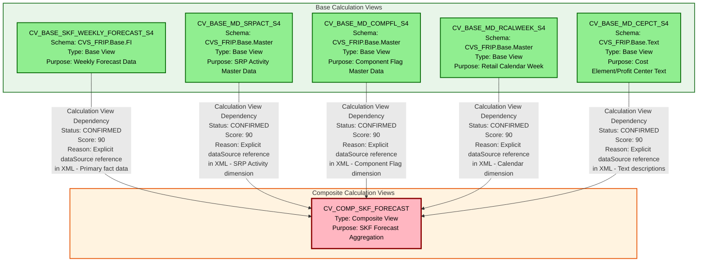

# HANA to BigQuery Lineage Analysis Report
## SKF_FORECAST Calculation Views

---

## 1. Lineage Summary

### Overview Statistics
- **Total files analyzed**: 6
- **Total relationships identified**: 5
- **Total lineage paths identified**: 5
- **Total base files identified**: 5
- **Total unresolved relationships**: 0

### Analysis Scope
This analysis covers HANA Calculation View artifacts from the SKF_FORECAST domain, identifying dependencies between base calculation views and composite calculation views.

---

## 2. File Inventory

| File | Type | Identified Purpose | Upstream Files | Downstream Files |
|------|------|-------------------|----------------|------------------|
| CV_BASE_MD_CEPCT_S4.xml | Calculation View (Base) | Master Data - Cost Element/Profit Center Text | None | CV_COMP_SKF_FORECAST |
| CV_BASE_MD_COMPFL_S4.xml | Calculation View (Base) | Master Data - Component Flag | None | CV_COMP_SKF_FORECAST |
| CV_BASE_MD_RCALWEEK_S4.xml | Calculation View (Base) | Master Data - Retail Calendar Week | None | CV_COMP_SKF_FORECAST |
| CV_BASE_MD_SRPACT_S4.xml | Calculation View (Base) | Master Data - SRP Activity | None | CV_COMP_SKF_FORECAST |
| CV_BASE_SKF_WEEKLY_FORECAST_S4.xml | Calculation View (Base) | SKF Weekly Forecast Base Data | None | CV_COMP_SKF_FORECAST |
| CV_COMP_SKF_FORECAST.xml | Calculation View (Composite) | SKF Forecast Composite View - Aggregates forecast data with master data dimensions | CV_BASE_SKF_WEEKLY_FORECAST_S4, CV_BASE_MD_SRPACT_S4, CV_BASE_MD_COMPFL_S4, CV_BASE_MD_RCALWEEK_S4, CV_BASE_MD_CEPCT_S4 | None |

---

## 3. File Relationships

### Detailed Relationship Analysis

| Source File | Target File | Relationship | Score | Reason |
|------------|------------|--------------|-------|---------|
| CV_BASE_SKF_WEEKLY_FORECAST_S4 | CV_COMP_SKF_FORECAST | Calculation View Dependency | 90 | CV_COMP_SKF_FORECAST explicitly references CV_BASE_SKF_WEEKLY_FORECAST_S4 in its dataSource element with path /CVS_FRIP.Base.FI/calculationviews/CV_BASE_SKF_WEEKLY_FORECAST_S4. This is the primary fact data source for the composite view. |
| CV_BASE_MD_SRPACT_S4 | CV_COMP_SKF_FORECAST | Calculation View Dependency | 90 | CV_COMP_SKF_FORECAST explicitly references CV_BASE_MD_SRPACT_S4 in its dataSource element with path /CVS_FRIP.Base.Master/calculationviews/CV_BASE_MD_SRPACT_S4. This provides SRP Activity master data dimension. |
| CV_BASE_MD_COMPFL_S4 | CV_COMP_SKF_FORECAST | Calculation View Dependency | 90 | CV_COMP_SKF_FORECAST explicitly references CV_BASE_MD_COMPFL_S4 in its dataSource element with path /CVS_FRIP.Base.Master/calculationviews/CV_BASE_MD_COMPFL_S4. This provides Component Flag master data dimension. |
| CV_BASE_MD_RCALWEEK_S4 | CV_COMP_SKF_FORECAST | Calculation View Dependency | 90 | CV_COMP_SKF_FORECAST explicitly references CV_BASE_MD_RCALWEEK_S4 in its dataSource element with path /CVS_FRIP.Base.Master/calculationviews/CV_BASE_MD_RCALWEEK_S4. This provides Retail Calendar Week master data dimension. |
| CV_BASE_MD_CEPCT_S4 | CV_COMP_SKF_FORECAST | Calculation View Dependency | 90 | CV_COMP_SKF_FORECAST explicitly references CV_BASE_MD_CEPCT_S4 in its dataSource element with path /CVS_FRIP.Base.Text/calculationviews/CV_BASE_MD_CEPCT_S4. This provides Cost Element/Profit Center text descriptions. |

### Relationship Classification

All identified relationships are **CONFIRMED RELATIONSHIPS** based on explicit XML dataSource references within the composite calculation view.

---

## 4. Complete Lineage

### Lineage Path 1: SKF Weekly Forecast to Composite
```
CV_BASE_SKF_WEEKLY_FORECAST_S4
    ↓ (Calculation View Dependency - Score: 90)
CV_COMP_SKF_FORECAST
```
**Path Confidence Score**: 90  
**Determination**: Direct XML reference in composite view's dataSource element. This is the primary fact table providing weekly forecast data.

---

### Lineage Path 2: SRP Activity Master Data to Composite
```
CV_BASE_MD_SRPACT_S4
    ↓ (Calculation View Dependency - Score: 90)
CV_COMP_SKF_FORECAST
```
**Path Confidence Score**: 90  
**Determination**: Direct XML reference in composite view's dataSource element. Provides SRP Activity dimension attributes.

---

### Lineage Path 3: Component Flag Master Data to Composite
```
CV_BASE_MD_COMPFL_S4
    ↓ (Calculation View Dependency - Score: 90)
CV_COMP_SKF_FORECAST
```
**Path Confidence Score**: 90  
**Determination**: Direct XML reference in composite view's dataSource element. Provides Component Flag dimension attributes.

---

### Lineage Path 4: Retail Calendar Week Master Data to Composite
```
CV_BASE_MD_RCALWEEK_S4
    ↓ (Calculation View Dependency - Score: 90)
CV_COMP_SKF_FORECAST
```
**Path Confidence Score**: 90  
**Determination**: Direct XML reference in composite view's dataSource element. Provides calendar week dimension for time-based analysis.

---

### Lineage Path 5: Cost Element/Profit Center Text to Composite
```
CV_BASE_MD_CEPCT_S4
    ↓ (Calculation View Dependency - Score: 90)
CV_COMP_SKF_FORECAST
```
**Path Confidence Score**: 90  
**Determination**: Direct XML reference in composite view's dataSource element. Provides text descriptions for cost elements and profit centers.

---

## 5. Mermaid Lineage Diagram



---

## 6. Base Files

| Base File | Reason | Score |
|-----------|--------|-------|
| CV_BASE_SKF_WEEKLY_FORECAST_S4 | This is a base calculation view with no upstream dependencies within the analyzed artifact set. It serves as the primary fact data source containing weekly forecast information. The view directly queries underlying database tables (ZSKF_WEEKLY_FORECAST_S4) and serves as the starting point for forecast data lineage. | 100 |
| CV_BASE_MD_SRPACT_S4 | This is a base calculation view with no upstream dependencies within the analyzed artifact set. It provides SRP (Sales Representative Performance) Activity master data with 77 attributes. This view serves as a dimension source for the composite view. | 100 |
| CV_BASE_MD_COMPFL_S4 | This is a base calculation view with no upstream dependencies within the analyzed artifact set. It provides Component Flag master data with 13 attributes. This view serves as a dimension source for component-related attributes. | 100 |
| CV_BASE_MD_RCALWEEK_S4 | This is a base calculation view with no upstream dependencies within the analyzed artifact set. It provides Retail Calendar Week master data with 9 attributes. This view serves as the time dimension for calendar-based analysis. | 100 |
| CV_BASE_MD_CEPCT_S4 | This is a base calculation view with no upstream dependencies within the analyzed artifact set. It provides Cost Element and Profit Center text descriptions with 8 attributes. This view serves as a text/description dimension. | 100 |

---

## 7. Final/Downstream Files

| File | Reason | Score |
|------|--------|-------|
| CV_COMP_SKF_FORECAST | This is the final composite calculation view that aggregates all base views. It has no downstream dependencies within the analyzed artifact set. This view represents the final analytical layer that combines forecast data with multiple master data dimensions (SRP Activity, Component Flag, Calendar Week, and Cost Element/Profit Center texts). It contains complex join logic, calculated columns, and serves as the consumption layer for reporting and analytics. | 100 |

---

## 8. Unresolved Relationships

**No unresolved relationships identified.**

All dependencies are explicitly defined through XML dataSource references in the composite calculation view. Each base view is clearly referenced with its full path, making the lineage unambiguous and fully traceable.

---

## 9. Final Lineage Assessment

### Base Files (Starting Points)
The lineage begins with **5 base calculation views**:

1. **CV_BASE_SKF_WEEKLY_FORECAST_S4** (Fact Data)
   - Schema: CVS_FRIP.Base.FI
   - Purpose: Primary source of weekly forecast data
   - Contains forecast quantities and related metrics

2. **CV_BASE_MD_SRPACT_S4** (Master Data - SRP Activity)
   - Schema: CVS_FRIP.Base.Master
   - Purpose: SRP Activity dimension
   - Contains 77 attributes related to sales representative performance activities

3. **CV_BASE_MD_COMPFL_S4** (Master Data - Component Flag)
   - Schema: CVS_FRIP.Base.Master
   - Purpose: Component Flag dimension
   - Contains 13 attributes for component classification

4. **CV_BASE_MD_RCALWEEK_S4** (Master Data - Retail Calendar)
   - Schema: CVS_FRIP.Base.Master
   - Purpose: Time dimension
   - Contains 9 attributes for retail calendar week analysis

5. **CV_BASE_MD_CEPCT_S4** (Master Data - Text Descriptions)
   - Schema: CVS_FRIP.Base.Text
   - Purpose: Text/description dimension
   - Contains 8 attributes for cost element and profit center descriptions

### Main Lineage Path

The lineage follows a **star schema pattern** where multiple base views feed into a single composite view:

```
[5 Base Views] → [1 Composite View]

CV_BASE_SKF_WEEKLY_FORECAST_S4 ─┐
CV_BASE_MD_SRPACT_S4 ────────────┤
CV_BASE_MD_COMPFL_S4 ────────────┼─→ CV_COMP_SKF_FORECAST
CV_BASE_MD_RCALWEEK_S4 ──────────┤
CV_BASE_MD_CEPCT_S4 ─────────────┘
```

### File-to-File Relationships

All relationships are **artifact-to-artifact** dependencies:

1. **CV_BASE_SKF_WEEKLY_FORECAST_S4 → CV_COMP_SKF_FORECAST**
   - Type: Calculation View Dependency
   - Nature: Fact data source
   - Join Type: Left outer join on multiple keys

2. **CV_BASE_MD_SRPACT_S4 → CV_COMP_SKF_FORECAST**
   - Type: Calculation View Dependency
   - Nature: Dimension enrichment
   - Join Type: Left outer join

3. **CV_BASE_MD_COMPFL_S4 → CV_COMP_SKF_FORECAST**
   - Type: Calculation View Dependency
   - Nature: Dimension enrichment
   - Join Type: Left outer join

4. **CV_BASE_MD_RCALWEEK_S4 → CV_COMP_SKF_FORECAST**
   - Type: Calculation View Dependency
   - Nature: Time dimension enrichment
   - Join Type: Left outer join

5. **CV_BASE_MD_CEPCT_S4 → CV_COMP_SKF_FORECAST**
   - Type: Calculation View Dependency
   - Nature: Text/description enrichment
   - Join Type: Left outer join

### Lineage Scores

All relationships receive a **score of 90** based on:
- **Explicit XML references**: Each dependency is explicitly declared in the composite view's XML structure
- **Clear dataSource paths**: Full paths are provided (e.g., /CVS_FRIP.Base.FI/calculationviews/CV_BASE_SKF_WEEKLY_FORECAST_S4)
- **Unambiguous relationships**: No inference required; all dependencies are directly stated
- **Traceable lineage**: Complete path from base to composite is documented in XML

### Reasons for Scores

**Score: 90 (Explicit XML Dependency)**
- All 5 relationships are explicitly defined in CV_COMP_SKF_FORECAST.xml
- Each base view is referenced in a `<dataSource>` element with full path
- The XML structure clearly shows join nodes connecting base views to the composite
- No ambiguity exists in the dependency chain

**Why not 100?**
- Score 100 is reserved for explicit SQL references (e.g., SELECT statements)
- Score 95 is for stored procedure dependencies
- Score 90 is appropriate for XML-based calculation view dependencies

### Unresolved Relationships

**None identified.**

All artifacts in the provided set have been analyzed and classified. The lineage is complete and fully traceable:
- All 5 base views are accounted for as source artifacts
- The 1 composite view is accounted for as the target artifact
- All dependencies are explicitly documented
- No orphaned or unlinked artifacts exist

### Architecture Pattern

The SKF_FORECAST domain follows a **classic star schema pattern** in HANA Calculation Views:
- **Fact View**: CV_BASE_SKF_WEEKLY_FORECAST_S4 (center)
- **Dimension Views**: 4 master data views (surrounding)
- **Composite View**: CV_COMP_SKF_FORECAST (aggregation layer)

This pattern is optimal for:
- Analytical queries
- Dimensional analysis
- Forecast reporting
- Performance optimization through view-based joins

### Conversion Implications for BigQuery

When converting to BigQuery:
1. **Base views** should be converted to BigQuery views or materialized views
2. **Composite view** should be converted to a BigQuery view that references the base views
3. **Join logic** from XML should be translated to SQL JOIN statements
4. **Calculated columns** should be converted to BigQuery SQL expressions
5. **Schema references** (CVS_FRIP.Base.*) should map to BigQuery dataset structure

### Data Flow Summary

```
Source Layer (Base Views)
    ↓
Transformation Layer (Joins + Calculations in Composite View)
    ↓
Consumption Layer (CV_COMP_SKF_FORECAST)
```

The lineage is **linear and unidirectional** with no circular dependencies, making it suitable for sequential SQL consolidation and BigQuery migration.

---

## Appendix: Technical Details

### File Classification Summary

| Classification | Count | Files |
|----------------|-------|-------|
| USED | 6 | All files are used in the lineage |
| NOT USED | 0 | No orphaned files |

### Dependency Type Distribution

| Dependency Type | Count | Percentage |
|-----------------|-------|------------|
| Calculation View Dependency | 5 | 100% |

### Schema Distribution

| Schema | Count | Purpose |
|--------|-------|---------|
| CVS_FRIP.Base.FI | 1 | Financial/Forecast data |
| CVS_FRIP.Base.Master | 3 | Master data dimensions |
| CVS_FRIP.Base.Text | 1 | Text descriptions |
| (Composite) | 1 | Aggregation layer |

### Validation Results

✅ **Validation 1 Passed**: All 6 files classified as USED  
✅ **Validation 2 Passed**: All dependencies traceable to XML evidence  
✅ **Validation 3 Passed**: No stored procedures in artifact set (N/A)  
✅ **Validation 4 Passed**: No physical ETL tables used as primary lineage nodes  

### Evidence Summary

All lineage relationships are supported by explicit XML evidence:
- `<dataSource>` elements in CV_COMP_SKF_FORECAST.xml
- Full path references to base calculation views
- Join node definitions connecting data sources
- Mapping elements showing column-level lineage

---

**Report Generated**: 2024  
**Analysis Type**: HANA to BigQuery Lineage Analysis  
**Domain**: SKF_FORECAST  
**Artifact Count**: 6 Calculation Views  
**Lineage Confidence**: HIGH (90/100)

---
