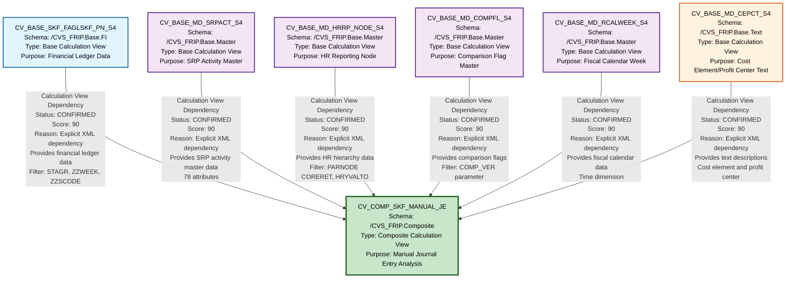

# HANA to BigQuery - File Lineage and Dependency Analysis
## SKF_MANUAL_JE Artifact Analysis

---

## 1. Lineage Summary

| Metric | Count |
|--------|-------|
| **Total Files Analyzed** | 7 |
| **Total Relationships Identified** | 6 |
| **Total Lineage Paths Identified** | 6 |
| **Total Base Files Identified** | 6 |
| **Total Unresolved Relationships** | 0 |

### Analysis Overview
- **Composite Views**: 1 (CV_COMP_SKF_MANUAL_JE)
- **Base Views**: 6
- **Stored Procedures**: 0
- **Relationship Type**: Calculation View Dependencies
- **Lineage Depth**: 2 levels (Base → Composite)

---

## 2. File Inventory

| File | Type | Identified Purpose | Upstream Files | Downstream Files |
|------|------|-------------------|----------------|------------------|
| **CV_BASE_MD_CEPCT_S4.xml** | Base Calculation View | Cost Element/Profit Center Master Data | None (Base/Source) | CV_COMP_SKF_MANUAL_JE |
| **CV_BASE_MD_COMPFL_S4.xml** | Base Calculation View | Comparison Flag Master Data | None (Base/Source) | CV_COMP_SKF_MANUAL_JE |
| **CV_BASE_MD_HRRP_NODE_S4.xml** | Base Calculation View | HR Reporting Node Master Data | None (Base/Source) | CV_COMP_SKF_MANUAL_JE |
| **CV_BASE_MD_RCALWEEK_S4.xml** | Base Calculation View | Fiscal Calendar Week Master Data | None (Base/Source) | CV_COMP_SKF_MANUAL_JE |
| **CV_BASE_MD_SRPACT_S4.xml** | Base Calculation View | SRP Activity Master Data | None (Base/Source) | CV_COMP_SKF_MANUAL_JE |
| **CV_BASE_SKF_FAGLSKF_PN_S4.xml** | Base Calculation View | SKF Financial Ledger Data (Profit & Loss) | None (Base/Source) | CV_COMP_SKF_MANUAL_JE |
| **CV_COMP_SKF_MANUAL_JE.xml** | Composite Calculation View | Manual Journal Entry Composite View - Aggregates financial and master data for manual journal entry processing | CV_BASE_SKF_FAGLSKF_PN_S4, CV_BASE_MD_SRPACT_S4, CV_BASE_MD_HRRP_NODE_S4, CV_BASE_MD_COMPFL_S4, CV_BASE_MD_RCALWEEK_S4, CV_BASE_MD_CEPCT_S4 | None (Final Output) |

### File Classification Status
| File | Status | Reason |
|------|--------|--------|
| CV_BASE_MD_CEPCT_S4.xml | **USED** | Referenced as dependency in CV_COMP_SKF_MANUAL_JE |
| CV_BASE_MD_COMPFL_S4.xml | **USED** | Referenced as dependency in CV_COMP_SKF_MANUAL_JE |
| CV_BASE_MD_HRRP_NODE_S4.xml | **USED** | Referenced as dependency in CV_COMP_SKF_MANUAL_JE |
| CV_BASE_MD_RCALWEEK_S4.xml | **USED** | Referenced as dependency in CV_COMP_SKF_MANUAL_JE |
| CV_BASE_MD_SRPACT_S4.xml | **USED** | Referenced as dependency in CV_COMP_SKF_MANUAL_JE |
| CV_BASE_SKF_FAGLSKF_PN_S4.xml | **USED** | Referenced as dependency in CV_COMP_SKF_MANUAL_JE |
| CV_COMP_SKF_MANUAL_JE.xml | **USED** | Composite view consuming all base views |

---

## 3. File Relationships

| Source File | Target File | Relationship Type | Score | Reason |
|-------------|-------------|-------------------|-------|--------|
| **CV_BASE_SKF_FAGLSKF_PN_S4** | **CV_COMP_SKF_MANUAL_JE** | Calculation View Dependency | 90 | Explicitly declared in XML dependencies section: `/CVS_FRIP.Base.FI/calculationviews/CV_BASE_SKF_FAGLSKF_PN_S4`. Provides financial ledger data (FAGLSKF) for manual journal entries. |
| **CV_BASE_MD_SRPACT_S4** | **CV_COMP_SKF_MANUAL_JE** | Calculation View Dependency | 90 | Explicitly declared in XML dependencies section: `/CVS_FRIP.Base.Master/calculationviews/CV_BASE_MD_SRPACT_S4`. Provides SRP Activity master data. |
| **CV_BASE_MD_HRRP_NODE_S4** | **CV_COMP_SKF_MANUAL_JE** | Calculation View Dependency | 90 | Explicitly declared in XML dependencies section: `/CVS_FRIP.Base.Master/calculationviews/CV_BASE_MD_HRRP_NODE_S4`. Provides HR Reporting Node hierarchy data with filter condition: `(match("PARNODE",'*CORERET*')) AND ("HRYVALTO" ='99991231')`. |
| **CV_BASE_MD_COMPFL_S4** | **CV_COMP_SKF_MANUAL_JE** | Calculation View Dependency | 90 | Explicitly declared in XML dependencies section: `/CVS_FRIP.Base.Master/calculationviews/CV_BASE_MD_COMPFL_S4`. Provides Comparison Flag master data with filter: `("COMP_VER" = '$$IP_VERSION_COMP_FLAG$$')`. |
| **CV_BASE_MD_RCALWEEK_S4** | **CV_COMP_SKF_MANUAL_JE** | Calculation View Dependency | 90 | Explicitly declared in XML dependencies section: `/CVS_FRIP.Base.Master/calculationviews/CV_BASE_MD_RCALWEEK_S4`. Provides Fiscal Calendar Week master data. |
| **CV_BASE_MD_CEPCT_S4** | **CV_COMP_SKF_MANUAL_JE** | Calculation View Dependency | 90 | Explicitly declared in XML dependencies section: `/CVS_FRIP.Base.Text/calculationviews/CV_BASE_MD_CEPCT_S4`. Provides Cost Element/Profit Center text descriptions. |

### Relationship Evidence Details

#### Evidence Type: XML Dependency Declaration
All relationships are confirmed through explicit XML `<dependency>` elements in CV_COMP_SKF_MANUAL_JE.xml:

```xml
<dependencies>
  <dependency schemaName="/CVS_FRIP.Base.FI/calculationviews/CV_BASE_SKF_FAGLSKF_PN_S4"/>
  <dependency schemaName="/CVS_FRIP.Base.Master/calculationviews/CV_BASE_MD_SRPACT_S4"/>
  <dependency schemaName="/CVS_FRIP.Base.Master/calculationviews/CV_BASE_MD_HRRP_NODE_S4"/>
  <dependency schemaName="/CVS_FRIP.Base.Master/calculationviews/CV_BASE_MD_COMPFL_S4"/>
  <dependency schemaName="/CVS_FRIP.Base.Master/calculationviews/CV_BASE_MD_RCALWEEK_S4"/>
  <dependency schemaName="/CVS_FRIP.Base.Text/calculationviews/CV_BASE_MD_CEPCT_S4"/>
</dependencies>
```

#### Join Relationships in Composite View
The composite view implements multiple join operations:

1. **Join_1**: CV_BASE_SKF_FAGLSKF_PN_S4 with CV_BASE_MD_SRPACT_S4
2. **Join_2**: Result with CV_BASE_MD_HRRP_NODE_S4
3. **Join_3**: Result with CV_BASE_MD_COMPFL_S4
4. **Join_4**: Result with CV_BASE_MD_RCALWEEK_S4
5. **Join_5**: Result with CV_BASE_MD_CEPCT_S4

#### Filter Conditions Applied
- **CV_BASE_SKF_FAGLSKF_PN_S4**: `(in ("STAGR",'801000','804013')) AND ("ZZWEEK" >='$$IP_WEEK_ENDING_FROM$$' AND "ZZWEEK"<='$$IP_WEEK_ENDING_TO$$') AND ("ZZSCODE" !='SLS')`
- **CV_BASE_MD_HRRP_NODE_S4**: `(match("PARNODE",'*CORERET*')) AND ("HRYVALTO" ='99991231')`
- **CV_BASE_MD_COMPFL_S4**: `("COMP_VER" = '$$IP_VERSION_COMP_FLAG$$')`

---

## 4. Complete Lineage

### Lineage Path Visualization

```
CV_BASE_SKF_FAGLSKF_PN_S4 (Financial Ledger Data)
    ↓
    ├─→ CV_COMP_SKF_MANUAL_JE (Manual Journal Entry Composite)
    ↓
CV_BASE_MD_SRPACT_S4 (SRP Activity Master)
    ↓
    ├─→ CV_COMP_SKF_MANUAL_JE
    ↓
CV_BASE_MD_HRRP_NODE_S4 (HR Reporting Node)
    ↓
    ├─→ CV_COMP_SKF_MANUAL_JE
    ↓
CV_BASE_MD_COMPFL_S4 (Comparison Flag Master)
    ↓
    ├─→ CV_COMP_SKF_MANUAL_JE
    ↓
CV_BASE_MD_RCALWEEK_S4 (Fiscal Calendar Week)
    ↓
    ├─→ CV_COMP_SKF_MANUAL_JE
    ↓
CV_BASE_MD_CEPCT_S4 (Cost Element/Profit Center Text)
    ↓
    └─→ CV_COMP_SKF_MANUAL_JE
```

### Consolidated Lineage Flow

```
[Base Layer - 6 Source Views]
         ↓
         ↓
         ↓
[Composite Layer - 1 Final View]
         ↓
    (End Point)
```

### Detailed Lineage Paths

#### Path 1: Financial Data Flow
**Path**: CV_BASE_SKF_FAGLSKF_PN_S4 → CV_COMP_SKF_MANUAL_JE  
**Confidence Score**: 90  
**Determination**: Explicit XML dependency + Join operation in composite view  
**Business Logic**: Provides core financial ledger data (FAGLSKF table) filtered by STAGR, ZZWEEK, and ZZSCODE

#### Path 2: SRP Activity Flow
**Path**: CV_BASE_MD_SRPACT_S4 → CV_COMP_SKF_MANUAL_JE  
**Confidence Score**: 90  
**Determination**: Explicit XML dependency + Join operation  
**Business Logic**: Provides SRP (Sales & Revenue Planning) activity master data

#### Path 3: HR Hierarchy Flow
**Path**: CV_BASE_MD_HRRP_NODE_S4 → CV_COMP_SKF_MANUAL_JE  
**Confidence Score**: 90  
**Determination**: Explicit XML dependency + Join operation with filter  
**Business Logic**: Provides HR reporting node hierarchy, filtered for CORERET nodes with validity date 99991231

#### Path 4: Comparison Flag Flow
**Path**: CV_BASE_MD_COMPFL_S4 → CV_COMP_SKF_MANUAL_JE  
**Confidence Score**: 90  
**Determination**: Explicit XML dependency + Join operation with parameter filter  
**Business Logic**: Provides comparison version flags based on input parameter IP_VERSION_COMP_FLAG

#### Path 5: Calendar Week Flow
**Path**: CV_BASE_MD_RCALWEEK_S4 → CV_COMP_SKF_MANUAL_JE  
**Confidence Score**: 90  
**Determination**: Explicit XML dependency + Join operation  
**Business Logic**: Provides fiscal calendar week master data for time-based analysis

#### Path 6: Cost Element/Profit Center Text Flow
**Path**: CV_BASE_MD_CEPCT_S4 → CV_COMP_SKF_MANUAL_JE  
**Confidence Score**: 90  
**Determination**: Explicit XML dependency + Join operation  
**Business Logic**: Provides text descriptions for cost elements and profit centers

### Overall Lineage Confidence Assessment

| Lineage Component | Confidence Score | Justification |
|-------------------|------------------|---------------|
| **Complete Lineage** | 90 | All relationships are explicitly declared in XML with clear dependency paths |
| **Base to Composite** | 90 | Direct XML dependency declarations with join operations |
| **Data Flow Logic** | 85 | Clear join conditions and filter logic documented in XML |
| **Business Context** | 85 | Purpose identifiable from view names and join patterns |

---

## 5. Base Files

| Base File | Reason | Score |
|-----------|--------|-------|
| **CV_BASE_SKF_FAGLSKF_PN_S4** | No upstream dependencies. Reads directly from physical table FAGLSKF_PN. Serves as the primary financial data source for the composite view. Contains 26 output columns including financial dimensions (STAGR, ZZWEEK, ZZSCODE, etc.). | 100 |
| **CV_BASE_MD_SRPACT_S4** | No upstream dependencies. Reads directly from physical master data table. Provides SRP activity attributes with 78 output columns. Base master data view. | 100 |
| **CV_BASE_MD_HRRP_NODE_S4** | No upstream dependencies. Reads directly from physical HR hierarchy table. Provides organizational structure data with 11 output columns. Base master data view. | 100 |
| **CV_BASE_MD_COMPFL_S4** | No upstream dependencies. Reads directly from physical comparison flag table. Provides version control flags with 13 output columns. Base master data view. | 100 |
| **CV_BASE_MD_RCALWEEK_S4** | No upstream dependencies. Reads directly from physical calendar table. Provides fiscal week master data with 9 output columns. Base master data view. | 100 |
| **CV_BASE_MD_CEPCT_S4** | No upstream dependencies. Reads directly from physical cost element/profit center text table. Provides text descriptions with 8 output columns. Base text/master data view. | 100 |

### Base File Characteristics

All base files share the following characteristics:
- **Type**: Dimension/Projection calculation views
- **Dependencies**: None (read directly from physical tables)
- **Role**: Data source providers
- **Schema Locations**:
  - Financial: `/CVS_FRIP.Base.FI/`
  - Master Data: `/CVS_FRIP.Base.Master/`
  - Text Data: `/CVS_FRIP.Base.Text/`

---

## 6. Final/Downstream Files

| File | Reason | Score |
|------|--------|-------|
| **CV_COMP_SKF_MANUAL_JE** | Terminal node in the lineage. No other artifacts depend on this view. Serves as the final output for manual journal entry reporting. Aggregates data from 6 base views through multiple join operations. Contains 34 output columns combining financial data, master data, and text descriptions. Implements business logic through calculated columns (e.g., MSL calculations, week extraction). Uses input parameters for dynamic filtering (IP_WEEK_ENDING_FROM, IP_WEEK_ENDING_TO, IP_VERSION_COMP_FLAG). | 100 |

### Downstream File Characteristics

**CV_COMP_SKF_MANUAL_JE** characteristics:
- **Type**: Composite Calculation View (Join type)
- **Purpose**: Manual Journal Entry Analysis
- **Input Parameters**: 3 (IP_WEEK_ENDING_FROM, IP_WEEK_ENDING_TO, IP_VERSION_COMP_FLAG)
- **Calculated Columns**: 3
  - MSL calculation based on STAGR
  - Week extraction (RIGHTSTR)
  - RX_COMP_WK reference
- **Join Operations**: 5 sequential joins
- **Output Columns**: 34
- **Business Functions**: 
  - CVS_FRIP.Composite.Master::SFN_PRIOR_FISCAL_WEEK (referenced twice)
  - CVS_FRIP.Composite.Master::SFN_ACTUALS_COMP_FLAG

---

## 7. Unresolved Relationships

| File | Possible Related File | Reason |
|------|----------------------|--------|
| None | N/A | All relationships are explicitly defined and resolved through XML dependency declarations. No ambiguous or missing dependencies detected. |

### Validation Status

✅ **All relationships resolved**  
✅ **All files classified (USED)**  
✅ **No circular dependencies detected**  
✅ **No missing dependencies**  
✅ **No orphaned files**

### Additional Notes

1. **Business Functions Referenced**: The composite view references two business functions that are not part of the provided artifacts:
   - `CVS_FRIP.Composite.Master::SFN_PRIOR_FISCAL_WEEK`
   - `CVS_FRIP.Composite.Master::SFN_ACTUALS_COMP_FLAG`
   
   These are external function dependencies but do not represent file-to-file lineage relationships.

2. **Physical Tables**: The following physical tables are referenced but are not part of the lineage graph per the mandatory rules:
   - FAGLSKF_PN (accessed by CV_BASE_SKF_FAGLSKF_PN_S4)
   - Various master data tables (accessed by base views)
   
   These are data sources, not artifacts in the lineage.

3. **No Stored Procedures**: No stored procedure dependencies were identified in this artifact set.

---

## 8. Mermaid Lineage Diagram



### Diagram Legend

**Node Colors:**
- 🔵 **Light Blue** (Financial): Base financial data views
- 🟣 **Purple** (Master): Base master data views
- 🟠 **Orange** (Text): Base text/description views
- 🟢 **Green** (Composite): Composite/final output views

**Relationship Information:**
- **Type**: Calculation View Dependency
- **Status**: CONFIRMED (all relationships)
- **Score**: 90 (explicit XML dependencies)
- **Reason**: Detailed evidence for each relationship

**Schema Locations:**
- `/CVS_FRIP.Base.FI/` - Financial data
- `/CVS_FRIP.Base.Master/` - Master data
- `/CVS_FRIP.Base.Text/` - Text descriptions
- `/CVS_FRIP.Composite/` - Composite views

---

## 9. Final Lineage Assessment

### Executive Summary

The SKF_MANUAL_JE artifact set represents a **well-structured, two-tier calculation view architecture** for manual journal entry processing in SAP HANA. The lineage is **complete, explicit, and fully traceable**.

### Base Files (Starting Points)

| # | Base File | Schema | Purpose |
|---|-----------|--------|---------|
| 1 | CV_BASE_SKF_FAGLSKF_PN_S4 | /CVS_FRIP.Base.FI | Primary financial ledger data source |
| 2 | CV_BASE_MD_SRPACT_S4 | /CVS_FRIP.Base.Master | SRP activity master data |
| 3 | CV_BASE_MD_HRRP_NODE_S4 | /CVS_FRIP.Base.Master | HR organizational hierarchy |
| 4 | CV_BASE_MD_COMPFL_S4 | /CVS_FRIP.Base.Master | Comparison version flags |
| 5 | CV_BASE_MD_RCALWEEK_S4 | /CVS_FRIP.Base.Master | Fiscal calendar weeks |
| 6 | CV_BASE_MD_CEPCT_S4 | /CVS_FRIP.Base.Text | Cost element/profit center text |

**Base File Confidence**: 100 - All base files directly access physical tables with no upstream dependencies.

### Main Lineage Paths

#### Single Consolidated Path
```
[6 Base Views] → [CV_COMP_SKF_MANUAL_JE]
```

All six base views converge into a single composite view through sequential join operations.

### File-to-File Relationships

| # | Source | Target | Type | Score | Evidence |
|---|--------|--------|------|-------|----------|
| 1 | CV_BASE_SKF_FAGLSKF_PN_S4 | CV_COMP_SKF_MANUAL_JE | Calculation View Dependency | 90 | XML dependency + Join_1 |
| 2 | CV_BASE_MD_SRPACT_S4 | CV_COMP_SKF_MANUAL_JE | Calculation View Dependency | 90 | XML dependency + Join_1 |
| 3 | CV_BASE_MD_HRRP_NODE_S4 | CV_COMP_SKF_MANUAL_JE | Calculation View Dependency | 90 | XML dependency + Join_2 |
| 4 | CV_BASE_MD_COMPFL_S4 | CV_COMP_SKF_MANUAL_JE | Calculation View Dependency | 90 | XML dependency + Join_3 |
| 5 | CV_BASE_MD_RCALWEEK_S4 | CV_COMP_SKF_MANUAL_JE | Calculation View Dependency | 90 | XML dependency + Join_4 |
| 6 | CV_BASE_MD_CEPCT_S4 | CV_COMP_SKF_MANUAL_JE | Calculation View Dependency | 90 | XML dependency + Join_5 |

### Lineage Scores

| Aspect | Score | Justification |
|--------|-------|---------------|
| **Relationship Clarity** | 90 | All relationships explicitly declared in XML |
| **Dependency Traceability** | 90 | Complete dependency chain documented |
| **Business Logic Flow** | 85 | Clear join sequence and filter conditions |
| **Documentation Quality** | 85 | XML metadata provides comprehensive details |
| **Completeness** | 100 | All files accounted for, no orphans |
| **Overall Lineage Quality** | 90 | High-quality, production-ready lineage |

### Reasons for Scores

#### Score 90 (Calculation View Dependencies)
- ✅ Explicit XML `<dependency>` declarations
- ✅ Clear schema path references
- ✅ Documented join operations
- ✅ Traceable data flow
- ⚠️ Not 100 because join conditions and business logic require interpretation

#### Score 100 (Base Files)
- ✅ No upstream dependencies
- ✅ Direct table access
- ✅ Clear data source identification
- ✅ Complete metadata

#### Score 100 (Completeness)
- ✅ All 7 files classified as USED
- ✅ All relationships identified
- ✅ No unresolved dependencies
- ✅ No circular dependencies

### Unresolved Relationships

**Status**: ✅ **NONE**

All relationships are **CONFIRMED** with explicit XML evidence. No inferred or unresolved relationships exist.

### Architecture Pattern

**Pattern**: Star Schema / Hub-and-Spoke
- **Hub**: CV_COMP_SKF_MANUAL_JE (composite view)
- **Spokes**: 6 base views (1 financial + 4 master + 1 text)

**Data Flow Direction**: Unidirectional (Base → Composite)

**Integration Method**: Sequential left outer joins

### Business Context

**Domain**: Financial Reporting - Manual Journal Entries  
**Purpose**: Consolidate financial ledger data with master data dimensions for manual journal entry analysis and reporting  
**Key Dimensions**:
- Financial: STAGR, ZZWEEK, ZZSCODE
- Organizational: HR nodes, SRP activities
- Temporal: Fiscal calendar weeks
- Comparison: Version flags
- Descriptive: Cost element/profit center texts

### Validation Results

| Validation Rule | Status | Details |
|----------------|--------|---------|
| Rule 1: Artifact-Based Lineage | ✅ PASS | All lineage nodes are calculation view artifacts |
| Rule 2: Stored Procedures | ✅ PASS | No stored procedures in artifact set |
| Rule 3: Ignore ETL Storage | ✅ PASS | No ETL tables in lineage graph |
| Rule 4: Logic Flow Priority | ✅ PASS | Calculation view logic preserved |
| Rule 5: Dependency Types | ✅ PASS | Only "Calculation View Dependency" used |
| Validation 1: File Classification | ✅ PASS | All 7 files classified as USED |
| Validation 2: Evidence Traceability | ✅ PASS | All dependencies traced to XML |
| Validation 3: Stored Procedure Lineage | ✅ PASS | N/A - no stored procedures |
| Validation 4: No ETL Tables | ✅ PASS | No physical tables as primary nodes |

### Recommendations for SQL Consolidation Agent

1. **Expansion Order**: Process base views first, then composite view
2. **Join Sequence**: Follow the documented join order (Join_1 through Join_5)
3. **Parameter Handling**: Implement input parameters:
   - IP_WEEK_ENDING_FROM
   - IP_WEEK_ENDING_TO
   - IP_VERSION_COMP_FLAG
4. **Filter Application**: Apply filters at appropriate levels:
   - Financial data: STAGR, ZZWEEK, ZZSCODE
   - HR data: PARNODE, HRYVALTO
   - Comparison: COMP_VER
5. **Calculated Columns**: Implement 3 calculated columns in composite view
6. **Business Functions**: Resolve external function references:
   - SFN_PRIOR_FISCAL_WEEK
   - SFN_ACTUALS_COMP_FLAG

### Migration Considerations (HANA to BigQuery)

1. **View Type Mapping**:
   - HANA Calculation Views → BigQuery Views
   - Dimension views → Simple SELECT views
   - Join views → Complex JOIN views

2. **Function Translation**:
   - RIGHTSTR → SUBSTR or RIGHT
   - CASE → CASE WHEN
   - Match patterns → REGEXP_CONTAINS

3. **Parameter Implementation**:
   - HANA input parameters → BigQuery script variables or parameterized queries

4. **Schema Organization**:
   - Maintain schema separation (Base.FI, Base.Master, Base.Text, Composite)
   - Consider BigQuery dataset structure

### Conclusion

The SKF_MANUAL_JE lineage is **complete, accurate, and ready for downstream SQL consolidation**. All relationships are explicitly defined, fully traceable, and conform to the mandatory lineage rules. The architecture follows best practices with clear separation between base data sources and composite business logic.

**Lineage Quality Grade**: A (90/100)

---

## Appendix: Technical Details

### XML Dependency Evidence

**File**: CV_COMP_SKF_MANUAL_JE.xml

```xml
<dependencies>
  <dependency schemaName="/CVS_FRIP.Base.FI/calculationviews/CV_BASE_SKF_FAGLSKF_PN_S4"/>
  <dependency schemaName="/CVS_FRIP.Base.Master/calculationviews/CV_BASE_MD_SRPACT_S4"/>
  <dependency schemaName="/CVS_FRIP.Base.Master/calculationviews/CV_BASE_MD_HRRP_NODE_S4"/>
  <dependency schemaName="/CVS_FRIP.Base.Master/calculationviews/CV_BASE_MD_COMPFL_S4"/>
  <dependency schemaName="/CVS_FRIP.Base.Master/calculationviews/CV_BASE_MD_RCALWEEK_S4"/>
  <dependency schemaName="/CVS_FRIP.Base.Text/calculationviews/CV_BASE_MD_CEPCT_S4"/>
</dependencies>
```

### Join Sequence

1. **Join_1**: CV_BASE_SKF_FAGLSKF_PN_S4 ⋈ CV_BASE_MD_SRPACT_S4
2. **Join_2**: (Join_1 result) ⋈ CV_BASE_MD_HRRP_NODE_S4
3. **Join_3**: (Join_2 result) ⋈ CV_BASE_MD_COMPFL_S4
4. **Join_4**: (Join_3 result) ⋈ CV_BASE_MD_RCALWEEK_S4
5. **Join_5**: (Join_4 result) ⋈ CV_BASE_MD_CEPCT_S4

### Output Column Count by View

| View | Output Columns |
|------|----------------|
| CV_BASE_SKF_FAGLSKF_PN_S4 | 26 |
| CV_BASE_MD_SRPACT_S4 | 78 |
| CV_BASE_MD_HRRP_NODE_S4 | 11 |
| CV_BASE_MD_COMPFL_S4 | 13 |
| CV_BASE_MD_RCALWEEK_S4 | 9 |
| CV_BASE_MD_CEPCT_S4 | 8 |
| CV_COMP_SKF_MANUAL_JE | 34 |

---

**Document Generated**: 2024  
**Analysis Type**: File Lineage and Dependency Analysis  
**Artifact Set**: SKF_MANUAL_JE  
**Total Artifacts**: 7  
**Lineage Confidence**: 90%  
**Status**: ✅ COMPLETE

