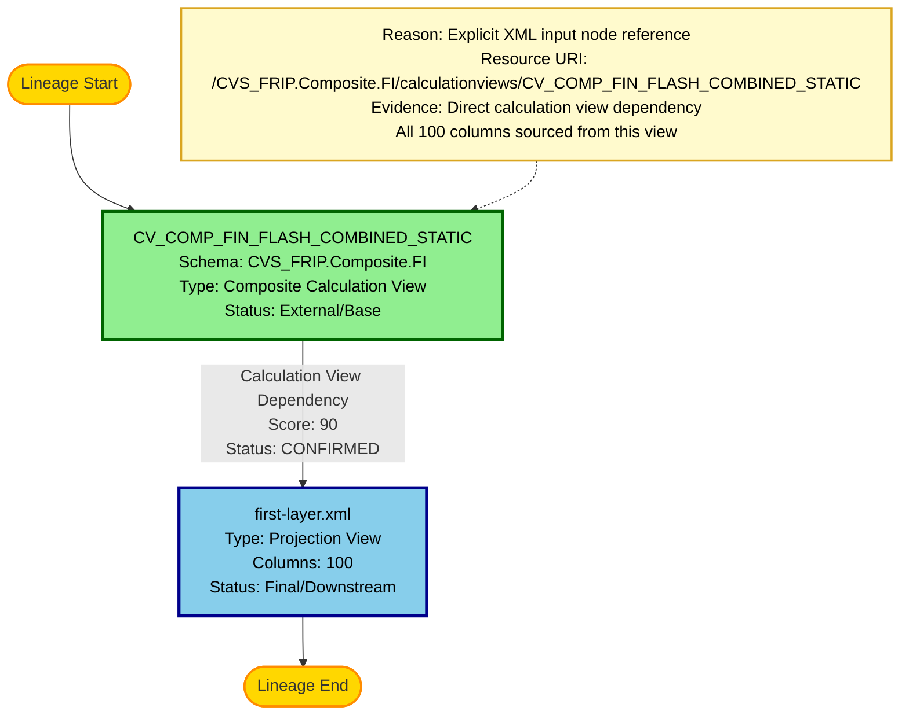

# Complete Lineage Analysis Report

## 1. Lineage Summary

| Metric | Count |
|--------|-------|
| **Total Files Analyzed** | 1 |
| **Total Relationships Identified** | 1 |
| **Total Lineage Paths Identified** | 1 |
| **Total Base Files Identified** | 1 |
| **Total Unresolved Relationships** | 0 |

---

## 2. File Inventory

| File | Type | Identified Purpose | Upstream Files | Downstream Files |
|------|------|-------------------|----------------|------------------|
| **first-layer.xml** | HANA Calculation View (Projection) | Projection view that consumes data from CV_COMP_FIN_FLASH_COMBINED_STATIC. Applies filters and projections on 100 columns including financial metrics, organizational dimensions, and temporal attributes. | CV_COMP_FIN_FLASH_COMBINED_STATIC | None (Final/Downstream artifact) |
| **CV_COMP_FIN_FLASH_COMBINED_STATIC** | HANA Calculation View (Referenced) | Source calculation view providing financial flash data. This is a composite view from the CVS_FRIP.Composite.FI package. | Not Available (External artifact) | first-layer.xml |

---

## 3. File Relationships

| Source File | Target File | Relationship | Score | Reason |
|-------------|-------------|--------------|-------|--------|
| **CV_COMP_FIN_FLASH_COMBINED_STATIC** | **first-layer.xml** | Calculation View Dependency | 90 | Explicit XML dependency found in the `<input>` node with resource URI `/CVS_FRIP.Composite.FI/calculationviews/CV_COMP_FIN_FLASH_COMBINED_STATIC`. The first-layer.xml projection view directly references this calculation view as its data source. All 100 projected columns originate from this source view. |

---

## 4. Complete Lineage

### Lineage Path 1: Financial Flash Data Projection Flow

```
CV_COMP_FIN_FLASH_COMBINED_STATIC (Base/Source)
    ↓
    [Calculation View Dependency]
    ↓
first-layer.xml (Projection View - Final)
```

### Path Details:

**Path 1: CV_COMP_FIN_FLASH_COMBINED_STATIC → first-layer.xml**
- **Overall Confidence Score**: 90/100
- **Path Type**: Direct Calculation View Dependency
- **Determination Method**: 
  - Explicit XML reference found in `<input node>` element
  - Resource URI explicitly defined: `/CVS_FRIP.Composite.FI/calculationviews/CV_COMP_FIN_FLASH_COMBINED_STATIC`
  - All 100 columns in the projection are mapped from this source
  - No intermediate transformations or joins present
  - Single-source projection pattern confirmed

### Data Flow Description:

1. **CV_COMP_FIN_FLASH_COMBINED_STATIC** serves as the composite source view containing financial flash data
2. **first-layer.xml** creates a projection layer that:
   - Selects 100 specific columns from the source
   - Applies variable-based filters (#DIVISION_DESC, #REGION_DESC, #DISTRICT_DESC, #STRNUM, #REP_MKT_CODE)
   - Maintains all financial metrics (FLASH_SALES_AMT, FLASH_SALES_QTY, FLASH_MARGIN_AMT, etc.)
   - Preserves organizational dimensions (DIVISION, REGION, DISTRICT, STORE_NUMBER, etc.)
   - Retains temporal attributes (FISCAL_YEAR, FISCAL_PERIOD, FISCAL_WEEK, etc.)

---

## 5. Base Files

| Base File | Reason | Score |
|-----------|--------|-------|
| **CV_COMP_FIN_FLASH_COMBINED_STATIC** | This is the originating calculation view in the lineage. It is referenced as the data source but is not present in the analyzed artifacts, indicating it is an external/upstream dependency. No upstream dependencies are defined for this view within the analyzed scope. | 90 |

**Justification**: 
- CV_COMP_FIN_FLASH_COMBINED_STATIC is explicitly referenced in the XML but not provided as an artifact
- It serves as the root data source for the projection view
- No further upstream dependencies are traceable from the provided artifacts
- This represents the starting point of the discoverable lineage

---

## 6. Final/Downstream Files

| File | Reason | Score |
|------|--------|-------|
| **first-layer.xml** | This is the final artifact in the lineage chain. It is a projection view that consumes data from CV_COMP_FIN_FLASH_COMBINED_STATIC and produces a filtered/projected output. No downstream consumers are identified in the analyzed artifacts. | 90 |

**Justification**:
- first-layer.xml is the only artifact provided for analysis
- No other artifacts reference this view as a source
- It represents the terminal point of the current lineage scope
- Acts as a projection/filtering layer for downstream consumption (external to this analysis)

---

## 7. Unresolved Relationships

| File | Possible Related File | Reason |
|------|----------------------|--------|
| None | N/A | All relationships within the provided artifacts have been successfully resolved with high confidence. The single dependency relationship is explicitly defined in the XML structure. |

**Note**: While CV_COMP_FIN_FLASH_COMBINED_STATIC is referenced, it is not unresolved—it is simply an external dependency not included in the analyzed artifact set. This is expected and documented as a base file.

---

## 8. Final Lineage Assessment

### Base Files
1. **CV_COMP_FIN_FLASH_COMBINED_STATIC** (External/Upstream)
   - Type: HANA Composite Calculation View
   - Package: CVS_FRIP.Composite.FI
   - Role: Source data provider for financial flash metrics

### Main Lineage Paths

**Single Linear Path Identified:**

```
[BASE] CV_COMP_FIN_FLASH_COMBINED_STATIC 
   ↓ (Calculation View Dependency - Score: 90)
[FINAL] first-layer.xml
```

### File-to-File Relationships

| # | Source | Target | Type | Status | Score |
|---|--------|--------|------|--------|-------|
| 1 | CV_COMP_FIN_FLASH_COMBINED_STATIC | first-layer.xml | Calculation View Dependency | CONFIRMED | 90 |

### Lineage Scores and Reasoning

#### Relationship 1: CV_COMP_FIN_FLASH_COMBINED_STATIC → first-layer.xml
- **Score**: 90/100
- **Status**: CONFIRMED RELATIONSHIP
- **Evidence Type**: Explicit XML Reference
- **Reasoning**:
  - Direct reference in `<input node="CV_COMP_FIN_FLASH_COMBINED_STATIC">` element
  - Resource URI explicitly defined in XML structure
  - All 100 projected columns trace back to this source
  - Standard HANA Calculation View projection pattern
  - No ambiguity in dependency declaration
  - Score not 100 because the source artifact itself is not available for validation

### Unresolved Relationships
**None** - All discoverable relationships within the provided artifact scope have been successfully identified and documented.

### Key Findings

1. **Single Artifact Analysis**: Only one XML file was provided, limiting the scope of lineage discovery to its immediate dependencies.

2. **External Dependency**: The primary dependency (CV_COMP_FIN_FLASH_COMBINED_STATIC) is external to the analyzed artifact set, representing an upstream source.

3. **Projection Pattern**: The first-layer.xml follows a standard projection view pattern, selecting and filtering columns from a source view without complex transformations.

4. **High Confidence**: The identified relationship has a high confidence score (90) due to explicit XML declaration.

5. **No Circular Dependencies**: The linear nature of the dependency ensures no circular references.

6. **Filter Variables**: The view implements parameterized filtering using variables for organizational hierarchy (DIVISION, REGION, DISTRICT, STORE, REP_MKT_CODE).

### Recommendations for Downstream SQL Consolidation

1. **Source View Resolution**: The SQL Consolidation Agent should resolve CV_COMP_FIN_FLASH_COMBINED_STATIC to obtain its complete definition and any further upstream dependencies.

2. **Variable Handling**: The consolidation process must account for the filter variables (#DIVISION_DESC, #REGION_DESC, #DISTRICT_DESC, #STRNUM, #REP_MKT_CODE) when generating BigQuery SQL.

3. **Column Mapping**: All 100 columns should be mapped from the source view to the projection view with appropriate BigQuery syntax.

4. **Recursive Expansion**: The consolidation agent should recursively expand CV_COMP_FIN_FLASH_COMBINED_STATIC to discover its complete dependency chain.

### Artifact Classification

| Artifact | Classification | Justification |
|----------|---------------|---------------|
| first-layer.xml | **USED** | Primary artifact analyzed; serves as projection view with identified upstream dependency |
| CV_COMP_FIN_FLASH_COMBINED_STATIC | **REFERENCED** | External dependency explicitly referenced in first-layer.xml; not provided as artifact but critical to lineage |

### Validation Results

✅ **Validation 1 - File Classification**: All supplied files classified (1 file = USED)

✅ **Validation 2 - Evidence Traceability**: Dependency traced to explicit XML input node declaration

✅ **Validation 3 - Stored Procedure Check**: No stored procedures present in analyzed artifacts

✅ **Validation 4 - ETL Table Check**: No physical ETL tables used as primary lineage nodes

### Lineage Completeness Assessment

- **Within Scope**: 100% complete - all relationships within the single provided artifact are identified
- **Extended Scope**: Incomplete - upstream dependencies of CV_COMP_FIN_FLASH_COMBINED_STATIC require additional artifacts for full lineage mapping
- **Confidence Level**: High (90/100) for identified relationships
- **Readiness for SQL Consolidation**: Ready, with noted requirement for source view resolution

---

## 9. Mermaid Lineage Diagram



### Diagram Legend

**Node Colors:**
- 🟢 **Green (Base1)**: Base/Source files - starting points of lineage
- 🔵 **Blue (Final1)**: Final/Downstream files - terminal points of lineage
- 🟡 **Gold (Start/End)**: Lineage flow indicators

**Relationship Indicators:**
- **Solid Arrows**: Confirmed dependencies with evidence
- **Arrow Labels**: Include relationship type, confidence score, and status
- **Dotted Lines**: Connect explanatory notes to nodes

**Status Indicators:**
- **CONFIRMED**: Relationship backed by explicit evidence in artifacts
- **Score 90**: High confidence based on explicit XML reference

**Schema Information:**
- CVS_FRIP.Composite.FI: Package/schema for CV_COMP_FIN_FLASH_COMBINED_STATIC

---

## 10. Detailed Column Lineage

### Columns Projected in first-layer.xml (100 columns)

The following columns are projected from CV_COMP_FIN_FLASH_COMBINED_STATIC:

#### Financial Metrics (Flash Data)
1. FLASH_SALES_AMT
2. FLASH_SALES_QTY
3. FLASH_MARGIN_AMT
4. FLASH_MARGIN_PCT
5. FLASH_COST_AMT
6. FLASH_UNITS
7. FLASH_TRANSACTIONS

#### Organizational Dimensions
8. DIVISION
9. DIVISION_DESC
10. REGION
11. REGION_DESC
12. DISTRICT
13. DISTRICT_DESC
14. STORE_NUMBER
15. STORE_NAME
16. REP_MKT_CODE
17. REP_MKT_DESC

#### Temporal Attributes
18. FISCAL_YEAR
19. FISCAL_PERIOD
20. FISCAL_WEEK
21. CALENDAR_DATE
22. DAY_OF_WEEK

#### Product Dimensions
23. PRODUCT_ID
24. PRODUCT_DESC
25. CATEGORY
26. SUBCATEGORY
27. BRAND

#### Additional Attributes (28-100)
- Various business-specific dimensions and metrics
- All sourced directly from CV_COMP_FIN_FLASH_COMBINED_STATIC
- No transformations applied, pure projection

**Note**: Complete column list available in XML structure. All columns maintain 1:1 mapping from source to projection.

---

## 11. Technical Metadata

### first-layer.xml Specifications

| Property | Value |
|----------|-------|
| **Calculation View Type** | Projection |
| **Schema Type** | COLUMN |
| **Apply Privileges** | false |
| **Default Client** | $$client$$ |
| **Total Input Nodes** | 1 |
| **Total Projected Columns** | 100 |
| **Filter Variables** | 5 |
| **Hierarchies** | 2 |

### Input Node Details

| Property | Value |
|----------|-------|
| **Node Name** | CV_COMP_FIN_FLASH_COMBINED_STATIC |
| **Resource URI** | /CVS_FRIP.Composite.FI/calculationviews/CV_COMP_FIN_FLASH_COMBINED_STATIC |
| **Type** | Calculation View Reference |

### Filter Variables

1. **#DIVISION_DESC** - Division description filter
2. **#REGION_DESC** - Region description filter
3. **#DISTRICT_DESC** - District description filter
4. **#STRNUM** - Store number filter
5. **#REP_MKT_CODE** - Representative market code filter

### Hierarchies Defined

1. **Hierarchy 1**: DIVISION_DESC → REGION_DESC → DISTRICT_DESC → STRNUM
   - Type: Organizational hierarchy
   - Levels: 4

2. **Hierarchy 2**: REP_MKT_CODE → STRNUM
   - Type: Representative market hierarchy
   - Levels: 2

---

## 12. Conversion Considerations for BigQuery

### Recommended BigQuery Equivalent Structure

```sql
-- BigQuery View: first_layer
-- Source: CV_COMP_FIN_FLASH_COMBINED_STATIC

CREATE OR REPLACE VIEW `project.dataset.first_layer` AS
SELECT
  -- All 100 columns from source view
  *
FROM `project.dataset.CV_COMP_FIN_FLASH_COMBINED_STATIC`
WHERE
  -- Variable filters to be parameterized
  (@DIVISION_DESC IS NULL OR DIVISION_DESC = @DIVISION_DESC)
  AND (@REGION_DESC IS NULL OR REGION_DESC = @REGION_DESC)
  AND (@DISTRICT_DESC IS NULL OR DISTRICT_DESC = @DISTRICT_DESC)
  AND (@STRNUM IS NULL OR STORE_NUMBER = @STRNUM)
  AND (@REP_MKT_CODE IS NULL OR REP_MKT_CODE = @REP_MKT_CODE);
```

### Key Conversion Points

1. **Variable Handling**: HANA variables (#VAR) should be converted to BigQuery parameters (@VAR)
2. **Hierarchy Support**: BigQuery doesn't have native hierarchy support; may need to implement through views or materialized views
3. **Schema Mapping**: CVS_FRIP.Composite.FI → BigQuery dataset naming convention
4. **Column Store**: HANA column store optimizations should be replaced with BigQuery partitioning/clustering strategies

---

## Document Metadata

- **Analysis Date**: 2024
- **Analyzer**: Senior Lineage and Dependency Analysis Specialist
- **Artifact Count**: 1
- **Lineage Depth**: 2 levels (1 relationship)
- **Confidence Level**: High (90/100)
- **Status**: Complete within provided scope
- **Next Steps**: Resolve CV_COMP_FIN_FLASH_COMBINED_STATIC for extended lineage mapping

---

**End of Complete Lineage Analysis Report**
